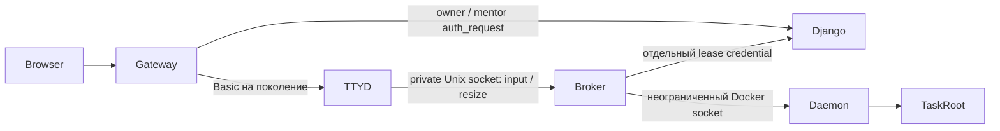

# Terminal Broker 2.0 — итоговый отчёт и security-review

28 октября 2026, Europe/Moscow. Ветка `feature/terminal-broker-v2`, база `edf8d9d`.
**Рекомендация: NO-GO для production rollout.** Функциональные проверки пройдены,
но воспроизведён HIGH-риск обхода cleanup пользователем root. Полный Docker socket
у Broker остаётся границей доверия уровня host. Hosted Actions не выполнялся:
remote-ветка отсутствует, push удержан по указанию пользователя.

`TERMINAL_BROKER_ENABLED=false` сохранён. Staging/production, deploy, main, push и PR
не затрагивались. Пользовательское изменение `README.md` исключено из коммитов.

## 1. Реализация и файлы

Сохранён лабораторный прототип. Новый transport использует Docker Exec PTY напрямую,
input/resize protocol и отдельный клиент ttyd. Каждое подключение получает свой
Exec/PTY. Клиент не задаёт container ID, Exec ID или Docker command. Journal с fsync
сохраняется до старта Bash; recovery выполняется до listen. Identity: полный Docker
ID, queue, slug, attempt ID, UUID поколения. Lease проверяется при подключении и
периодически. Неподтверждённая очистка блокирует сессии и сохраняет journal.



| Область | Файлы |
|---|---|
| Runtime | `terminal/{protocol,broker_client,broker_v2,runtime_probe}.py` |
| Images | `terminal/Dockerfile.{broker,service,e2e}` |
| Lifecycle/auth | `sandbox/services/{docker_service,terminal_broker,environments}.py`; `sandbox/{terminal_broker_views,views,urls}.py` |
| Generation | `sandbox/models.py`, миграция `0035_terminal_broker_generation.py` |
| Gateway/default OFF | оба nginx config, `config/settings.py`, `.env.example`, `.env.prod.example` |
| Compatibility | 15 учебных Dockerfile, `experiments/terminal_broker/compatibility_audit.py` |
| Unit/integration | `sandbox/tests/test_terminal_broker.py`, `test_ledger_migration.py`, `experiments/terminal_broker/test_v2*.py` |
| E2E/CI | `experiments/terminal_broker/{e2e_*,fullstack_*,browser_terminal.cjs}`, `.github/workflows/terminal-broker.yml` |

Ownership/generation сохраняются до запуска broker/ttyd. Broker reconcile выполняется
до удаления task. State volumes автоматически не удаляются. Legacy остаётся при
выключенном флаге; автоматического fallback при ошибке Broker нет. Compose не изменён.
Изолированный namespace задаётся test settings; default — `ticket-sandbox`.
Короткие legacy-имена сохранены; длинные имеют hash-суффикс до DNS-лимита 63 символов.

Исправлены подтверждённые дефекты: гонки публикации shell/helper Exec state после EOF,
HTTP/SocketIO close order, `/proc/environ` во время выхода процесса, общий секрет
Basic/lease, публичные auth URL, отсутствие отзыва disabled owner и длинные DNS labels.

## 2. Совместимость всех учебных образов

Все 20 исходных Dockerfile собраны/запущены под отдельными audit-тегами, затем все
20 исправленных — под другими тегами. Старые images не заменялись/не удалялись.
Probe использует `sleep infinity`, не выполняет учебные поломки при startup.

**Исходно 8/20 совместимы, 12 без Python. После исправления 20/20 совместимы.**
Все Dockerfile основаны на Ubuntu 22.04. Проверены Bash, `/proc`, Python **3.10.12**,
`os.pidfd_open` и `signal.pidfd_send_signal`; kernel VDS **6.8.0-147-generic**.

| Задание | Исходный образ | Исправленный |
|---|---|---|
| candidate/missing-hosts-entry | OK | OK |
| candidate/nginx-wrong-port | нет Python | OK |
| candidate/service-not-running | нет Python | OK |
| candidate/single-file-permission | нет Python | OK |
| candidate/wrong-index-filename | нет Python | OK |
| l1/cron-not-working | нет Python | OK |
| l1/deleted-file-descriptor | нет Python | OK |
| l1/disk-full | нет Python | OK |
| l1/https-ipv4-listener | нет Python | OK |
| l1/https-sni-wrong-vhost | нет Python | OK |
| l1/nginx-413-upload | OK | OK |
| l1/nginx-upstream-timeout | OK | OK |
| l1/nginx-upstream-wrong-port | OK | OK |
| l1/nginx_not_starting | нет Python | OK |
| l1/php-fpm-down | OK | OK |
| l1/port-already-in-use | OK | OK |
| l1/restored-backup-permissions | нет Python | OK |
| l1/sajt-ne-rabotaet-posle-perenosa | нет Python | OK |
| l1/service-bind-localhost | OK | OK |
| l1/wordpress-500-after-move | OK | OK |

Безопасное решение: явный `python3` в 15 Dockerfile, где его не было. Три из них
получали Python транзитивно через PHP/MySQL; явная зависимость исключает эту случайность.
Учебные скрипты не изменены. В запущенные задания пакеты не устанавливались.
Deployment images отдельно требуют пересборки; они не обновлялись. Launch preflight
проверяет Python 3.9+, Bash, `/proc` и реальные pidfd syscalls. Нужны совместимые
kernel/seccomp на каждом host. Capability audit не заменяет полный учебный smoke.

Результаты с image ID, SHA256 Dockerfile, версиями и причинами:
[baseline](experiments/terminal_broker/evidence/review-2026-10-28/compatibility-baseline.json),
[fixed](experiments/terminal_broker/evidence/review-2026-10-28/compatibility-fixed.json).

## 3. Полный PostgreSQL/Redis/Celery E2E

**PASS для host_port и docker_network.** Отдельные новые PostgreSQL/Redis containers,
DB и очередь на режим, реальные Celery prefork workers, `task_always_eager=false`,
Gunicorn/Django, nginx, ttyd. Task создаётся настоящим `create_task_container` из
`training_tasks/l1/service-bind-localhost`; factory не подменяется mock.

1. Два пользователя через настоящий HTTP `start_task` ставят задания в Redis/Celery.
2. Worker создаёт независимые task/broker/ttyd и поколения, состояние — в PostgreSQL.
3. Чужой attempt получает 403. Проходят две вкладки, `stty size`, resize, Ctrl+C,
   сохранение соседней сессии после закрытия вкладки.
4. Настоящий HTTP `restart_task` ставит `sandbox.restart_environment` в Redis.
5. Worker отзывает старую сессию и создаёт новый Docker ID/UUID. Старый WebSocket
   закрыт; новый терминал работает. `restart_count=1`, ledger `reset/finished/success`.
6. Тестовая Celery-задача вызывает настоящий `cleanup_attempt_environment`:
   обе попытки idle, имена/URL очищены, gateway даёт 403.

`host_port`: worker с host network, ttyd опубликован только на loopback.
`docker_network`: worker/gateway используют Docker DNS, ttyd без host-port.
Bridge-worker не получает доступ к host loopback от одного переключения флага.

Версии: Python **3.13.17**, Django **6.0.5**, Celery **5.6.3**, docker-py **7.1.0**,
psycopg **3.3.4**, Engine **29.1.3**, PostgreSQL **16.15**, Redis **7.4.11**.

[Fullstack results](experiments/terminal_broker/evidence/review-2026-10-28/fullstack.json),
[host worker](experiments/terminal_broker/evidence/review-2026-10-28/worker-host_port.txt),
[network worker](experiments/terminal_broker/evidence/review-2026-10-28/worker-docker_network.txt).
Предварительные строгие SIGKILL/recovery и fullscreen `top` evidence сохранены в
[evidence/2026-10-28](experiments/terminal_broker/evidence/2026-10-28/README.md).

Исправлены ошибки стенда: готовность временного PostgreSQL при initdb, неполный source
snapshot, ledger lookup через FK вместо `attempt_id`, hostname с underscore и ввод
до готовности xterm. Итоговый E2E выполнен на свежих БД после исправлений.

## 4. Авторизация и security-review

Активные проверки в обоих режимах: без Basic **401**, неверный/чужой Basic **401**,
правильный Basic **200**. Отдельный правильный lease **204**, Basic-as-lease **403**,
любая изменённая часть identity **403**. Публичные `/terminal-auth/`,
`/terminal-broker-auth/`, `/_terminal_auth` дают **404**. В ttyd нет Docker CLI/socket,
journal не смонтирован, socket volume read-only. Web не имеет Docker socket.
Basic/lease разделены HMAC domains. Disabled owner отзывает lease: unit test PASS.

| Finding | Статус | Значение |
|---|---|---|
| F1: полный Docker socket у Broker | **CRITICAL trust boundary, открыт** | Компрометация Broker даёт управление daemon/host; cap_drop/read-only этого не ограничивают |
| F2: root очищает token дочернего процесса | **HIGH, воспроизведён в обоих режимах** | Дочерний процесс переживает закрытие вкладки, даже когда journal очищен |
| F3: Python cleanup внутри task | **HIGH, открыт** | Task-root контролирует interpreter/filesystem; это не trusted containment |
| F4: общий Basic/lease secret | Исправлен | Domain separation, active отрицательный тест |
| F5: auth-header через публичный URL | Исправлен на gateway | Прямой Django listener должен оставаться приватным |
| F6: disabled owner сохраняет lease | Исправлен | `user.is_active` проверяется |
| F7: Python / DNS limits | Исправлен | 20/20 probes; имена до 63 символов |
| F8: volumes, polling/load, shared network, plaintext internal HTTP | Остаточные риски | Нужны retention, нагрузка, control-plane segmentation/TLS |
| F9: hosted Actions | **NOT RUN** | Gate после разрешённого push |

F2 воспроизведён вводом в настоящий root Bash:

```sh
env -i PATH=/usr/bin:/bin bash -c 'trap "" HUP TERM; exec sleep 600' &
```

После закрытия вкладки observer подтвердил: PID существует, команда `sleep`,
`TB_SESSION_TOKEN` отсутствует. Процесс породил проверяемый shell; последующее удаление
**собственного test environment** завершило его. Pidfd предотвращает сигнал повторно
использованному PID, но не выявляет скрытых потомков. F2/F3 требуют trusted supervisor/
cgroup boundary вне task-controlled filesystem/PID namespace. Findings записаны
отдельно от functional PASS; прошедший E2E их не закрывает.

Protocol probes отклонили container ID, command, Exec ID и чужой credential.
Это не доказывает безопасность привилегированного Broker при эксплуатации его ошибки.
[Docker daemon attack surface](https://docs.docker.com/engine/security/).
[Host security](experiments/terminal_broker/evidence/review-2026-10-28/host_port-security.json),
[network security](experiments/terminal_broker/evidence/review-2026-10-28/docker_network-security.json).

## 5. Тесты и GitHub Actions

| Проверка | Результат |
|---|---|
| Broker offline / настоящий локальный PTY | **43 passed** |
| Полный Django: sandbox, traineediary, assessment, react_frontend | **807 run, 7 skipped, без ошибок** |
| Focused auth / Docker / DNS | **31 passed** |
| Images | **8/20 → 20/20** |
| PostgreSQL/Redis/Celery E2E | **оба PASS**, отдельный HIGH finding |
| Python/JS/shell syntax, migration drift, Django check, whitespace | PASS |
| actionlint 1.7.7 | **PASS**, shellcheck отключён |
| Hosted GitHub Actions | **NOT RUN**, ветка отсутствует на remote |

Workflow содержит отдельные compatibility/fullstack jobs, `contents: read`, concurrency,
artifacts без приватного `stack.json`. `ci.yml` сохраняет общий suite и deploy только
для main; `trusted-checker.yml` не менялся.

Точная выполненная lint-команда на VDS:

```sh
docker run --name tc-tb2-20261028-actionlint-final --user 0 \
  -v /root/tc-e2e-pilot/terminal-broker-2-review-20261028:/review:ro -w /review \
  rhysd/actionlint:1.7.7 -color -shellcheck= terminal-broker.yml
```

`git ls-remote --heads origin feature/terminal-broker-v2` вернул пустой результат.
Новый workflow не запустить hosted без публикации; manual dispatch нового workflow
требует его наличия в default branch:
[GitHub workflow_dispatch](https://docs.github.com/en/actions/how-tos/manage-workflow-runs/manually-run-a-workflow).
После разрешённого push сработает `on.push` feature-ветки. Публикация только ради CI
до показа результата нарушила бы явное указание пользователя.

## 6. Точные команды и сохранённые данные

Локально:

```sh
.venv/bin/python -m unittest discover -s experiments/terminal_broker -p 'test_*.py'
DEBUG=True DB_ENGINE=django.db.backends.sqlite3 DB_NAME=:memory:   .venv/bin/python manage.py test sandbox traineediary assessment react_frontend --noinput
DEBUG=True DB_ENGINE=django.db.backends.sqlite3 DB_NAME=:memory:   .venv/bin/python manage.py makemigrations --check --dry-run
DEBUG=True DB_ENGINE=django.db.backends.sqlite3 DB_NAME=:memory: .venv/bin/python manage.py check
git diff --check
```

Lab root: `/root/tc-e2e-pilot/terminal-broker-2-review-20261028`. Изменения сделаны на
Mac; baseline — `source`, исправленная копия — `source-fixed`. Выполненные команды
на VDS ниже. Повторять только с **новыми** prefix/state, не поверх сохранённых БД:

```sh
cd /root/tc-e2e-pilot/terminal-broker-2-review-20261028/source-fixed
docker build -t ticket-sandbox-terminal-broker:review -f terminal/Dockerfile.service .
docker build -t ticket-sandbox-ttyd:broker-review -f terminal/Dockerfile.broker .
docker run --name tc-tb2-20261028-audit-fixed-driver --user 0   -v /var/run/docker.sock:/var/run/docker.sock   -v /root/tc-e2e-pilot/terminal-broker-2-review-20261028/source-fixed:/app:ro   -v /root/tc-e2e-pilot/terminal-broker-2-review-20261028/audit-fixed:/audit -w /app   tc-e2e-django:lab python -m experiments.terminal_broker.compatibility_audit   --output /audit --prefix tc-tb2-20261028-audit-fixed
docker run --name tc-tb2-20261028-pg5-driver --user 0   -v /var/run/docker.sock:/var/run/docker.sock   -v /root/tc-e2e-pilot/terminal-broker-2-review-20261028/source-fixed:/app:ro   -v /root/tc-e2e-pilot/terminal-broker-2-review-20261028/fullstack-r5:/lab -w /app   tc-e2e-django:lab python -m experiments.terminal_broker.fullstack_start   --prefix tc-tb2-20261028-pg5   --host-source /root/tc-e2e-pilot/terminal-broker-2-review-20261028/source-fixed   --host-state /root/tc-e2e-pilot/terminal-broker-2-review-20261028/fullstack-r5
```

На Mac:

```sh
ssh -N -L 29190:127.0.0.1:29190 -L 29191:127.0.0.1:29191   -L 29192:127.0.0.1:29192 -L 29193:127.0.0.1:29193 ticket-sandbox-lab
NODE_PATH=/tmp/terminal-broker-browser/node_modules   TB_CHROME='/Applications/Google Chrome.app/Contents/MacOS/Google Chrome'   node experiments/terminal_broker/fullstack_browser.cjs   /tmp/terminal-broker-browser/fullstack.json /tmp/tb2-review-evidence
```

Приватный Mac `fullstack.json` скопирован из lab `fullstack-r5/stack.json`: содержит
временные cookies/control tokens, **не включён в Git/artifacts**. Публичный
`evidence/.../fullstack.json` — другой файл с результатами без credentials.
Browser сам очищает попытки через Celery; новые тестовые контейнеры затем штатно
остановлены и удалены по собственному namespace. Тома PostgreSQL/Redis/broker state,
БД, images и исходные lab resources сохранены. Оригинальный
`ticket-sandbox-l1-service-bind-localhost-1` продолжил работу: StartedAt
`2026-10-22T14:02:54.421725064Z`, RestartCount `0`.

## 7. Rollout gates

Флаг оставить выключенным. Допустим только изолированный lab pilot на отдельном
Docker host с явно принятой моделью доверия. До production нужны:

1. Trusted supervisor/cgroup вне task для F2/F3 и повтор adversarial cleanup/recovery.
2. Ограничение blast radius F1: выделенный daemon/VM/control plane либо проверяемая
   daemon-side policy/proxy с привязкой к target/Exec. Python allowlist не ограничит
   уже скомпрометированный Broker с полным socket.
3. Ревью локальных коммитов, отдельное разрешение push, hosted Actions и исправление
   CI failures. Затем отдельно рассматривать PR.
4. Daemon restart, host reboot, disk-full/fsync fault injection, нагрузка, retention,
   полный учебный smoke образов, kernel/seccomp целевого host, приватный Django
   listener, сильный общий SECRET_KEY web/worker, внутренний TLS/сегментация.

Отчёт подтверждает функциональную работу в лаборатории и фиксирует ограничения;
не подтверждает production-ready безопасность.
