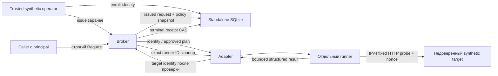

# Trusted Checker Foundation & Isolated PoC — задача №18

15 октября 2026. Репозиторий Training Platform, ветка `feature/roadmap-react`, исходный HEAD `26cdce0bd3edfbd7d977f855f01d8389d03c06f6`.

## 1. Результат и границы

Добавлен отдельный пакет [trusted_checker_poc](trusted_checker_poc/), не подключённый к Django/Celery/Sandbox. Он реализует typed broker, versioned allowlist registry, durable SQLite receipts/leases, независимый HTTP runner, синтетический localhost fixture и подготовленный Docker adapter с launch/identity guards. Есть отдельные Dockerfile и standalone Compose; production Compose не изменён.

**Реально выполнены только unit/fake-adapter integration tests.** Действительно изолированный Docker daemon не подтверждён, поэтому Docker API не опрашивался, images не собирались и контейнеры/сети не создавались. Наличие socket или работающий Docker Desktop не считается доказательством изоляции. Namespace/capability isolation и реальные HTTP-соединения между контейнерами остаются непроверенными.

Нет source events, наград, CheckRun, технического зачёта, Ledger mutations и production migrations. Платина остаётся выключенной. Отчёт №17 и 83 PNG сохранены без изменений.

## 2. Архитектура



В тестах D — fake adapter, а контейнерное окружение — явная модель. SQLite, Python runner parser, broker, потоки и процессы настоящие; Docker и transport смоделированы. В реальном adapter origin результата задаёт наблюдаемый broker-owned runner container, а не HTTP body target. Task не имеет broker API listener, SQLite mount, socket или канала публикации результата. Это архитектурное разделение, а не проведённый runtime penetration test.

## 3. Каталоги и зависимости

| Файл | Назначение |
|---|---|
| [contracts.py](trusted_checker_poc/contracts.py) | Request/Target/Runner/Outcome/Result, strict parsing, identity validation, neutral errors |
| [registry.py](trusted_checker_poc/registry.py) | Единственная policy v1, immutable artifact configuration и source digest |
| [state.py](trusted_checker_poc/state.py) | Изолированные SQLite targets/runs/locks; pre-issued UUID, admission и terminal CAS |
| [broker.py](trusted_checker_poc/broker.py) | Allowlist, owner binding, deadline, result validation, durable recovery и cleanup |
| [runner.py](trusted_checker_poc/runner.py) | Stdlib HTTP client: только numeric private IPv4:8080/probe, fresh challenge, bounded response |
| [synthetic_target.py](trusted_checker_poc/synthetic_target.py) | Недоверенный HTTP echo fixture с reload bind из `/fixture/service.json` |
| [docker_adapter.py](trusted_checker_poc/docker_adapter.py) | Dormant SDK adapter, exact identity inspect, fixed launch spec, bounded protocol, exact cleanup |
| [runner Dockerfile](trusted_checker_poc/images/runner/Dockerfile) | Отдельная rootfs, UID10001, фиксированный Python entrypoint |
| [target Dockerfile](trusted_checker_poc/images/target/Dockerfile) | Writable/root synthetic target, первоначально localhost only |
| [compose.isolated.yml](trusted_checker_poc/compose.isolated.yml) | Только fixture и отдельная internal network, без web/worker/DB/Redis/socket/ports |
| [tests](trusted_checker_poc/tests/) | 37 unit/adversarial tests и fake Docker/HTTP adapter |

Broker/state/runner используют Python stdlib, сторонних runner dependencies нет. Docker adapter рассчитан на существующий проектный `docker==7.1.0`; requirements проекта не менялись. Runtime Python/stdlib фиксируется approved base-image digest, а не установкой mutable packages при каждом запуске.

Dockerfile **не содержит выдуманного digest и не имеет mutable base по умолчанию**: обязательный `PYTHON_BASE` должен иметь вид `<approved-reference>@sha256:<64 hex>`, что дополнительно проверяется build-step. Сборка здесь не выполнялась, конкретного verified base и runner image пока нет. По умолчанию registry имеет `runner_image_id=None` и возвращает `artifact_not_provisioned` без запуска. Для будущего стенда оператор должен проверить исходники, base digest, сборку и фактический local image ID; только затем установить immutable ID в trusted Registry configuration. Fake digest в тестах маркирует исключительно fake artifact и не является release digest.

## 4. Registry/policy

Единственный разрешённый ID: `synthetic-ipv4-v1`.

| Поле | Значение |
|---|---|
| checker_id/version | `synthetic-ipv4` / `1` |
| adapter_id/version | `independent-http-peer` / `1` |
| execution_mode | `separate-container-ipv4` |
| schema_version | `1` |
| artifact | operator-provisioned `sha256:<full local image ID>`, source SHA256 `runner.py` |
| timeout | default5с; trusted configuration допускает >0 и ≤30с; тестовый fixture использует меньший budget |
| ресурсы | 0,25CPU, RAM64MiB, pids32, output≤4096bytes |

Registry создаётся доверенным кодом, не из request JSON. Нельзя выбрать другой checker/adapter/mode/resource profile через запрос. Неизвестная policy/schema — unknown, без fallback к штатному `check.sh`. Mutable image tag отвергается.

При выдаче UUID полный descriptor policy сохраняется в SQLite. Если до исполнения изменились artifact/source digest/timeout или другие policy facts, результат `policy_changed_since_issue`; старый issued run не переназначается новому artifact. Terminal receipt остаётся прежним и после перезапуска broker. Source digest описывает checkout, image ID — утверждённый artifact; их correspondence пока является ответственностью trusted build/release оператора, **не реализованной supply-chain attestation**.

## 5. Broker API и авторизация

Это локальный Python API, **не публичный HTTP endpoint**. `owner` — principal, который обязан передавать доверенный вызывающий код; здесь нет аутентификации интернет-клиента. Если пакет получит сетевой API, потребуется отдельная authentication/authorization до этих методов. Пользовательский JSON не должен сам назначать principal.

Trusted fixture operator создаёт `State` в отдельном private scratch directory и выполняет `state.enroll(Target(...))`, используя полный предварительно проверенный Docker ID/identity. Повторная enrollment того же container ID не переписывает исходную binding. После Docker restart старое StartedAt перестаёт совпадать; для нового эксперимента требуется новая явная binding/fixture, а не молчаливая замена.

`broker.issue(target_id, owner, policy_id)` выдаёт заранее зарегистрированный UUID. Затем:

```python
result = broker.execute({
    "run_id": issued_uuid,
    "policy_id": "synthetic-ipv4-v1",
    "target_id": full_64_hex_id,
    "generation": enrolled_generation,
    "synthetic_task_id": "synthetic-localhost",
    "schema_version": 1,
}, owner=authenticated_synthetic_principal)
```

`Request.parse` требует точный набор полей, реальные строки и integer schema (bool не принимается), UUID в каноническом виде, полный container ID. Unissued UUID, чужой principal, несовпадающая generation/policy/task/target — `InvalidRequest`, а не физическая проверка. Добавление image, command, mount/socket/volumes_from, network/capabilities, target name, URL, port или integrity отклоняется. Broker не универсальный Docker proxy; shell из JSON не исполняется.

Синтетический operator/код broker/registry/state file входят в TCB. Защита от злонамеренного host/daemon administrator или произвольного Python-кода, уже исполняющегося внутри broker process, здесь не заявляется.

## 6. Синтетическое задание и challenge

Fixture первоначально слушает `127.0.0.1:8080`. Его config `/fixture/service.json` содержит `{"bind":"127.0.0.1"}`. В будущем оператор isolated fixture может атомарно заменить конфигурацию на `{"bind":"0.0.0.0"}`; сервер перечитает её и пересоздаст listener без Docker restart. В середине scored probe конфигурацию менять не следует; проверка фиксирует ограниченное сетевое наблюдение, не непрерывную исправность.

Runner находится в отдельной network namespace/peer container, обращается **на enrolled IPv4 target**, а не на собственный localhost. Target не предоставляет IP, URL или код checker. Runner не использует task curl/ss/ip/PATH, Docker exec или shell. Сеть и endpoint разрешает broker по trusted enrollment, а при реальном исполнении они сверяются с daemon inspect. Разрешены только RFC1918 IPv4; metadata/link-local, loopback, public IP, hostname, URL и IPv6 отвергаются. Путь и порт фиксированы `/probe`, 8080. Redirect не выполняется; proxies/DNS из target не используются.

Для каждого физического исполнения broker создаёт nonce32bytes и передаёт runner. Probe отправляет `X-PoC-Challenge`; ответ должен быть HTTP200 и точным JSON `{challenge: nonce, service: "synthetic-ipv4-v1"}`. Body limit1024bytes, transport timeout и общий broker deadline. Статический старый marker не проходит, redirect/неверный/слишком большой ответ — failed. Простой динамический imitator, который отражает nonce, **может пройти**: challenge подтверждает свежую корреляцию запроса и сетевую работоспособность, не неизменность исходного приложения. Это явно проверено тестом; `target_fixture=unknown` не повышается.

Connection refused при сохранённой target identity означает `service_unreachable`, failed в пределах этого synthetic criterion. Target disappearance — unknown/target_unavailable; transport timeout — unknown/timeout; прочие transport ошибки — unknown/infrastructure. Нельзя переносить такую классификацию без проверки реальной маршрутизации/adapter health на production задачи.

## 7. Runner launch и Docker adapter

`DockerAdapter` не вызывает `docker.from_env`, не выбирает default socket, не строит/pull images и не добавляется в Compose проекта. Для его создания нужны явно переданный bounded-timeout SDK client и `DedicatedDaemonApproval` с ожидаемым daemon ID, exact network ID, уникальным `poc-...` scope и письменным основанием изоляции. Adapter сверяет daemon ID и internal network scope. Эти сверки защищают от ошибочного выбора endpoint, но **сами по себе не доказывают**, что daemon не разделяется с production. Approval создаётся trusted оператором только после отдельного подтверждения инфраструктуры; выдуманная строка evidence не делает shared daemon изолированным.

Фиксированный launch spec:

- Approved immutable image ID; entrypoint `/usr/local/bin/python -I /checker/runner.py`, пустой command; никаких task-owned scripts.
- UID/GID10001, read-only rootfs, drop ALL capabilities, privileged=false, no-new-privileges, отдельный tmpfs `/scratch` 1MiB с noexec/nosuid/nodev.
- 0,25CPU, RAM64MiB, pids32; noninteractive stdin/TTY; bounded json-file logging.
- Только enrolled network ID; нет host PID/network/IPC, socket, host mounts, volumes_from и Django/DB/Redis credentials. Environment от broker содержит только target IPv4 и nonce; base-image environment остаётся частью approved artifact.
- Inspect сверяет image/User/entrypoint/command/environment/run labels, rootfs/privilege/capabilities/mounts, namespace modes/network, working directory, ресурсы. Перед start и после wait/config read выполняется повторная проверка.

Broker сохраняет **точный runner ID до start**. Только после этого runner допускается к физическому выполнению. Результат читается из bounded output именно recorded runner; не из target stdout. Ненулевой runner exit — unknown/runner failure, а не technical fail задания. Протокол не принимает произвольные поля `integrity` из stdout. Самого self-report `integrity=verified` нет: статус вычисляет broker из ожидаемой/наблюдаемой конфигурации.

Источник checker отделён от target rootfs. Но реальная защита read-only/capabilities/PID/namespace, корректность конкретного SDK/daemon, лимиты и build reproducibility **не проверялись на контейнерах**. В тестах проверены specification и fail-closed guards на mock attrs.

## 8. Container identity binding

Enrollment фиксирует полный target container ID, generation, owner, synthetic_task_id, image ID, network ID, IPv4, StartedAt, RestartCount и PoC scope. Имена контейнеров из request не принимаются. Docker adapter получает объект только по полному ID, проверяет synthetic role/scope, Running, единственную approved network и отсутствие mounts/binds у target fixture.

Перед prepare runner и после его завершения Target должен точно совпасть с enrollment. Любая замена ID/generation/StartedAt/restart_count/image/network/IP — unknown. Старое имя не используется для поиска нового target после reset. Сверка до/после защищает наблюдаемую identity и restart/reset, но **не является атомарным snapshot пользовательских файлов/процессов**; промежуточное изменение приложения без Docker restart остаётся за рамками integrity proof.

## 9. Idempotency, concurrency, restart/crash

Standalone SQLite содержит targets, issued runs с owner/request/policy snapshots, status/deadline/runner/result, и unique target leases. `BEGIN IMMEDIATE` сериализует admission между потоками/процессами; используются обычные реальные filesystem SQLite transactions. База не Django, не рабочая SQLite и не process-local dict. Путь `:memory:` запрещён. Только локальный filesystem; сетевой FS/high availability не тестировались. Оператор должен выделить private directory/file permissions и не монтировать state в target/runner.

- UUID заранее issued; повтор issued payload проверяется на точное совпадение.
- Из `issued` в `running` admission проходит один раз, с unique lease на target. Другой run не перехватывает активный target. Общий лимит — максимум2 durable leases; failed cleanup тоже занимает слот. Дополнительная process-local bounded semaphore ограничивает зависшие adapter threads четырьмя; она не заменяет durable admission.
- Повтор `running` возвращает unknown/in-progress без второго runner; после terminal outcome повтор возвращает сохранённый результат byte-for-byte по структуре.
- Весь adapter operation находится под broker monotonic deadline. После timeout main coordinator записывает unknown; фоновый поток не имеет права записать terminal verdict, его поздний success игнорируется. `finish` — CAS только из running. Cleanup выполняется после закрытия результата, не превращает pass в fail.
- При restart неизвестный running receipt не запускается заново. После durable deadline он закрывается как `execution_outcome_unknown`; при известном runner ID можно попытаться exact cleanup. До expiry возвращается in-progress. Автоматического повторного физического выполнения под тем же ключом нет.
- `cleanup(run_id)` работает только с recorded runner ID, observed image ID, role=runner, scope и run label. Нет list/prune или удаления по broad name/label. Target удалить этим методом нельзя. При успехе создаётся отдельный cleanup receipt и освобождается lease; technical Result.cleanup=`recorded_separately`, его содержимое не переписывается.
- Cleanup exception/неподтверждённая идентичность/недоступность daemon оставляют lease, а технический receipt сохраняется. Оператор может повторить exact cleanup; нельзя вручную снять lease, пока не доказано отсутствие физического исполнителя.

**Известные ограничения recovery:** crash/timeout между Docker create и записью runner ID может оставить orphan; автоматическое обнаружение/удаление по имени/label намеренно не реализовано. Нет безопасного default reset для этой ситуации: lease удерживается, требуется отдельное operator reconciliation по подтверждённой identity. Аналогично потеря ответа remove и исчезнувший runner не превращаются автоматически в подтверждённый cleanup. Это консервативная quarantine, не готовый production janitor. Cleanup SDK calls требуют bounded client timeout и не входят в обещание общего job SLA; реальный upper bound не измерен.

## 10. Typed result и границы доверия

Result содержит run_id, checker/adapter IDs и versions, schema, requested/observed Target, nullable Runner identity, requested/started/finished timestamps, passed/failed/unknown, failure_class, reason, policy_identity, evidence_digest, integrity и ссылку-семантику отдельного cleanup receipt. StartedAt в Result — время broker admission, не заявление о точном старте CPU checker; Docker instance StartedAt находится в target identity. Unknown до запуска может иметь null runner/observed facts.

| Измерение | Что означает |
|---|---|
| checker_runtime | `verified_configuration` только после совпадения approved image и launch attrs; иначе unknown. Это не аппаратная/криптографическая аттестация исполнения. |
| target_identity | `matched_before_and_after` лишь после обеих проверок; ошибка/timeout не получают эту отметку по одному preflight inspect. |
| target_fixture | Всегда unknown: приложение и файлы target недоверенные. |
| observation_consistency | `bounded_probe_only` при завершённом bracketed наблюдении; непрерывная или атомарная согласованность не заявляется. |
| criteria_validity | Только `synthetic_ipv4_behavior_only`, не весь контракт реального L1-задания. |
| cryptographic_attestation | false |

SHA256 evidence — digest ограниченного observation envelope (в том числе response digest и challenge match), не подпись target и не доказательство неизменности приложения. Source/image descriptors сохраняются отдельно в policy/result. Task HTTP body не может выбрать integrity/status: runner валидирует ожидаемый ответ, broker валидирует допустимые пары reason/result и сам присваивает integrity scopes.

Основные reason/failure distinctions: `service_unreachable`/technical, `unexpected_http_response`/technical, `redirect_rejected`/technical, `target_unavailable`/target_unavailable, `target_identity_mismatch` или `target_changed_during_execution`/identity, `runner_deadline_exceeded`/timeout, `runner_crash`/runner, Docker/API/adapter failures/infrastructure или unknown_execution, `policy_unsupported`/policy, `runner_identity_mismatch`/integrity. Raw exception/secret text в result не копируется.

## 11. Test matrix и подтверждённые результаты

Команда из корня репозитория:

```sh
.venv/bin/python -m unittest discover -s trusted_checker_poc/tests -t . -v
```

**37 тестов, OK**, окончательный прогон 0,996с. Лог `/tmp/task18-tests.log`. Время отражает fakes и локальные SQLite/process/thread tests, не Docker performance. Весь HTTP transport в тестах — fake connection; реальных сетевых listeners/probes не запускалось. SDK adapter проверяется MagicMock, без client connection. Межпроцессный тест использует настоящий multiprocessing spawn и одну SQLite, а физические runner calls считает fake adapter через shared counter.

| Сценарий | Выполненная проверка | Результат/граница |
|---|---|---|
| localhost-only → network bind | Broker + настоящий runner probe/parser + fake peer transport | failed → passed; не реальный контейнерный TCP |
| изменение target check.sh / curl / PATH | Модель hostile target facts, adapter не исполняет target | Probe не зависит от этих facts; не runtime filesystem exploit |
| статический fake HTTP | Реальный probe/parser, fake response | failed, свежий challenge не совпал |
| динамический fake HTTP | Fake echo со свежим nonce | passed только behavior, fixture integrity unknown |
| redirect / oversized/malformed reply | Настоящий protocol parser | Не следовать redirect, не принимать лишнее/сломанное тело |
| произвольные URL/endpoints/public/metadata IP | Request + runner validation | Reject без transport; port/path фиксированы |
| disappearance до/во время | Fake Docker inspect | unknown; preflight исчезновение не запускает runner |
| container replacement / generation reset / restart | Fake before/after identity | unknown; также проверены image/network/IP |
| повтор UUID / broker restart | Реальные SQLite receipts | Один запуск, тот же terminal Result |
| одновременно один UUID | Реальные потоки и SQLite + fake runner gate | Второй физический runner не появляется |
| тот же UUID в разных процессах | Настоящий multiprocessing + SQLite | Counter физической fake-run операции равен1 |
| другой UUID того же target | Реальная durable lease | target_busy, нет перехвата |
| global parallel limit | Реальные leases трёх разных targets | Третий запрос capacity_exhausted |
| timeout / поздний success | Реальный broker deadline, задержка fake runner | Terminal unknown остаётся неизменным |
| crash / daemon unavailable | Fake adapter/SDK errors, включая pre-prepare | unknown; private exception не выдаётся наружу |
| restart с неизвестным running | Новый Broker/State над реальной SQLite | Никакого нового исполнения, quarantine/unknown |
| cleanup error / retry | Fake exact cleanup + SQLite lease | Pass сохраняется; пока cleanup не подтверждён, target_busy |
| неверная policy / unbuilt artifact | Настоящий Registry/Broker | Unknown без запуска/fallback |
| подмена runner artifact | Fake prepare + реальная broker validation | Unknown до physical run |
| policy/artifact изменились после issue | Реальный persisted policy descriptor | policy_changed_since_issue |
| чужой owner / изменённый Request / unissued UUID | Настоящий parser + state | Reject, не запускать |
| команды, images, host mounts/socket, network/caps/volumes_from | Настоящий strict parser | Лишние поля reject |
| ослабленный runner HostConfig/Env/User/entrypoint/TTY/run labels | Реальный validator над SDK mocks | Reject privileged, host namespaces/mounts, неверные resources/identity |
| cleanup foreign role/scope/run | Реальный Docker adapter над SDK mocks | remove не вызывается; нет list/prune |
| runner nonzero/поддельный output | SDK mocks + protocol handling | Unknown/crash/protocol error; integrity из stdout не принимается |

Общие imports/существующие файлы не менялись. Поэтому Django regression и frontend tests по условию задачи не запускались; их результаты №16 не выдаются за новый прогон. Текущие invariants дополнительно проверены SHA256 всех исходных tracked files, прежнего отчёта №17 и PNG.

## 12. Изолированный Docker стенд: что ещё не проверено

Нет подтверждённых runtime результатов: build pinned base/runner, фактическая SDK-create совместимость со всеми daemon defaults, реальные User/RO mount/caps/CPU/RAM/PID ограничения, namespace separation, network reachability/IPv4 refusal, cross-container challenge, egress/DNS isolation, работа reload bind, process kill/cleanup после timeout/crash, реальные daemon reconnect и orphan reconciliation. Это отдельные acceptance пункты, не пропущенные «успешные тесты».

Перед будущим запуском требуется **отдельный dedicated daemon/VM**, где нет production/platform ресурсов. Проверку назначения host/daemon и доступов проводит оператор вне task-controlled окружения; записываются daemon ID и основание изоляции. Не использовать текущий project Compose/network, default context как доказательство, рабочий Redis/DB/attempts и credentials. После этого можно:

1. Проверить approved base digest и собрать два Dockerfile с context `trusted_checker_poc/`, записать фактические local image IDs и provenance. Не подставлять тестовый fake IMAGE из tests.
2. Запустить только standalone [compose.isolated.yml](trusted_checker_poc/compose.isolated.yml) в отдельном PoC project/scope с явными environment settings, не объединяя с Compose проекта и не импортируя `.env.prod`.
3. Проверить exact internal network/target ID/labels/StartedAt/RestartCount/image и enroll. Передать bounded-timeout SDK client/approval в DockerAdapter; default Registry не сможет запустить unprovisioned runner.
4. Проверить localhost-only failure, атомарно исправить bind fixture и проверить независимый peer success; затем adversarial сценарии настоящего Docker из таблицы. Несанкционированный target, namespace/resource drift, identity/cleanup ambiguity должны оставаться unknown.
5. Cleanup проводить по записанным full IDs; никогда `docker prune` или удаление всех объектов с похожим именем. Текущая реализация удаляет только own recorded runner, а жизненный цикл standalone target/network остаётся у isolated operator.

Эти шаги **не выполнялись** в задаче. Документирование procedure не подтверждает безопасность доступного сейчас daemon и не даёт разрешения затронуть реальные контейнеры.

## 13. Следующий пилот

Следующий кандидат — `service-bind-localhost` из аудита №17, сначала только non-awarding shadow на отдельном стенде. Нужно согласовать behavioral criterion и fixture integrity, внедрить выделенную сеть target, verified adapter health, build provenance и generation enrollment. Policy v1 этого synthetic пакета нельзя зарегистрировать как доверенную policy реального задания простым переименованием slug.

Пилот не должен создавать второй scored ordinal, CheckRun, source event или notification, менять technical_passed_at и повторно проверять старый технический зачёт. Подключение к Ledger/Celery потребует отдельной additive attestation schema, signed/authenticated broker channel/transport principal, versioned policy и тестов source/late-write compatibility. Здесь такого подключения нет.

## 14. Почему это ещё не Sandbox platinum и что нужно до production

Отдельный runner защищает место вычисления verdict, но не доказывает неизменность приложения, cron provenance, PHP/FPM/DB dependencies, FD/DAC facts и полную историю всех15 обязательных заданий. Синтетический dynamic fake server может пройти именно наблюдаемый сетевой критерий; это достаточное доказательство границы текущей модели, а не признак готовности high award.

До production нужны: независимый security review broker/SDK boundaries; утверждённая release/registry provenance; настоящая аутентификация API principal/runner identity; изолированная инфраструктура и network policy; реальные adversarial Docker tests; resource/performance/cleanup/daemon-loss benchmarks; operator orphan recovery без broad delete; state permissions/backup/schema upgrade strategy; trusted adapters и frozen trust policy для каждого required task; новая Ledger attestation и согласованная activation policy. SQLite prototype не заявляется HA-брокером и не заменяет production DB/queue design.

Host/daemon/registry/operator compromise вне модели защиты от synthetic target. Между create и durable runner registration остаётся fail-closed orphan window; до его разрешения state удерживает slot. Сверки target до/после не доказывают промежуточную неизменность. Runtime integrity здесь означает проверяемую конфигурацию, не криптографическую аттестацию.

Изменены только новые файлы `trusted_checker_poc/` и этот отчёт. Существующие source files, отчёты №15–17, production configuration и PNG не изменялись. Staging/commit/push/merge/deploy, Docker integration и production операции не выполнялись. Реализация остановлена на изолированной основе PoC; Sandbox platinum остаётся заблокированной.
