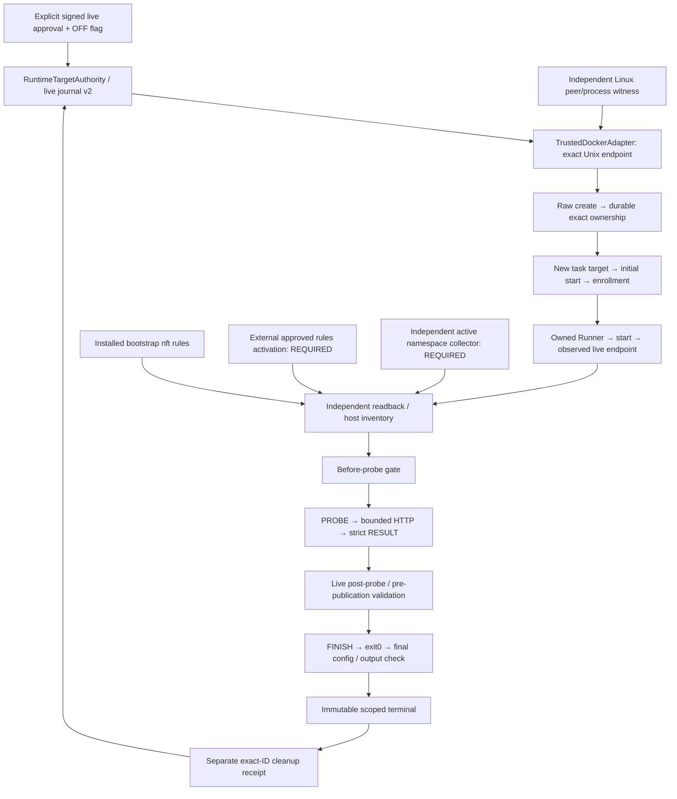

# Trusted Checker: Live Docker Runtime Implementation — №20.1b-2

19 октября 2026 · `feature/roadmap-react` · база `4692e09f9cd867a40f3cfeb29355b9d08f2bafde`.

## 1. Результат и граница готовности

Добавлены dormant live Docker Adapter, отдельный HTTP Runner artifact, строгий protocol decoder, operator composition, exact ownership cleanup/recovery, nftables templates/compiler и independent validator с read-only Linux inventory. Код проверен **только offline/mocks**. Docker daemon, sockets, HTTP endpoints, firewall, VDS, staging/production не использовались; build/run/exec/cleanup/deploy и commit/push/rebase не выполнялись.

**Runtime acceptance не выполнена. End-to-end live release заблокирован без independently installed active namespace probe collector и активации точного ruleset внешним approved операторским механизмом.** Production реализации active packet collector в пакете нет. Валидатор не выдаёт полный receipt по одному readback или `Internal=true`; при отсутствии collector composition заканчивает run как unknown до `PROBE`. Это намеренная остановка соответствующего runtime path, а не fake network validation.

Причина: до runner start отсутствуют реальные veth/EndpointID; до существования target/runner нельзя выполнить active matrix в их namespace. После start нужны exact port bindings и атомарная установка правил, которую задача запрещает применять автоматически. Текущий контракт явно различает bootstrap preflight и active evidence; выбор trusted installer/collector, namespace privileges и их transport/lifecycle должен пройти review **до любых runtime mutations**. Готового безопасного end-to-end CLI, который обходит эти blockers, нет.

Изучены предыдущие [аудит](TRUSTED_CHECKER_SANDBOX_INTEGRATION_AUDIT.md), [shadow foundation](TRUSTED_CHECKER_SHADOW_FOUNDATION.md), [runtime provenance](TRUSTED_CHECKER_RUNTIME_PROVENANCE.md), актуальные authority/contracts, shadow pure predicate, PoC raw-create/start/cleanup и реальные Dockerfile/start/customer-app/app_server задания. Sandbox уже использует `containers.run` с поздней фиксацией ID; этот путь не переиспользуется. `trusted_checker_shadow/`, `trusted_checker_poc/`, прежние отчёты и `training_tasks/` сохранены. Никаких academic writers, Django/Celery hooks или generation backfill не добавлено.

## 2. Файлы и архитектура

Изменены четыре existing runtime-файла, без изменения прежних тестов:

| Файл | Изменение |
|---|---|
| `trusted_checker_runtime/contracts.py` | Явный approval schema2/live mode, v2 expected config, before-probe phase, exit evidence, typed CreateTrace. Schema1/offline policy остаётся отдельной. |
| `trusted_checker_runtime/attestation.py` | Отдельный recovery-signed CreateTrace в closed receipt union. |
| `trusted_checker_runtime/authority.py` | Version-aware enrollment/terminal, preflight versus active matrix, before-probe gate и final exit/config check. |
| `trusted_checker_runtime/journal.py` | Отдельный live store marker/version2 и необратимый per-journal stop latch вне SQLite mutation lock. |

Новые файлы:

| Файл | Назначение |
|---|---|
| `trusted_checker_runtime/live_contract.py` | Immutable live policy/profiles, phase-specific validation digests. |
| `trusted_checker_live/__init__.py` | Без bootstrap/client discovery. |
| `trusted_checker_live/transport.py` | Explicit Unix SDK transport и Linux daemon incarnation witness. |
| `trusted_checker_live/interfaces.py` | Явные v2 ports; v1 interfaces сохранены, permit allocation выполняется внутри authority-backed create. |
| `trusted_checker_live/signing.py` | Scoped local signer, ключи только через trusted installation. |
| `trusted_checker_live/spec.py` | Fixed create parameters, normalized inspect и approved MAC mapping. |
| `trusted_checker_live/adapter.py` | Raw create → ownership; separate starts; identity/network observation; bounded result/finalize. |
| `trusted_checker_live/runner.py` | Standalone stdlib IPv4 HTTP peer и lifecycle handshake. |
| `trusted_checker_live/Runner.Dockerfile` | Отдельный non-root artifact, pinned base/source build checks. |
| `trusted_checker_live/protocol.py` | Closed versioned decoder, duplicate-key/size/type checks. |
| `trusted_checker_live/egress.py` | Render-only nft JSON compiler, read-only nft reader, independent verification algorithm. |
| `trusted_checker_live/host_inventory.py` | Read-only Linux veth/netns/daemon correlation через host binaries. |
| `trusted_checker_live/composition.py` | Operator-only target provisioning, run, kill и rollback. |
| `trusted_checker_live/recovery.py` | Exact owned cleanup и authenticated create-trace ownership-only recovery. |
| `trusted_checker_live/artifacts.py` | Source manifest и pinned build-only copy task Dockerfile. |
| `trusted_checker_live/templates/daemon.json.example` | Шаблон отдельного daemon; не применён. |
| `trusted_checker_live/templates/network.json.example` | Internal bridge bootstrap request; placeholders не разрешают execution. |
| `trusted_checker_live/templates/bootstrap.nft.json` | Default-deny bootstrap transaction template; не применён. |
| `trusted_checker_live/tests/__init__.py`, `tests/support.py` | Explicit SDK/host/packet fixtures, без настоящих sockets/daemon. |
| `trusted_checker_live/tests/test_runtime.py` | Lifecycle/security/cleanup/recovery/duplicates/rollback. |
| `trusted_checker_live/tests/test_runner_and_isolation.py` | HTTP wire/protocol/ruleset/host reader/import checks. |
| `TRUSTED_CHECKER_LIVE_RUNTIME_IMPLEMENTATION.md` | Этот отчёт, blockers и acceptance plan. |



Installer и active collector на схеме — обязательные внешние зависимости, не выполненные действия. В учебную evidence graph стрелок нет.

## 3. Live policy, approval и store

`LIVE_POLICY`: `service-bind-localhost-live-peer-v2`, version/schema2, mode `live_external_peer`. SHA-256 canonical policy:

```text
5f1c67299d60026999d7a6484d83c01d2bab3c3c04470466af50391095d9e527
```

Task `l1/service-bind-localhost`, scope external_ipv4_http_only; fixed GET numeric IPv4:8080 `/`; status200; body `APP OK: customer service is running`; max1024 bytes до `rstrip(b"\n")`; headers≤8192; HTTP2s/API3s/run8s. Никаких DNS/proxy/redirect. Protocol и bootstrap/active validation method включены в policy identity. Shared pure body/status predicate сохранён; HTTP semantics не расширены challenge endpoint или target exec.

Offline `POLICY`/digest и synthetic PoC не изменены. Approval schema2 обязан явно выбирать live ID/digest и `LIVE_TARGET/LIVE_RUNNER` profile digests. Нельзя смешать live policy с schema1, offline profile или старым synthetic approval. Signed operator approval по-прежнему фиксирует principal/scope, daemon/endpoint/session/config digest, immutable target/runner image IDs, checker source, network, limits/max1 и expiry≤1h.

Для live создаётся **новый** `RuntimeJournal(path, live=True)` с marker `trusted_checker_live_runtime_v2`, version2. Offline marker не принимается в live mode, live marker не открывается как offline; проверки чужого marker read-only и byte-preserving. Автоматической migration исторических journals нет. Path по-прежнему отдельный `*.runtime.sqlite3`,0600, без legacy DB injection.

Trusted installation передаёт keys/grants явно. В коде нет key defaults, чтения credentials из env/request или выдачи operator approval из Docker inspect. HMAC roles не являются host/kernel attestation; primary verifier/key owners входят в TCB. Раздельные keys/processes/OS principals и protected transport нужно проверить отдельно. Labels используются только для consistency **после** ownership.

## 4. Docker Adapter и daemon/session

`TrustedDockerAdapter` не создаёт client в `__init__`. `approval()` проверяет registered live approval, live marker, explicit endpoint config digest, enabled/epoch/expiry/stop latch до client factory. Нет `DockerClient.from_env`, context, default socket, server-version auto discovery или generic public SDK proxy.

Live port version — `trusted-checker-live-runtime-v2`: он использует существующие issued DTO/fences, но не выдаётся за structural implementation старого future ProtocolV1. V2 `create(intent)` сам запрашивает permit у authority; finalize и active-before-probe — новые явные v2 steps. `OfflineCoordinator` и v1 interface declarations не менялись.

Выбран узкий transport: Linux Unix socket строго под `/run/tc-shadow/`, Docker SDK7.1.0, explicit API1.45 и timeout≤3s. `open_explicit_api` инициализирует audited Unix adapter без обычного APIClient bootstrap, читающего `~/.docker/config.json`: пустые auth/proxy configs, requests trust_env=false, нет HTTP/HTTPS adapters, SSH/TCP fallback. Обновление SDK/API требует review; сейчас реальные requests не отправлялись.

`DaemonWitness` связывает independently approved host boot UUID, SO_PEERCRED PID/UID, `/proc/<pid>/stat` start ticks, socket device/inode; endpoint digest входит в approval. Adapter перед identity/API operations сравнивает Linux witness и отдельно Docker `info.ID`. Так обычный daemon restart с прежним info.ID не проходит по старому process/socket anchor. Прокси/socket activation с peerPID1 не принимаются этим profile. Host compromise/endpoint impersonation не исключены; info.ID и PID не криптографическая аттестация.

`create` использует только issued immutable intent. До mutation проверяются daemon, approved image и network. `create_host_config` строится из fixed spec, `create_container` — RAW SDK, с explicit static approved IPv4/MAC. Возвращённый full64 `Id` capture/sign/ownership фиксируется **до** любого post-create inspect/reload/log. При lost response или write failure никакого `containers.run`, name/labels lookup, повторного create/start нет. Persisted dispatch переживает rollback/crash. Поздний Id после deadline/kill учитывается только как ownership/quarantine.

Create и initial target start разделены. Runner start проходит отдельный authority start fence; SDK errors маппятся в bounded constant reason. SDK retries не включены. Есть wall/persisted deadline и process-local monotonic budget; timeout каждого вызова ограничен remaining budget. Это не hard real-time cancellation уже отправленного daemon call.

Private SDK dispatch имеет закрытый allowlist фиксированных операций; exec, arbitrary network mutation, build/pull/prune и неизвестные методы отвергаются до client construction. Публичные методы принимают только issued intent/permit/enrollment IDs; это не generic Docker RPC и не sandbox для hostile Python plugins.

`spec.normalize` проверяет actual User/RO/privileged/caps/nnp, PID/IPC, env/command/workdir, все non-tmpfs mounts/volumes/devices/ports/DNS/extra hosts, tmpfs, CPU/memory+swap/PID, logs, image, single network и endpoint/MAC/state. Target/runner name и labels не определяют ownership. Адрес/MAC derivation фиксированы approval network, не trainee request. Incompatible Docker inspect serialization приводит к unknown, не к ослаблению guards.

## 5. Runner и strict protocol

Artifact — `Runner.Dockerfile` + standalone `runner.py`. Non-root10001, fixed `/usr/bin/python3 -I /checker/service_bind_peer.py`, RO rootfs, dropALL, nnp, private PID/IPC, scratch tmpfs1MiB, no socket/host mounts, CPU0.25/memory64MiB/PID32, logs16KiB×1, protocol4096 bytes. Environment только fixed PATH и approved numeric `TC_TARGET_IPV4`; image source digest label сверяется с approval. Dockerfile проверяет base `@sha256:…` и SHA-256 скопированного runner source.

HTTP transport создаёт AF_INET socket напрямую, после canonical RFC1918 IPv4 validation. `connect((ip,8080))` не вызывает getaddrinfo; proxy/environment/URL resolver отсутствуют. Один GET `/`, HTTP/1.0, Connection:close. Parser ограничивает headers/body, отвергает duplicate/folded/malformed headers и unsupported chunked/content-encoding. Такое framing — unknown, не guessed pass. Реальный app_server отвечает HTTP/1.0 с Content-Length; это совместимо статически. Redirect не прослеживается; bad status/body/oversize — failed после identity/network validation, timeout/incomplete/protocol uncertainty — unknown. Refused — scoped failed только после active network gate и последующих identity checks.

Lifecycle — **PROBE → RESULT → FINISH**, не sleep: runner ждёт control release через stdin; host сначала наблюдает live endpoint и подтверждает active egress. После bounded HTTP runner отдаёт одну JSON строку и остаётся в bounded finalize state. Пока namespace существует, independent validator выполняет after-probe и before-publication checks. Затем host посылает FINISH, требует exit0, повторно читает **весь** bounded output и проверяет final config/generation; только потом authority публикует terminal. Без финального exit receipt live passed невозможен. Исчезнувший/быстрый runner не «исправляется» искусственной задержкой.

Protocol version2: exact keys `protocol_version/policy_id/policy_version/target_ipv4/status/body_b64/complete/transport`. Decoder отвергает duplicate keys, unknown fields, bool-as-version/status, неверный IP/policy, oversize/bad base64/неполный JSON. Runner не утверждает trusted verdict: authority вычисляет predicate. Два чтения output сравниваются через **in-memory** digest; restart composition не допускает resume/finish нового процесса по потерянной памяти. Arbitrary response bodies/digests не архивируются ради диагностики; report/journal сохраняют typed outcome и allowed receipts, matching expected body digest — как прежде.

## 6. Task-specific target compatibility

Новый target использует настоящий `training_tasks/l1/service-bind-localhost` context. `artifacts.target_build_recipe` делает build-only копию Dockerfile с pinned `ubuntu:22.04@sha256:…`; файлы задания и его исходный Dockerfile не меняет. Mutable training tag не является approved runtime image.

Root UID0/writable app/config сохранены, `/tmp`128MiB и `/run`64MiB tmpfs; initial `/start.sh` разрешён fixed command. `customer-app` создаёт `/run/customer-app` заново, поэтому скрытый tmpfs исходный directory не препятствует PID file; log directory остаётся в rootfs. Python listener8080, редактирование app.conf и restart собственного same-UID process статически не требуют NET_ADMIN/NET_RAW. `/start.sh` удаляет себя: Docker restart запрещён как reuse generation, reset — новый create/enrollment.

Compatibility проверена исходниками/spec/mock inspect; реальные apt image/permissions/kernel/tools/ручное изменение bind не запускались. Более строгий dropALL/noexec profile может ограничить отдельные учебные tools/solutions; это runtime prerequisite. Нет ttyd/socket, Docker exec checker, `/probe`, изменения app ради nonce или применения synthetic target exceptions.

## 7. Сеть, enforcement и независимая validation

Выбран dedicated daemon **и host без других Linux bridges/workloads**. Internal bridge `tcsh0`, exact NetworkID/subnet, один target и один runner. Templates отключают default Docker bridge/NAT/ip forwarding в отдельном daemon. Existing `training-platform-runtime`/production сети недопустимы.

`compile_rules` генерирует native nft JSON. Ничего не исполняет:

| Hook | Политика |
|---|---|
| bridge prerouting/forward, priority−310 | Bootstrap: drop-all. Active: exact physical veth + source MAC/IP binding, runner→target TCP dport8080, response target→runner sport8080 established; только нужный ARP для пары. |
| bridge input/output, priority−310 | Drop-all: запрет доступа к host и host-originated обхода peer boundary. |
| inet input/forward/output, priority−310 | Drop при iif/oif `tcsh0`: маршрутизация в другие IPv4/host/metadata/platform сети запрещена отдельно от same-bridge path. |
| Остальной bridge traffic | Default drop: IPv6, DNS/другие IP/порты, лишние interfaces/неверный L2, IPv4 fragments запрещены; DF bit разрешён. |

MAC задаётся deterministic `02:42:<IPv4 bytes>` и проверяется в inspect/inventory. Active rules привязаны к physical port; одного claimed IP/MAC недостаточно. Root target dropALL не получает NET_RAW/NET_ADMIN. Native bridge conntrack должен реально поддерживаться. `br_netfilter` bridge-nf-call-{iptables,ip6tables,arptables} должен быть0/неактивен: иначе inet path может блокировать даже разрешённые bridge packets. Код ничего не меняет в sysctl.

Default-drop bridge hooks затронут **все bridges host**, поэтому единственный tcsh0 — жёсткий host gate, а не рекомендация. Нельзя применять template на общей VDS. Initial installation — отдельный bootstrap transaction; `activation_template` рендерит атомарный delete+replace **только своих известных** bridge/inet tables после разрешения. Нет автоматического `nft -f`, iptables или sysctl apply. Перед следующим sample внешний installer должен вернуть bootstrap; старые veth rules не считаются действительными для новой generation.

`ReadOnlyNftReader` выполняет только fixed `nft -j list table … tc_shadow`. Independent validator сравнивает фактическую table/chain/rule structure, а не digest, присланный enforcer. Неизвестный объект/лишнее allow правило/иной interface отвергаются. Exact parser/kernel normalization пока не проверены настоящим nft; при несовпадении — отказ.

`LinuxHostInventory` сопоставляет exact Docker ID/start/EndpointID/IP/MAC/PID с host bridge ports и reciprocal veth ifindex/iflink. Fixed host `/usr/bin/nsenter --net=/proc/<pid>/ns/net /usr/sbin/ip -j -d link show` входит **только в network namespace**, не target mount/PID namespace, не читает task files и не использует Docker exec. Проверяются netns inode/process start до/после, отсутствие лишних bridges/ports/interfaces, daemon witness и br_netfilter. Все вызовы этого helper в текущих тестах mocked; реальные namespaces не открывались.

Coverage versioned явно:

- Enrollment/before-create/before-start: только `bootstrap_default_deny`, `rules_readback_verified`, `topology_bound`. Active success не утверждается.
- Before-probe/after-probe/before-publication: exact activated rules **и** независимый active matrix: allow_target_8080, deny_other_target_ports, deny_other_ipv4, deny_host, deny_metadata, deny_db_redis_django, deny_dns, deny_ipv6, deny_spoofing. Evidence привязан к runner namespace identity, capture digest и свежему времени. Полная matrix обязательна для probe release и результата.

**Blockers:** production ActiveNamespaceProbeProvider, protected capture/injection implementation и внешний approved installer/activation handshake не реализованы. Нельзя заменить их `verified=true` из operator JSON или тестовым ActiveFixture. Нужен collector, который независимо подтверждает отправку probes, их прохождение/блокировку на выбранных kernel hooks, correct netns/interface generation, отсутствие capture loss и platform/host обхода. Для broken loopback положительная проверка policy должна отличать доставленный target RST от firewall drop, не требуя исправленного приложения. Timing всего readback/matrix/HTTP/finalize должен уложиться в immutable8s budget. Пока это не решено, автоматический end-to-end live path **не готов к запуску**.

## 8. Ownership, cleanup, recovery, kill

Create ownership: отдельные `authority_created_target`/`shadow_runner`, exact ID, daemon/session, image, scope, intent/run UUID, binding/generation и authenticated receipt. `sandbox_task_ownership=not_claimed`; existing Sandbox targets никогда не принимаются. Authority не имеет generic delete API.

`ExactCleanup.confirm` разрешает только known owned terminal runner либо quarantined target. Проверяет exact ID/image/original binding и daemon session; labels — дополнительная consistency. Persisted remove intent предшествует raw DELETE. В узком SDK transport cleanup требует именно raw response HTTP204; generic SDK return `None`/успех202/поздний NotFound недостаточны. Cleanup receipt сохраняется отдельно от terminal. Replay confirmed receipt не выполняет второй DELETE. Lost remove response/ошибка persistence оставляют pending/circuit; no TTL release, label/name deletion или prune.

`OwnershipRecovery.recover` требует ранее committed create dispatch, quarantined target либо terminal unknown runner, separate recovery-signed `CreateTrace` от independent daemon create event/contemporaneous trusted trace. Проверяются context/domain/intent digest/daemon/session/image/full64 ID/create window; затем exact candidate inspect **created**, RestartCount0 и весь profile. Восстанавливается ownership только для cleanup, не start/enrollment/result. Generic inspect/labels без independent trace не принимаются. Сбор/аутентификация contemporaneous source trace самим host collector ещё prerequisite; никакой автоматический поиск historical orphan не добавлен.

Flag OFF остаётся default. `LiveRuntime.kill` сначала создаёт fsynced0600 stop latch рядом с live journal без SQLite mutation lock, затем пытается записать disabled/epoch. Даже если in-flight SDK держит DB и control update busy, каждый v2 launch gate видит latch. Он необратим для этого live journal: простое enable не оживляет permits; для нового pilot нужен новый approved store после учёта старых ресурсов. Recovery/cleanup допускаются после disable/expiry. Изъятие/перезапись latch владельцем filesystem — host TCB compromise, не защищаемая capability.

Kill не отзывает уже отправленный API call. Late exact Id всё равно записывается как quarantine, old unknown immutable. Start/create dispatch intent survives crash; дубль не повторяется. Max active1/global circuit включает unresolved create/cleanup. Ошибки shadow не связаны с trainee HTTP/Celery и не блокируют Sandbox.

## 9. Offline проверки

```sh
.venv/bin/python -W error::ResourceWarning -m unittest discover -s trusted_checker_live/tests -t .
.venv/bin/python -W error::ResourceWarning -m unittest discover -s trusted_checker_runtime/tests -t .
.venv/bin/python -W error::ResourceWarning -m unittest discover -s trusted_checker_shadow/tests -t .
.venv/bin/python -m unittest discover -s trusted_checker_poc/tests -t .
```

| Suite | Результат |
|---|---|
| Новые live tests | **48 tests, OK**,5.143s |
| Existing runtime | **66 tests, OK**,5.986s |
| Existing shadow | **56 tests, OK**,0.994s |
| Existing PoC | **166 tests, OK**,4.656s |
| Всего | **336 tests, OK**; нет skips |

Логи — `/tmp/task201b2-live.log`, `/tmp/task201b2-runtime-regressions.log`, `/tmp/task201b2-shadow.log`, `/tmp/task201b2-poc.log`. Все SDK mutations, host commands и HTTP sockets заменены mocks. В одном unit test **локально конструируется** Unix SDK transport под запретом socket и Docker-config loading; никаких SDK requests нет. Fresh Python import test запрещает socket/process calls и подтверждает отсутствие даже импорта Docker/Django при импорте live modules. Host helper проверен с fake `/proc`/ifindex и mocked nsenter.

Покрыты wrong daemon/endpoint/session/policy/image/network, malformed raw response, timeout/lost response, ownership write failure, concurrent/duplicate create/start, kill inside create/late Id, target restart/StartedAt/EndpointID/IP/extra networks, forged/changed/final incomplete runner output, nonzero exit, HTTP timeout/redirect/wrong body/slow headers/oversize, unconfirmed active egress/false matrix/readback changes, cleanup without ownership/lost remove/replay, trace recovery and rollback after disable. Независимость от academic writes сохраняется архитектурно и unchanged-source проверками; реальная Django integration не запускалась.

SHA-256 baseline76 файлов: изменены только четыре runtime-файла из §2, остальные72 неизменны. Проверены Python syntax/compile, JSON templates, policy digest, whitespace и Markdown fences; tracked Git diff пуст. Mermaid проверен только по базовой структуре, без полного renderer/parser. Ни nft parser, ни real Docker inspect не использовались как новые доказательства.

## 10. Подготовка и acceptance на выделенной VDS — НЕ ВЫПОЛНЯЛОСЬ

До review blockers из §7 реальный pilot не начинать. Ниже последовательность, не unattended deployment script. Все immutable IDs/keys/anchor/interface facts должны быть получены и независимо одобрены, placeholders не являются approval.

1. **Source/offline gate без daemon.** Проверить source manifest, provenance предыдущих этапов, новый policy digest, все336 tests, версии Python/SDK7.1.0 и source hashes задания. На VDS повторить offline suite до любых runtime actions.
2. **Build review.** Отдельно одобрить pinned Ubuntu base, build host и разрешённый builder egress к package repositories. Build не обязан быть bit-reproducible: зафиксировать build recipe/context/SBOM по возможности и **final immutable image IDs**, затем signing approval. Рабочий task Dockerfile не менять.
3. **Read-only daemon preflight.** После отдельного разрешения read access exact Unix endpoint проверить daemon info.ID, SDK/API compatibility, independent boot/PID/start/socket witness, private dedicated daemon/host/no other bridges/workloads/socket holders и existing unresolved state. Не использовать Docker context/DOCKER_HOST discovery.
4. **Isolated network.** Отдельно approved создать одну internal bridge по review template. До create сохранить operator setup intent; немедленно сохранить exact network ID/raw creation receipt в отдельном operator resource journal. Это не ownership authority-контейнера и не разрешение удалять чужие networks.
5. **Bootstrap firewall.** После подтверждения dedicated host применить reviewed default-deny tables и approved br_netfilter settings. Зафиксировать original host config и rollback plan. Read-only validator должен увидеть ровно ожидаемые ruleset/topology, а не echo шаблона от installer.
6. **Independent validation prerequisites.** Завершить и review active namespace collector/packet captures, source authentication, privileged host helper, atomic active-rule activation и reset-to-bootstrap lifecycle. Прогнать отдельную approved negative validation. Если нет полноценного collector/installer или не хватает8s budget — **STOP, не заменять receipt fixtures и не удлинять budget скрыто**.
7. **Один новый target.** Новая live approval+store, explicit enable; `LiveRuntime.provision_new(ProvisionRequest)` через raw create → ownership → separate initial start → inspect/bootstrap validation → enrollment. Existing Sandbox IDs не использовать. Учёт всех new resources — exact IDs, никаких names-only cleanup.
8. **Broken loopback run.** Только один sample; runner actual UID/caps/nnp/RO/mount/socket/resources/live endpoint подтверждены. При live waiting state внешний approved installer активирует правила для реально разрешённых veth; independent matrix gate пропускает PROBE только после доказательства. Loopback8080 должен дать scoped failed, не инфраструктурный pass.
9. **Fixed wildcard run.** Отдельно approved изменение app.conf/customer-app только в новом тестовом target оператором; app/task source и checker не подменять. Вернуть bootstrap, новый request UUID/sample slot, затем scoped passed. Отдельно legitimate manual process, wrong port/body/stopped/forged responder с явными semantic limits.
10. **Identity/timeout/failure cases.** Отдельно одобренные negative mutations target restart/reset/network/endpoint, SDK lost response/ownership/cleanup ambiguity, concurrency, kill during call, runner malformed/late output. Fake-only faults не выдавать за daemon coverage. Любая неожиданная uncertainty закрывает admission.
11. **Exact cleanup.** Подтвердить каждый runner cleanup204/receipt; rollback target — explicit quarantine/revoke и exact owned cleanup. Unknown create — независимый create trace и cleanup-only recovery либо quarantine; никогда prune/adopt/list-by-labels. Historical orphan не инспектировать/не трогать.
12. **No-new-orphan accounting.** Сопоставить новые raw IDs/intents/start/terminal/cleanup с independently collected daemon events; read-only inventory нужен для detection gaps, не permission to delete. При unresolved ресурсе не объявлять cleanup_complete и не удалять journal.
13. **Network/firewall rollback.** Только по operator network ownership receipt и отдельному разрешению вернуть собственные settings/rules, удалить только новый owned network после closure endpoints. Не удалять shared networks или чужие nft tables; убедиться, что runtime state/recovery сохранены.
14. **Evidence/review.** Сохранить filtered receipts, separate private traces/keys, actual physical starts/live observations, timings/resource limits, coverage gaps и quarantine. Runtime acceptance отчёт и security review отдельно; никаких academic writes/платины/production rollout.

Local source preparation, **не build**, допустима без daemon:

```sh
.venv/bin/python -c 'from trusted_checker_live.artifacts import source_manifest; import json; print(json.dumps(source_manifest(), indent=2))'
```

## 11. Mutating/опасные операции — только отдельное согласование

Следующие примеры **не выполнялись** и не являются разрешением. Не переносить их на shared/production host.

**IMAGE BUILD/PULL:** после одобрения exact builder endpoint/base/egress; значения заранее заданы оператором. Для target сначала получить reviewed pinned Dockerfile copy через `target_build_recipe`, сохранить в private build directory; context остаётся `training_tasks/l1/service-bind-localhost`.

```sh
# MUTATING: explicit approved build daemon; no default context.
docker --host "$TC_APPROVED_BUILD_ENDPOINT" build \
  --build-arg PYTHON_BASE="$TC_APPROVED_UBUNTU_DIGEST" \
  --build-arg CHECKER_SOURCE_SHA256="$TC_REVIEWED_RUNNER_SOURCE_SHA256" \
  -f trusted_checker_live/Runner.Dockerfile trusted_checker_live

# MUTATING: reviewed pinned task Dockerfile copy, actual task context.
docker --host "$TC_APPROVED_BUILD_ENDPOINT" build \
  -f "$TC_REVIEWED_PINNED_TASK_DOCKERFILE" training_tasks/l1/service-bind-localhost
```

Из image inspect получить точные image IDs и проверить source/build correspondence до signing approval; tag не подставлять в runtime contract. Сборка на отдельном builder предпочтительна: package egress не расширяет runtime peer network. Перенос approved images на runtime daemon — тоже отдельная mutation с учётом immutable IDs.

**FIREWALL:** только после fixed parser/compatibility review, independent inventory, known tables и утверждённого rollback. JSON не исполняется Python component автоматически.

```sh
# MUTATING: initial bootstrap or separately reviewed atomic activation JSON.
sudo /usr/sbin/nft -f "$TC_REVIEWED_NFT_TRANSACTION"
```

Остальные требующие отдельного разрешения действия: установка/запуск отдельного dockerd и применение daemon.json, image pulls/loads, network create/connect/disconnect/remove, sysctl changes, host namespace probe injection/capture, runtime enable/provision/start/probe/finalize, исправление test target, fault injections/reset/stop, exact remove/recovery apply и rollback. Нет предусмотренных команд prune, label-selected remove, daemon restart production или historical orphan cleanup.

## 12. Stop criteria и недоказанные гарантии

Немедленный STOP новых admissions при daemon/session/config drift; неправильном image/source/policy/profile; отсутствующем bootstrap/active proof; лишнем network/interface/bridge; неизвестном raw create/start/remove outcome; failed ownership persistence; unresolved cleanup; clock/deadline/kill failure; validator/capture gaps; final runner output/exit/config mismatch. Одного raw exit0 недостаточно. Recovery state/credentials сохраняются после disable; Sandbox workflow не ожидает этих действий.

Недоказаны реальные nft parser/normalization и native bridge conntrack semantics, physical same-bridge/host/IPv6 isolation, image/source/build/architecture correspondence, Linux kernel permissions/resource/log limits, SO_PEERCRED на выбранной VDS, actual API/transport cancellation и8s budget, физический at-most-once/cleanup после lost response, независимость OS principals/active collector, отсутствие orphan и shared-host blast radius. Full source/table/matrix comparison не является непрерывной аттестацией; два snapshots не ловят любое кратковременное изменение.

Обычный Sandbox остаётся за пределами этой реализации; нет readonly DB reader/ordinary identity provenance или same_generation_proven. External peer passed не доказывает loopback, application authenticity, persistence или полный учебный результат. VDS evidence старых этапов не изменено и не является acceptance этого кода.

**Остановка для review. Ни Docker/firewall actions, ни runtime acceptance, ни подключение к настоящему Sandbox на этом этапе не выполнены.**
