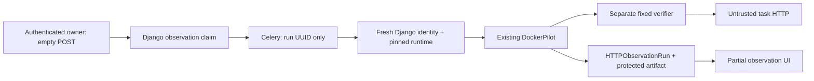

# Trusted Checker MVP — Django Observation Integration

22 октября 2026 · Git HEAD `4692e09f9cd867a40f3cfeb29355b9d08f2bafde`.

**`MVP DJANGO OBSERVATION INTEGRATION OFFLINE READY`. Default OFF.**
Реализован путь от авторизованной текущей Django attempt через Celery и прежний
Docker adapter до отдельного HTTP observation и UI. Один task:
`l1/service-bind-localhost`, одна явно выбранная тестовая attempt.
**21 новый integration test проходит.** Полный Sandbox: **427 tests, OK,
6 PostgreSQL-specific skips**; прежний adapter: **25 tests, OK**.

`matched/http_match` не создаёт PASSED CheckRun, technical timestamp, academic
pass, Ledger completion, достижения или прогресс. Bind, named process и network
isolation остаются `unverified`. Реального включения, Docker run или deploy в этой
задаче не было. H1/H2, RR01–RR05 и physical gates сохранены.

## 1. Решение и execution identity

Обычный `ledger.request_check` и `@checked` имеют lifecycle effects и предназначены
для технической проверки. Observation не вызывает их ради создания UUID.
Использован разрешённый заданием минимальный fallback:
[HTTPObservationRun](sandbox/observation_models.py), отдельная диагностическая
execution/result запись в том же Django app.

Если у текущей attempt уже есть последний `TechnicalCheckExecution` без events,
его run ID/ordinal ещё не использованы observation и legacy check не running,
они используются read-only. В обычной новой попытке такого безопасного pending
record может не быть: тогда создаются собственные UUID/ordinal observation.
Последний TechnicalCheckExecution, если существует, остаётся FK anchor;
его ID и последний event ID закреплены и перепроверяются. Никаких искусственных
technical execution, started/finished Ledger events или PASSED records не создаётся.
`execution_origin` явно различает эти случаи.

`run_id` уникален, `(attempt, ordinal)` уникальны, partial unique constraint
разрешает одну queued/running observation на attempt. Request использует row lock
attempt; повторная доставка Celery выполняет атомарный queued → running claim и
не запускает adapter повторно. Завершённый run не переисполняется; новый ручной
запрос создаёт новую observation. Это не автоматический retry после unknown.

## 2. Файлы и реальный путь

| Файл / участок | Изменение |
|---|---|
| [http_observations.py](sandbox/services/http_observations.py) | Request, read-only DjangoObservationSource, job claim, вызов существующего DockerPilot и отдельное сохранение |
| [observation_config.py](sandbox/services/observation_config.py) | Host-owned policy, выбор одной attempt, opt-in launch и runtime readback |
| [observation_models.py](sandbox/observation_models.py), [0034](sandbox/migrations/0034_http_observation.py) | Диагностическая таблица и пустой по умолчанию `TaskAttempt.http_observation_runtime`; без data backfill |
| [observation_views.py](sandbox/observation_views.py), [urls.py](sandbox/urls.py), [task_detail.html](templates/sandbox/task_detail.html) | Owner-only POST, owner/staff status, отдельная кнопка и timestamped observation |
| [settings.py](config/settings.py), [tasks.py](sandbox/tasks.py) | Три default-OFF настройки, одна Celery task с nominal soft/hard limits 20/25s |
| [docker_service.py](sandbox/services/docker_service.py), [environments.py](sandbox/services/environments.py) | Только opt-in start/reset: approved image/network, cap-drop ALL, без tmpfs, сохранение runtime до READY |
| [views.py](sandbox/views.py), [checks.py](sandbox/services/checks.py), [ledger_execution.py](sandbox/services/ledger_execution.py) | Выбранная attempt не попадает в legacy checker и queued legacy execution; OFF/остальные задания сохраняют прежний путь |
| [test_http_observations.py](sandbox/tests/test_http_observations.py) | 21 сквозной Django/fake SDK test |
| [Конфигурация и evidence](experiments/trusted_checker_mvp/django_integration/README.md) | Lab examples, команды тестирования и логи |

Существующие `adapter.py`, `worker.py`, `verifier.py` **не изменены**.
Нет нового wire protocol, helper, FD ownership framework, generic task registry
или API загрузки результатов. Production academic success writers и
`technical_evidence.py` не менялись; в legacy wrapper добавлен только ранний отказ
для выбранной attempt.

## 3. Identity source и runtime mapping

На **обычном явно запрошенном start/reset** только выбранной pilot attempt
используются pinned local image ID и заранее approved dedicated network.
Нет build/pull/adoption. Проверяется daemon ID и пустая isolated network;
normal terminal/control plane остаётся отдельным доверенным компонентом.

Перед READY host readback сохраняет full container ID, Docker StartedAt,
RestartCount, PID, network/endpoint ID, numeric IP, daemon ID и UUID существующей
environment start/reset operation. Mapping хранится в диагностическом JSON field
attempt, атомарно вместе с normal environment state. Обновление mapping не является
результатом проверки. Старые среды без mapping не принимаются: требуется явный
тестовый start/reset, а не backfill или snapshot нового baseline при каждом check.

На POST и при каждом source fence перечитываются реальная ORM attempt, владелец,
current/available state, environment generation с finished success, runtime mapping,
последний technical execution/event и server policy. PostgreSQL source reads имеют
local statement timeout 1s. Source не пишет модели и не принимает JSON от стажёра.

Job строит `Execution` из **ранее сохранённого mapping** и своей execution identity.
Adapter независимо inspect-ит daemon/target/network до и после HTTP и cleanup.
Restart даже между POST и worker не становится допустимым новым baseline.
Reset, current=false, новая generation, изменение container/endpoint/IP/PID/start,
новый technical event или policy дают unknown. После adapter final result ещё раз
проверяется под короткими locks attempt → observation, без network wait внутри
этой transaction. Pre/post checks не исключают transient изменения между ними.

## 4. Входы, хранение и граница зачёта

- `POST /attempts/<id>/http-observation/`: authenticated owner, стандартный CSRF,
  пустая form body; параметры URL/IP/command/image/result и JSON upload запрещены.
  Attempt ID в URL — селектор авторизованной записи, не runtime authority.
- `GET /attempts/<id>/http-observation-status/`: owner или staff. Возвращаются
  только run/status/http/finite reason и partial flags, без Docker mapping/config.
- Старый `/check/` у выбранной attempt направлен в observation handler до
  технических/academic transitions. Старый queued legacy job получает ранний отказ
  до `begin_check`/execution. Обычный маршрут остальных attempts не меняется.
- Job сохраняет ≤8192-byte result от собственного Docker adapter, а не от POST.
  `academic_pass=false`, `task_verdict=unknown|failed`; даже HTTP mismatch не меняет
  `TaskAttempt.status`. В UI явно указано отсутствие зачёта и время observation.
- Сохраняется protected artifact механизма Stage 2: private shared directory,
  run UUID claim, O_EXCL и bounded result. Он не является academic evidence.

Проверка не исполняет `/task/check.sh`, curl/ip/ss из task или caller argv.
HTTP bytes target остаются недоверенным входом fixed parser. Result provenance
основан на owned Docker attach и доверенном host/daemon/verifier code; echoed UUID
нужен для correlation и не является authentication сам по себе.

Observation path не вызывает `finish_check`, completion/achievement/review writers,
не меняет `technical_passed_at`, CheckRun или прогресс. SQL assertion в positive
integration test разрешает INSERT/UPDATE/DELETE **только** diagnostic run table;
снимки остальных Sandbox/achievement/roadmap counts и всех attempt fields совпадают.
Обычный explicit environment start/reset по-прежнему пишет свои environment events;
это отдельное существующее действие пользователя, observation его не запускает.

## 5. Тестирование

Всё выполнено локально: настоящая Django ORM/test HTTP routing, in-memory SQLite,
fake SDK/transport. [Test settings](sandbox/tests/observation_settings.py) отключают
dotenv loading/Sentry и не используют рабочую DB или broker. Ни один APIClient
к daemon не создавался: factory подменена; provisioning тоже проверен fake client.

| Запуск | Фактический результат |
|---|---|
| Новый integration module | **21 tests, OK, 0.899s**, 0 failures/errors/skips |
| Полный `sandbox.tests` | **427 tests, OK, 16.839s**, 0 failures/errors, **6 skips** |
| Прежние fake Docker adapter tests | **25 tests, OK**, 0 failures/errors/skips |
| Django `check` | No issues |
| `makemigrations --check --dry-run` | No changes detected |

Новые cases: match без academic writes, pending TechnicalCheckExecution read-only
reuse и отдельный fallback, OFF/другой task, owner/input restrictions, stale/current
attempt, reset до/во время probe, restart до worker и во время capture, malformed
stream, replay/duplicate delivery, source без SQL writes, новая technical event,
broker unavailable, legacy routing/queued guard, UI/status separation, pinned launch
и сохранение новой mapping на explicit reset. Timeouts, output bounds и forged
binding дополнительно покрываются прежними 25 adapter tests.

В полном Sandbox suite **шесть существующих PostgreSQL lock/guard tests пропущены
на SQLite**. Также возникли unraisable `ResourceWarning: unclosed database` в старых
SQLite test connections; несмотря на exit 0, это не warning-free run. Новый модуль
и отдельный adapter run таких warnings не выдали. PostgreSQL concurrency acceptance
этим запуском не подтверждён.

Существующий migration regression адаптирован к schema 0034: сравнивает все прежние
поля attempt до/после и требует пустой новый mapping. Первоначальная привязка к
0033 с запросом current model закономерно ломалась после добавления field. Academic
assertions не удалены. Начальные прогоны также выявили настройки HTTPS/static assets
изолированного test runner и опечатку в новом test query; исправлены test setup/query,
без ослабления production guards.

Логи и воспроизводимые команды: [README](experiments/trusted_checker_mvp/django_integration/README.md),
[integration](experiments/trusted_checker_mvp/django_integration/integration-tests.txt),
[Sandbox](experiments/trusted_checker_mvp/django_integration/sandbox-tests.txt),
[adapter](experiments/trusted_checker_mvp/django_integration/adapter-tests.txt).
Старые H1/H2 suites не запускались: их код не менялся и integration его не импортирует.

## 6. Минимальное тестовое включение и blockers

Готовы [policy example](experiments/trusted_checker_mvp/django_integration/policy.example.json)
и отдельный [Compose lab override](experiments/trusted_checker_mvp/django_integration/enablement.compose.example.yml).
Они не подключены к default deployment; placeholders намеренно непригодны для запуска.
Оператору нужны migration 0034 на отдельной lab DB, одинаковые настройки web/worker,
одна fresh current test attempt и shared private artifact directory.

Три настройки: `SANDBOX_HTTP_OBSERVATION_ENABLED=true`,
`SANDBOX_HTTP_OBSERVATION_ATTEMPT_ID=<test ID>`,
`SANDBOX_HTTP_OBSERVATION_CONFIG=<host-owned absolute path>`.
До enable надо остановить/дождаться legacy jobs; уже исполняющийся legacy job,
прошедший ранний guard до изменения конфигурации, нельзя считать отозванным.
Смена флага не отменяет прошлый technical success. Не использовать реальные
пользовательские attempts и не сбрасывать их результаты ради pilot.

До использования остаются конкретные условия:

1. **Real adapter + Django pilot.** Pin approved actual image IDs/source, создать
   approved empty isolated network и явно пересоздать тестовую среду. Проверить
   full create/attach/wait/remove, mapping/readback, Celery/reset races и negative
   network cases. Проверить совместимость target с cap-drop ALL и без tmpfs.
2. **Control plane.** Доказать task → Docker/host/terminal/DB/worker denial на lab.
   Worker и terminal с Docker socket остаются TCB; read-only mount socket не
   ограничивает права Docker API. Web не получает нового daemon access.
3. **PostgreSQL.** Проверить row locks/partial unique claim и concurrent reset /
   duplicate delivery на lab PostgreSQL. SQLite tests не являются их доказательством.
4. **Operational unknown.** Nominal adapter 5s + cleanup 2s и Celery soft/hard
   20/25s не доказывают crash recovery. Hard kill/lost job может оставить active
   diagnostic claim или own worker: требуется operator diagnosis, без удаления
   artifact ради retry и без автоматического redispatch. Нужны обычные DB/job limits,
   retention и контроль частоты ручных checks перед расширением pilot.
5. **Семантика задания.** Даже real HTTP match не доказывает bind, customer-app
   process identity, локальную reachability, persistence исправления или состояние
   после probe. Эти свойства остаются unverified. Full technical/academic acceptance
   потребует отдельного решения; текущая интеграция никогда не выдаёт pass.

Переданное пользователем VDS `192.0.2.10` / Docker `29.1.3` smoke evidence
учтено именно как **сообщённый real HTTP smoke**: wildcard bind дал expected HTTP,
localhost-only и подмена check.sh не обманули отдельный verifier. Здесь оно не
перезапускалось, artifacts независимо не проверялись. Synthetic attempt/run из
smoke не принимается за evidence этой Django integration или полной network/
execution acceptance. К VDS не подключались.

## 7. Целостность и итог

Baseline закрепил **478 существующих файлов: 467 неизменны, 11 изменены**.
Ожидаемо изменены Django settings,
models, routing/UI, opt-in environment lifecycle, ранние legacy guards и migration
test; прочие baseline hashes сохранены. Точный pre/post manifest:
[integrity.json](experiments/trusted_checker_mvp/django_integration/integrity.json).
Прежние MVP adapter/worker/probe/tests/reports, H1/H2 source/findings/fixtures и
physical gates не редактировались. Новые approvals/physical permits не создавались.

Рабочие DB, файлы .env/credentials и пользовательские данные не открывались/не менялись.
Migration выполнялась только на временной test DB. Не было Docker build/pull/
container/network operations, SSH/VDS, native helper/setns/FD-exec/physical probes,
commit/push/rebase или deploy. Default flag остаётся OFF.

**Итог:** observation-only Django path работает в изолированных integration tests;
его можно предъявить для узкого lab review и отдельного разрешённого тестового
включения. Production защита пока не включена. Вне opt-in attempt прежний
`check.sh → exit0` риск сохраняется; HTTP match не повышается до PASSED.
