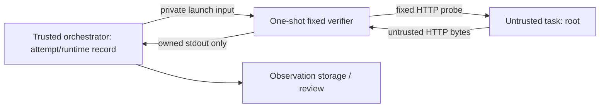

# Trusted Checker — Architecture Simplification & MVP Implementation Plan

22 октября 2026 · Git HEAD `4692e09f9cd867a40f3cfeb29355b9d08f2bafde`.

**Выбран A: одноразовый внешний verifier, fixed task policy, host-controlled
привязка попытки и собственная HTTP-проба.** Работающий local PoC находится в
[experiments/trusted_checker_mvp](experiments/trusted_checker_mvp/README.md):
**13 tests, OK**, реальный отдельный Python process и owned loopback HTTP fixture.
Новых зависимостей и подключения к Django нет.

**Это partial observation MVP, не готовая замена полной проверки задания.**
HTTP status/body проверяются реально; process identity/state, bind внутри task
namespace, реальный container identity и network isolation остаются `unverified`.
При HTTP match результат задания **`unknown`**, `academic_pass=false`.
Строгая связь local result с attempt/generation/run проверяется относительно
доверенной demo-записи; Docker runtime identity этим не аттестуется.

H1/H2 заморожены. [RR01–RR05](V2-06a-H1-INDEPENDENT-REREVIEW.md) остаются открытыми;
native helper не исправлялся и не активировался. Старая реализация и physical
gates сохранены. Нет `OS READY`, `PHYSICAL READY`, academic pass или deploy.

## 1. Что фактически делает Ticket Sandbox сейчас

Изучены исходники и task definition; БД, .env, Docker daemon и deployed host
не опрашивались. Ниже — свойства **текущего кода**, а не подтверждение live config.

| Участок | Фактический путь | Значение для нового checker |
|---|---|---|
| Task policy | [task.json](training_tasks/l1/service-bind-localhost/task.json), [app.conf](training_tasks/l1/service-bind-localhost/files/app.conf) | Поломка — bind `127.0.0.1:8080`; цель — восстановить сетевую доступность, сохранив локальную. `requires_manual_review=true` в definition; actual DB value не читался |
| Service | [app_server.py](training_tasks/l1/service-bind-localhost/files/app_server.py), [customer-app](training_tasks/l1/service-bind-localhost/files/customer-app), [Dockerfile](training_tasks/l1/service-bind-localhost/Dockerfile) | Python HTTP server, `/` и `/health`, body `APP OK: customer service is running\n`. `customer-app`/`systemctl` — изменяемые wrappers, не независимый service manager. PID file, config и process name нельзя считать proof |
| Creation | [docker_service.py:80](sandbox/services/docker_service.py#L80) | Image по mutable tag; task container получает 768 MiB, pids=256, no-new-privileges, drops только AUDIT_WRITE/MKNOD. Нет явного `network=`; task launch не передаёт Docker socket/host mounts, host PID/net mode или privileged=true |
| Runtime binding | [environments.py:282](sandbox/services/environments.py#L282), `run_environment_restart` | Сохраняются container ID/name и terminal refs. Reset пересоздаёт container, имя повторяется, ID меняется. `restart_count` приложения не равно Docker RestartCount и не является generation witness |
| Check | [docker_service.py:132](sandbox/services/docker_service.py#L132), [check.sh](training_tasks/l1/service-bind-localhost/files/check.sh) | Lookup по имени → `exec_run(timeout ... bash /task/check.sh)` внутри trainee container. Script вызывает свои curl/ip/awk. Root может менять script и tools. Перенос текста checker в exec сам по себе проблему tools/runtime не решит |
| Technical success | [checks.py:176](sandbox/services/checks.py#L176), [technical_evidence.py](sandbox/services/technical_evidence.py) | Exit 0 устанавливает `technical_passed_at`, PASSED CheckRun/exit0, Ledger finish и completion/achievement events. Успешный CheckRun или timestamp уже являются technical evidence для UI/progress |
| Академические transitions | [ledger.py:529](sandbox/services/ledger.py#L529), [views.py:827](sandbox/views.py#L827), [completions.py:218](sandbox/services/completions.py#L218) | Credit attempt с manual review сохраняет окружение до отправки текста; отдельное staff review. При этом technical success уже запускает отдельные completion/achievement paths. Запись «только CheckRun» не является безвредным observation storage |
| Existing request fences | [ledger_models.py:89](sandbox/ledger_models.py#L89), [ledger_execution.py](sandbox/services/ledger_execution.py) | Есть `TechnicalCheckExecution.run_id`, ordinal, criteria digest, duplicate/late-result checks. Они пригодны для integration; container ID/start/network/generation там не закреплены. Repository check.sh digest в `checker_identity` не доказывает исполнявшиеся bytes |

Существенная граница: [terminal container](sandbox/services/docker_service.py#L220)
имеет **rw Docker socket** и запускает `docker exec -it TARGET bash`.
Это другой container, чем trainee task. Из исходников не следует прямой socket
mount в task, но compromise terminal/worker даёт контроль над daemon и уничтожает
доверие к same-host checker. В [Compose](docker-compose.yml) worker и terminal
получают control-plane доступ; web/worker/DB/Redis/gateway используют platform
network. Это не следует копировать в verifier.

Docker отдельно указывает, что daemon control должен быть доступен доверенным
пользователям: через bind mounts можно воздействовать на host. Read-only mount
socket не является read-only Docker API. В threat model worker/daemon/terminal
остаются TCB. [Docker Engine security](https://docs.docker.com/engine/security/),
[daemon access](https://docs.docker.com/engine/security/protect-access/).

## 2. Реальные требования, которые можно проверять независимо

Проверяемый контракт должен описывать наблюдаемое поведение. HTTP checker может
сам послать request и сравнить ответ; Docker control plane может независимо
сообщить runtime/container state. Их нельзя заменить stdout из target exec.

Нельзя независимо подтвердить правильность исправления файла, сохранность
исходного customer-app binary, конкретный процесс или знание стажёром причины
только по HTTP body. Root способен запустить другой server с тем же ответом.
Если policy допускает любое функционально правильное восстановление, это
наблюдаемое поведение; если требуется именно исходный service/config, нужны
другие evidence или ручная проверка. Подмена HTTP application заранее известным
body не выдаёт proof происхождения приложения.

Для `service-bind-localhost` фиксируем пять отдельных свойств:

| Свойство | Независимый источник в выбранном design | Что есть в local PoC |
|---|---|---|
| 1. Service существует и работает | Собственная HTTP-проба доказывает живой HTTP endpoint в момент ответа; Docker inspect доказывает state контейнера. Named service/process identity — отдельный kernel/process source | Живой endpoint наблюдается. `service_process_state=unverified`; named process не определяется |
| 2. Bind address и port | Host/kernel socket inventory именно target netns; чтение target config, netstat/ss из container exec и Docker `ExposedPorts` недостаточны | `bind_address_and_port=unverified`, включая semantic task port 8080 |
| 3. HTTP по нужному пути | Fixed GET `/` непосредственно на numeric target IP:8080 из внешнего verifier. Для локальной доступности внутри task netns нужен отдельный источник/проба | Настоящий GET `/` на owned loopback surrogate endpoint. Доступ извне task container и его localhost не проверены |
| 4. Status/body | Независимо полученные HTTP 200 и exact versioned body; без redirects, DNS/proxy/env overrides | Реально проверены для local endpoint. Status 503, неверный body/JSON не дают match |
| 5. Конкретная attempt | Authenticated control record: user/task/attempt, execution UUID, environment UUID, exact runtime/daemon/network incarnation; pre/post comparison и single-use consumption | Local record: attempt ID + environment UUID + runtime UUID + fresh run UUID + numeric endpoint. Корреляция проверена; Docker identity — `unverified` |

Название slug не означает, что успешное решение должно **остаться localhost-only**.
Сейчас script требует ответы и на loopback, и на container IP. Одна внешняя 200
не доказывает ни local reachability, ни wildcard bind, ни единственный listener:
возможны два listeners или proxy. До принятия exact bind policy (например,
допустимы ли multiple listeners и IPv6) нет автоматического зачёта этого свойства.

## 3. Сравнение A и B

| Вопрос | A — одноразовый изолированный verifier | B — отдельный verifier service |
|---|---|---|
| TCB | Host/kernel/Docker, orchestrator, защищённый verifier image/code, runtime mapping, parser | Те же компоненты плюс долгоживущий service, auth/keys, request/result API, service storage, network policy |
| Student → Docker/host/checker | Task без socket/host mounts/host PID/net/privileged. Verifier без socket; orchestrator launch/inspect остаётся доверенным | Task не имеет control endpoint/keys. Read-only service interface всё равно требует auth, authorization и защиты target selection |
| Network boundary | Verifier не слушает API. Только исходящий fixed probe к выбранному target; host-level policy ограничивает task → host/control. Один worker на check | Отдельные control/data networks; service на data plane не должен публиковать control listener. Dual-homing само по себе не является защитой |
| Подмена ответа | Target HTTP — untrusted evidence, не verifier result. Result только из stdout конкретного запущенного worker | Result через защищённый authenticated channel; поля JSON без authentication и provenance бесполезны |
| Attempt identity | Record из orchestrator, full Docker ID/start/generation/network pre/post, fresh execution ID | Те же runtime checks; удалённому service нужно безопасно передавать и заново разрешать binding |
| Replay | Один новый worker на fresh run; result сверяется с pending execution/generation; future DB consume один раз | Нужны те же semantics и отдельная durable result/request lifecycle на сервисе |
| Linux/Docker privileges | Probe обычным non-root TCP client, без capabilities. Launch/inspect уже выполняет доверенный orchestrator. Bind inspection отдельно и не требует привилегий у HTTP worker | Probe тоже unprivileged. Для netns/kernel observations потребуется host observer; отдельная сеть не решает получение bind facts |
| Integration | Один fixed policy, snapshot + launch + bounded stdout + compare; можно начать observation-only | Новый deploy/service lifecycle, API/auth, retries/timeouts/versioning и operational ownership |
| Чего вариант не доказывает | Kernel/container escape resistance, original app identity, continuous correctness | То же; перенос в service не создаёт этих доказательств автоматически |

**Выбор: A.** B не нужен для одного fixed task. Отдельный service имеет смысл
при другом host/VM trust domain или множестве tasks; это отдельная потребность,
не prerequisite текущего MVP.

Для последующего Docker pilot A означает обычный одноразовый non-root verifier
container/process с защищённым code и собственным stdin/stdout. Используются
стандартные Docker lifecycle/attach/wait APIs; новый native helper, SCM_RIGHTS,
nonce wire protocol, FD escrow и собственная authority система не нужны.
Local PoC использует обычный Popen, без Docker adapter и скрытого fallback.

## 4. Точный trust boundary выбранного варианта



Trust boundary проходит между HTTP bytes target и кодом verifier, а также между
trainee runtime и host-controlled mapping/code/result transport. Result stdout
не является endpoint, на который trainee может отправить `{"passed":true}`.
Run UUID и echoed binding нужны для correlation; **это не MAC и не attestation**.
Защита основана на том, кто может запускать worker и писать его pipe, а не на
секретности формата. При compromise host/orchestrator/worker image гарантий нет.

Для Docker pilot целевой профиль, **ещё не настроенный этой задачей**:

- Target для этого task: root внутри private namespaces, без Docker socket,
  host mounts, shared PID/net, privileged и write access к verifier/control.
  Проверить работу с `cap_drop=ALL`: app на 8080, редактирование своих файлов и
  управление своими процессами не требуют namespace/network-admin capabilities.
  Это candidate minimum, его совместимость с image надо измерить отдельно.
- Verifier: отдельный non-root UID, cap_drop=ALL, no-new-privileges, read-only
  filesystem/image by digest, нет Docker socket/host proc/secrets, shell/target
  exec API и published ports. Небольшие memory/pids/CPU limits задаёт runtime.
- Task и временный verifier — на отдельной task network, не на platform network
  с DB/Redis/terminal. Только разрешённый probe target. Не использовать DNS для
  выбора target, не принимать IP/port/URL от trainee; IP берётся из inspected
  endpoint host record. Один task на такую network упрощает attribution.
- Отдельно проверить host INPUT/forwarding/published-port reachability:
  trainee не должен достигать daemon TCP/UNIX endpoints, host control services,
  gateway management, terminal и other attempts. `internal: true`, отсутствие
  published checker port или отдельное имя сети недостаточны как доказательство.
- Terminal с Docker socket остаётся защищённой частью control plane: trainee
  получает только shell **в task**, не shell/файлы terminal container. Не давать
  verifier этот socket. Review ttyd/gateway authorization и конфигурации является
  условием same-host доверия; их compromise означает выход за принятый TCB.

По Docker bridge docs контейнеры одной bridge обычно общаются, host имеет
доступ к ним, а published ports меняют доступность. Поэтому сеть проверяется
реальными negative cases, а не только Compose flags.
[Docker bridge network](https://docs.docker.com/engine/network/drivers/bridge/).

Local PoC **не реализует этот deployment profile**: процессы работают с UID
текущего пользователя, target fixture — owned HTTP thread, verifier — отдельный
Python process. У root на host или равноправного hostile same-UID process нет
заявленной изоляции. `network_isolation=unverified` — обязательный результат.

## 5. Небольшой исполняемый PoC

| Файл | Назначение |
|---|---|
| [verifier.py](experiments/trusted_checker_mvp/verifier.py) | Fixed task/body/path, bounded raw HTTP client, strict host request schema; только stdlib |
| [local.py](experiments/trusted_checker_mvp/local.py) | LocalControl record, запуск отдельного `python -I -S`, ограниченный pipe read, timeout/reap, exact fresh binding check |
| [test_mvp.py](experiments/trusted_checker_mvp/test_mvp.py) | 13 сквозных tests и собственный HTTP fixture |
| [demo.py](experiments/trusted_checker_mvp/demo.py) | Один end-to-end smoke run с readable JSON |

Verifier не использует `/task/check.sh`, `container.exec_run`, curl/ip/ss,
process stdout от trainee или task filesystem. Путь `/`, expected status 200 и
body зашиты в host-owned verifier. Body соответствует app_server.py **с newline**;
это exact PoC policy, а не неявная нормализация shell command substitution.

Endpoint в local режиме: только numeric `127.0.0.1`, nonprivileged port из
host-controlled fixture record. ОС выбирает свободный surrogate port; caller
`check(control, attempt_id)` не передаёт команды, argv, body, URL или port.
Внутренний trusted launch request содержит port, поскольку занятый локальный
8080 нельзя использовать как свой fixture. **Surrogate port не доказывает 8080.**
LocalControl не читает JSON от trainee и не реализует сетевой control interface.
Он является synthetic runtime mapping, не observation Docker. Future adapter
должен отдельно подтвердить daemon/container/start/network/generation; нельзя
просто переименовать local runtime UUID в Docker identity.

| Bound | Реализация |
|---|---|
| Trusted worker request | ≤1024 bytes, exact keys/types/canonical UUIDs, duplicate keys отвергаются |
| HTTP | ≤4096 buffered header bytes, body ≤256 bytes; fixed GET `/`; no redirects/proxy/DNS/chunked/content-encoding |
| Probe | Общий monotonic deadline 0.6s, проверка на каждом connect/send/recv, не только socket idle timeout |
| Worker stdout | ≤2048 bytes **во время чтения**, stderr в DEVNULL, raw response не экспортируется |
| Parent attempt | 1.5s nominal deadline, owned child kill/wait при timeout/error; reap allowance 0.5s, при ошибке нет положительного observation |
| Concurrency/retry | Один worker/один вызов, без auto retry; aggregate/concurrency quotas и persistent job fencing относятся к будущему orchestrator |

Это bounds на raw buffers и моделируемые blocking operations, не hard real-time
гарантия Python process creation, scheduler или RSS. Popen launch/OS stalls и
supervisor death требуют обычных runtime/service-manager limits в deployment.
Увеличения прежних v2 packet budgets здесь нет: это другой local HTTP smoke,
без использования v2 timing/permit types.

Worker exit 0 означает **transport/result ready**, включая `http=unknown`.
Supervisor проверяет private stdout schema, fresh run ID и полную binding,
сравнивает current record до/после и timing. JSON от приложения остаётся HTTP
body и не попадает в result decoder. Pure result parser сам по себе не
удостоверяет pipe provenance; именно поэтому нет upload/import-result API.

Ограниченный результат: schema/task, attempt/environment/runtime/run IDs,
`http=matched|mismatch|unknown`, finite reason, local binding status, четыре
`unverified` поля, `task_verdict=failed|unknown`, `academic_pass=false`,
`continuous_verification=false`. Ни один code path не возвращает task pass.
Evidence пример: [demo-result.json](experiments/trusted_checker_mvp/demo-result.json).

## 6. Выполненные tests и непроверенные угрозы

Финальный run: **13 tests, 0 failures/errors/skips, OK, 4.720s**, exit 0,
ResourceWarning отсутствуют. Demo: exit 0, `http=matched`, task unknown,
academic false. Лог: [tests.log](experiments/trusted_checker_mvp/tests.log).

| Угроза | Evidence / безопасное поведение | Предел |
|---|---|---|
| check.sh → exit 0 | Созданы inert spoof script/tools с marker; wrong HTTP всё равно mismatch, marker не создаётся | Не исполнялся script и не менялся настоящий task image |
| Подмена вывода команды | PATH/PYTHONPATH с fake tools не влияют на isolated worker; curl/ip вообще не вызываются | Compromise trusted Python/code вне модели |
| Service down | Owned reserved port без listener даёт unknown, а не pass | Это TCP endpoint state, не named daemon state |
| Неправильный bind | Реальный localhost-only fixture отвечает 200; bind остаётся unverified, task не засчитывается | Корректный bind внутри Docker не проверен |
| Body/status/готовый JSON | Wrong body, 503, `{"result":"passed"}` → mismatch | Endpoint с нужным application body показывает только соответствующее поведение |
| Неверный port | Ответчик на другом порту не ищется; pinned endpoint unavailable → unknown | Semantic 8080 внутри task не доказан |
| Старый result | Wrong attempt/environment/runtime/run не принимаются; replay raw result предыдущего worker даёт unknown | Нет durable cross-host replay journal; его заменяет будущий DB single-use execution |
| Checker/control unavailable | Missing worker file или mapping → unknown; exit code не превращается в task pass | Docker unavailable ещё не тестировался, adapter отсутствует |
| Timeout | Реальная задержка ответа → timeout; отдельный parent timeout kill/wait-ит owned child, poll показывает завершение | OS process stalls/descendants не доказаны |
| Student → checker | Нет ingress API; target response/redirect не может стать control/result request; requests с command/argv/URL не допускаются | **Container-to-checker network denial не проверен**. Нужен root-container scan/connection test в отдельном pilot |
| Вмешательство в control plane | HTTP redirect не выполняется, mapping не меняется; generation mutation между snapshot/read отбрасывает result | **Отсутствие доступа к Docker/host/DB/terminal не проверено live**. Нужны реальные isolation tests |
| Изменение после check | Старый match остаётся только историческим observation; после остановки fixture новый run даёт unknown | Нельзя обещать непрерывное состояние или исключение transient attach/revert |
| Malformed/oversized response | Oversized header/body, duplicate length, unsupported encoding/incomplete response → unknown | Ограниченный parser принимает только нужный HTTP subset, не весь HTTP стандарт |

Первые попытки запуска не являются green evidence: sandbox запрещал loopback
bind; разрешённый локальный запуск выявил занятый 8080. Чужой service не
останавливался и не опрашивался. После перехода на собственные ephemeral ports
один test ожидал только immediate refusal, хотя macOS дал timeout; expectation
уточнён до двух безопасных unknown reasons, implementation guard не ослаблен.

Запуск из repository root:

```sh
PYTHONDONTWRITEBYTECODE=1 .venv/bin/python -W error::ResourceWarning -m unittest experiments.trusted_checker_mvp.test_mvp -v
PYTHONDONTWRITEBYTECODE=1 .venv/bin/python -W error::ResourceWarning -m experiments.trusted_checker_mvp.demo
```

Не запускать этот local harness как изоляцию реального root trainee. Hostile
контейнеры/management network tests пока не проводились. Все 13 tests — tests
PoC, не доказательство полного security acceptance. Старые 1414 tests здесь
не запускались: старый runtime не менялся и не импортируется новым checker.

## 7. Минимальные последующие изменения Django / Ticket Sandbox

**В этой задаче ни один пункт не применён.** Нужны маленькие отдельно reviewable
шаги, не универсальный replacement всех tasks:

1. **Environment identity.** При создании/пересоздании среды host orchestrator
   задаёт новый environment UUID и сохраняет mapping: user/task/attempt,
   full container ID, daemon identity, start/restart incarnation, approved image
   digest, network ID и endpoint. До полного create/readback среда не READY.
   Использовать ID, а не повторяемое имя; pre/post inspect того же ID, restart
   или endpoint drift → unknown. Отдельно запретить IP reuse/handoff в ходе check.
2. **Один fixed route для одного task.** Отдельный opt-in observation handler
   для `l1/service-bind-localhost`, новый immutable verifier policy version;
   не заменять registry произвольными URLs/командами из Task.description/POST.
   Авторизовать ownership attempt в Django до lookup. Перенести local transport
   в one-shot isolated process/container; добавить стандартные runtime caps.
3. **Reuse existing job identity.** Использовать существующий
   `TechnicalCheckExecution.run_id`/ordinal как execution key и environment UUID
   как отдельную incarnation. Проверять current attempt/is_current, pending
   execution и env generation под row lock после probe; interrupt/reset делает
   result stale. Единственный consume через existing DB transaction/constraint,
   без новой собственной IPC/replay/ownership системы. Не держать DB lock во
   время network wait. Full runtime snapshot надо сохранить отдельно от slug.
4. **Observation-only storage.** Начать с protected bounded operator artifact
   по run ID либо отдельной таблицы TechnicalObservation без recognition в
   `technical_evidence.py`. Не создавать PASSED CheckRun, не ставить
   `technical_passed_at`, не вызывать finish_check(passed), completions,
   achievements, review/roadmap writers. Не подавать JSON PoC в старую
   exit-code success ветку. UI явно показывает partial/unverified.
5. **Network profile.** Отделить target/verifier data network от platform;
   review Docker/terminal/host ingress, default caps, mounts и allowed flows.
   Existing task launch с default bridge не считать готовым профилем.
   Separate network/host firewall config меняются только отдельным deploy step.
6. **Закрыть missing properties или изменить task policy явно.** Если для
   полного зачёта обязательны bind, локальный HTTP и named service state,
   HTTP-only adapter их не закрывает. Нужен небольшой отдельно reviewed
   host-side источник kernel sockets/process facts и локальной reachability.
   Возможный путь — bounded чтение host `/proc/<inspected PID>/net/tcp{,6}`
   с проверкой netns/PID generation, без запуска tools стажёра. Это design
   candidate, здесь не реализован и не принят. Не монтировать весь host proc
   в web/verifier и не выдавать CAP_SYS_ADMIN ради convenience. Если нужных
   read permissions/attribution нет — оставить unverified и ручной review.

Для initial observation MVP privileged kernel observer вообще не нужен. Docker
inspect даст container state, но не bind; kernel listen table, даже принятая,
не докажет customer-app binary, отсутствие proxy/NAT и continuous correctness.
Не начинать из-за этого новое универсальное H2 framework: сначала решить,
какие конкретные свойства task действительно обязательны для зачёта.

До отдельной integration задачи текущий production check.sh path остаётся
прежним и уязвимым к root trainee; этот PoC не объявляется уже включённой защитой.

## 8. Security review / включение: короткие критерии

Для **observation pilot**, без академических writes:

- На выделенной разрешённой среде проверить фактический launch profile:
  namespaces/mounts/caps/socket exposure/network flows, code/image immutability.
  Из root task попытаться подключиться к worker/control/daemon/DB/terminal,
  читать/менять code/result/control files и other attempts. Требуется реальный
  deny evidence, а не только отрицательный HTTP response из mock.
- Повторить fixed task faults: exit0 script, fake tools, wrong bind/body/port,
  unavailable/timeouts; malformed HTTP и slow-drip body не обходят total bound.
  Проверить limits, cancellation/worker exit и removal только своего worker ID
  средствами стандартного runtime. No auto retries после unknown.
- End-to-end reset/recreate/Docker restart/IP reuse/concurrent check: old result
  никогда не связывается с новой incarnation, late delivery не пишет success.
  Репозиторий/image/verifier policy и protected mapping проверяются отдельно.
- Убедиться, что observation storage/reader не активирует technical/academic
  completion. Для default-off pilot это отдельный regression на существующие
  Django writers; сейчас они не модифицировались.

Для **полного technical acceptance** дополнительно должны быть verified **все
обязательные** свойства из раздела 2 либо явно принята более узкая новая task
policy. Один HTTP match не основание. Академический transition требует отдельного
решения/изменения writer и acceptance tests; PoC его не разрешает.

Состояние после последнего probe не гарантируется. Result — ограниченное по
времени observation, не reusable permit. При consume/review нужна актуальная
generation и принятая freshness policy; если требуется работоспособность именно
тогда — новый probe. Проверки до/после не исключают transient изменения между
ними. Post-check поведение и оценка знаний остаются отдельными требованиями.

## 9. Что не нужно из старой v2 для этого MVP

| Оставить как research / не подключать | Причина |
|---|---|
| H1 binary codec, FD catalog/escrow, helper/supervisor, native identity/FD-exec, H2 | HTTP client не входит в trainee netns и не исполняет его код; стандартного runtime и private launch/result transport достаточно |
| Native nft/topology/management profiles, NSID/veth/FDB joins, full native capture registry | Один fixed HTTP contract не требует доказательства universal network equivalence или inventory всех kernel surfaces |
| Installer/ownership journal/rollback, canonical firewall recipe, CT/raw/byte proofs | MVP не устанавливает firewall и не принимает ownership исторических ресурсов |
| Physical 15-probe experiment, physical permit/authority, packet calibration/live adapter | Нет physical activation или заявления о management isolation/measurement acceptance |
| Большая общая fault matrix | Нужны несколько сквозных угроз конкретного task и deployment boundary; добавлять tests по обнаруженным новым risks |

Из старых работ сохраняются **идеи**: фиксированная policy вне target,
independent observation, separate attempt/runtime identity, bounded fail-closed,
unknown вместо fabricated facts и отсутствие automatic academic adoption.
Их реализация здесь не импортирует research modules. Reports/findings/gates
сохранены, RR01–RR05 не закрыты и не исправлены этим design.

## 10. Целостность и итог

Перед изменениями закреплены SHA-256 **474 existing files**: Sandbox, все шесть
Trusted Checker packages (включая PoC), task definition/files, Compose, settings,
terminal Dockerfile, старые reports и durable re-review artifacts. Все hashes
сохранены; manifest/evidence — [integrity.json](experiments/trusted_checker_mvp/integrity.json).
Старый dynamic physical source digest остаётся
`bffce5ec1e43bf1783f2b48a23b3372397c4fd5f8aded93ff3b4e95561efae3a`.
Новые files находятся только в отдельном experiments каталоге и этом report.

Выполнены source reads, новая документация/PoC, локальные Python processes и
собственные loopback HTTP fixtures. Native helpers/OS readers, Docker/VDS/SSH,
setns/FD-exec/firewall/routes/sysctl/physical probes не запускались. Исходники
Django/academic writers изучены без изменений; рабочие БД, credentials/.env
не читались и не менялись. Commit,
push, rebase и deploy не выполнялись. Старые findings и closed gates неизменны.

**Результат: A выбран; local independent HTTP PoC работает; full task acceptance
не готов и не включён.** Следующий минимальный шаг — отдельный observation-only
Docker/runtime/network adapter pilot с точной attempt binding. Полный pass
блокируют перечисленные unverified свойства; это видимая граница scope, а не
скрытое обещание восстановить все H1/H2/native proofs перед первой полезной HTTP
пробой.
