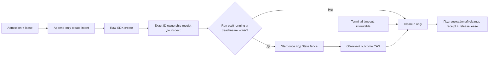

# Trusted Checker: create/register race и orphan recovery — задача №19.1

15 октября 2026, ветка `feature/roadmap-react`. Изменения ограничены standalone PoC. Новые реальные Docker/VDS испытания: **NOT RUN**. Доступ к одобренному daemon в этой сессии не предоставлен. Existing orphan не инспектировался и не удалялся дистанционно; локальный Docker Desktop/socket также не использовался.

## Подтверждённый пользователем инцидент

На отдельной Ubuntu 24.04.5 / Docker 29.9.1 прежний harness дал 15 успешных runtime scenarios, `deadline_and_late_result` inconclusive, пять fake-only scenarios и cleanup_incomplete / exit 4. Это сведения пользователя о реальном прогоне №19, не новый результат этой сессии.

| Факт | Значение |
|---|---|
| Integration | `8703c5d3-b740-4e7d-b530-ecf60fc9dad3` |
| Run | `bc473489-aef4-40b8-86ae-7f3bc8db36d8` |
| Runner | `f0697295277e151a931d6ee69361e65663e18196295a79baa225fb3cf8905d1d` |
| Image | `sha256:59bd19caf4eb8164825fb108d3e29be51bafa03c302da7a422d24020ce10b913` |
| Scope | `poc-task19-8703c5d3` |
| State | created, Running=false |
| SQLite | finished, runner=NULL, unknown/runner_deadline_exceeded, lease есть, cleanup receipt нет |
| Policy timeout | 1 с |

Совпадение этих данных с inspect labels не используется как самостоятельное доказательство ownership.

## Причина и timeline старого кода

1. Admission создаёт durable running row и lease; Docker create intent в SQLite отсутствует.
2. `containers.create()` создаёт контейнер и внутри SDK дополнительно делает `get(resp['Id'])`. Это проверено по установленному исходнику Docker SDK, без подключения к daemon. Ошибка этого GET уже может скрыть ID успешного create.
3. PoC вызывает reload/diagnostics и только затем `register_runner()`.
4. При deadline координатор раньше записывает terminal timeout. Register разрешён только для running, поэтому поздний ID не попадает в `runs.runner`.
5. Старый worker пытался сделать прямой cleanup, но без durable ownership/cleanup receipt. При crash/SDK error/завершении процесса handle теряется; lease остаётся.

Прежний API не позволял позднюю регистрацию после finished. Разрешать такую регистрацию как новый execution нельзя: timeout уже является неизменным техническим исходом.

## Новый lifecycle



В [state.py](trusted_checker_poc/state.py) добавлены standalone SQLite tables:

- `create_intents`: run UUID, integration UUID, approved daemon, runner generation, непредсказуемый ownership token, target/generation/network/image/policy binding, challenge digest и timestamps.
- `runner_ownership`: exact full Docker ID и provenance — raw SDK response или проверенная reconciliation. Не зависит от статуса running/finished и не утверждает runtime trust.
- `runner_starts`: однократный start request.
- `recovery_audit`: action/decision, exact candidate ID, daemon ID, numeric actor UID/PID, timestamp, evidence digest.
- Прежние `cleanups`: подтверждённое удаление, отдельно от technical receipt.

UPDATE/DELETE этих receipt tables запрещены SQLite triggers. `runs.runner` остаётся projection активного исполнения; позднее ownership хранится отдельно и может оставить projection NULL. Существующие `runs.result` не переписываются. Обновление schema делается только новым `State` для выбранной private PoC SQLite; Django migrations и рабочие БД не затрагиваются. Dry-run не создаёт State и не обновляет даже старую schema.

[Lifecycle](trusted_checker_poc/lifecycle.py) проверяет cancellation, monotonic deadline и persisted running state между операциями. После terminal closure разрешены запись позднего ID и exact cleanup, но не запуск, повторный create или чтение HTTP outcome как нового verdict.

[DockerAdapter](trusted_checker_poc/docker_adapter.py) в управляемом Broker-пути вызывает public low-level `create_host_config/create_container`. Full ID сохраняется сразу из raw create response **до** SDK get/reload/diagnostics. Фиксированные image/user/entrypoint/environment/RO/caps/namespaces/mounts/tmpfs/network/resources/labels остаются прежними; новые intent/session/generation/token labels дополнительно проверяются. Прямое trusted использование adapter без Broker не получает durable lifecycle автоматически и не является новым рекомендуемым workflow.

[Broker](trusted_checker_poc/broker.py) связывает intent до prepare. Late create response сохраняет ownership даже после timeout; следующий lifecycle check запрещает start. Finally и operator cleanup умеют читать ownership, когда `runs.runner` ещё NULL. Повторный old run UUID всегда возвращает прежний terminal receipt; физическое исполнение не повторяется.

## Deadline, cancellation и границы гарантий

| Случай | Результат |
|---|---|
| Deadline до create | Cooperative check запрещает новую операцию; технический timeout не меняется |
| Deadline внутри create | Начатый SDK request нельзя отменить задним числом; lease остаётся до известного исхода |
| Full ID пришёл поздно | Append-only ownership, никакого start, cleanup по exact ID |
| Create вернулся вовремя, registration задержалась | ID уже durably записан; late projection/start запрещены, cleanup независим |
| Crash между raw response и receipt | Intent остаётся, неизвестный кандидат требует независимой reconciliation |
| Ответ create потерян / неизвестная SDK ошибка | Никакого предположения об отсутствии контейнера; quarantine |
| Late success | CAS не заменяет timeout; после cancellation outcome не перечитывается ради повышения |
| Cleanup error / remove response lost | Нет подтверждения — нет освобождения lease; безопасный retry |

Start invocation и finish сериализованы через private SQLite transaction. SDK `start` вызывается только после проверки running/deadline и один раз; finish не может закоммититься посередине этой invocation. Это может задержать commit timeout на время уже начатого bounded SDK call. Cleanup confirmation и release lease выполняются в одной transaction; конкурентные процессы не делают два подтверждённых remove.

Это PoC, а не строгая wall-clock SLA: несколько bounded API calls и SQLite contention могут продлить ожидание. Start и cleanup держат write transaction выбранной standalone SQLite во время ограниченных SDK calls; callback не должен повторно входить в State. Shared production DB так использовать нельзя. Потеря ответа и crash после remove до commit всё ещё могут оставить quarantine, хотя контейнер физически исчез.

Cancellation не может отозвать HTTP request, уже переданный Docker daemon, и не является kernel-level termination proof. Если start был отправлен до deadline, его дальнейшая работа/неизвестный ответ закрываются как unknown и cleanup. Runner, созданный **поздно до какого-либо start**, не получает нового start request после timeout. Handshake коротких запусков №19 не менялся; post-start NetworkID validation сохраняется.

Завершённый отказ до prepare по-прежнему может освобождать lease при положительном доказательстве отсутствия create. Если coordinator уже закрыл run, пока read-only preflight ещё выполнялся, а durable no-create proof не был записан, сохранена консервативная quarantine. Отсутствие handle само по себе не снимает lease.

## Operator recovery: два допустимых источника ownership

Новая команда:

```sh
.venv/bin/python -m trusted_checker_poc.integration reconcile \
  "${POC_ARGS[@]}" --directory "$POC_RUN_DIR" \
  --run-id "$POC_RUN_ID" --runner-id "$POC_EXACT_RUNNER_ID"
```

По умолчанию dry-run: Docker только read-only; SQLite открывается `mode=ro`, без schema upgrade/ownership/audit writes. Session file lock координирует доступ к private journal. Команда не ищет candidates и принимает только полный ID и canonical run UUID. Нет label/name discovery, broad filters, prune, force flag или выполнения старого run.

Обязательны original approved daemon, journal integration/scope/image bindings, terminal unknown, exact candidate identity и **никогда не стартовавший created** container с полной разрешённой конфигурацией. Running/exited candidate не импортируется этим unknown-ID recovery workflow.

Далее требуется один из вариантов:

1. **Новый intent:** заранее сохранённые token/generation/session/daemon/target/image/policy/challenge bindings должны совпасть с candidate. Независимый create event читается непосредственно из того же approved daemon по exact container ID; Actor.ID, Type/Action, timeNano, image и все intent labels должны совпасть. Labels в inspect без daemon event не достаточны.
2. **Legacy №19:** до инцидента private journal должен содержать настоящий `pre_start` diagnostic **с exact SDK-returned runner ID**, run UUID, image, временем и ожидаемыми security facts. Это запись доверенного hook после возврата SDK, а не вручную скопированные labels. Дополнительно требуется соответствующий create event от approved daemon. Новый intent задним числом не фабрикуется.

Docker events — доверенный в этой модели daemon-side источник, а не подписанная attestation. SDK `events()` задаёт timeout=None независимо от client timeout; чтение вынесено в read-only daemon thread с 4-секундным budget, лимитом 32 events/64 KiB и максимум двумя зависшими readers на процесс. Поздний reader не имеет доступа к State mutation/cleanup. Unknown/timeout/audit errors сохраняют quarantine. Event retention ограничен; отсутствующий исторический event нельзя заменить пользовательским JSON или вручную дописанной записью.

Если dry-run подтверждён, отдельный apply:

```sh
.venv/bin/python -m trusted_checker_poc.integration reconcile \
  "${POC_ARGS[@]}" --directory "$POC_RUN_DIR" \
  --run-id "$POC_RUN_ID" --runner-id "$POC_EXACT_RUNNER_ID" \
  --allow-execution --apply
```

Apply дописывает ownership и audited reconciliation receipt. **Он не запускает и не удаляет runner, не меняет terminal и не снимает lease.** Отказы apply тоже аудируются. Numeric UID/PID обозначают локальный trusted operator process; сетевого API/аутентификации principal здесь нет. Повтор apply не меняет существующий ownership, новая audit entry фиксирует повторное действие.

Затем отдельно:

```sh
.venv/bin/python -m trusted_checker_poc.integration cleanup \
  "${POC_ARGS[@]}" --directory "$POC_RUN_DIR" --allow-execution
```

Cleanup проверяет exact ID/image/role/scope/run, а для нового intent — token/generation/integration/intent и исходный daemon. Успешное удаление создаёт отдельный cleanup receipt и атомарно освобождает lease. Повтор подтверждённого cleanup не отправляет новое remove. Последующий session cleanup удаляет также только записанные собственные временные targets/networks исходного integration run; чужой ручной target не входит в этот journal. При неразрешённой lease fixtures сохраняются.

## Точная процедура для existing orphan

Ничего из этого на VDS здесь не выполнялось. Сначала остановить только старый PoC harness, сохранить private копии **исходных** journal/SQLite и исходников. Не останавливать daemon, не редактировать receipts, не удалять locks и не дописывать synthetic `pre_start` из inspect.

1. Найти оригинальный private run directory по integration UUID `8703c5d3-b740-4e7d-b530-ecf60fc9dad3`. Проверить `journal.json`: полный UUID, scope, environment.daemon_id, runner/target image IDs. Отдельно подтвердить этот daemon оператором.
2. Read-only проверить original SQLite row и наличие original hook trace. Пример не выводит environment/HTTP/credentials:

```sh
POC_RUN_DIR=/opt/tc19-evidence/REPLACE_WITH_ORIGINAL_RUN_DIRECTORY
.venv/bin/python - "$POC_RUN_DIR" <<'PY'
import json, sqlite3, sys
from pathlib import Path
root = Path(sys.argv[1]).resolve()
j = json.loads((root/'journal.json').read_text())
run = 'bc473489-aef4-40b8-86ae-7f3bc8db36d8'
runner = 'f0697295277e151a931d6ee69361e65663e18196295a79baa225fb3cf8905d1d'
if j['integration_id'] != '8703c5d3-b740-4e7d-b530-ecf60fc9dad3':
    raise SystemExit('wrong integration journal')
db = sqlite3.connect((root/'state.sqlite').as_uri()+'?mode=ro', uri=True)
r = db.execute('SELECT status,runner,result FROM runs WHERE id=?',(run,)).fetchone()
print({'status':r[0], 'runner_projection':r[1], 'terminal_reason':json.loads(r[2])['reason']})
print({'lease_present':bool(db.execute('SELECT 1 FROM locks WHERE run_id=?',(run,)).fetchone())})
print({'matching_pre_start_trace':any(o.get('phase')=='pre_start' and o.get('run_id')==run
    and o.get('runner_id')==runner for o in j.get('observations',[]))})
db.close()
PY
```

3. После обновления кода задайте explicit endpoint только этой уже одобренной VDS, independently approved daemon ID и original target image ID. Не извлекайте approval автоматически из текущего socket. Используйте original runner image, rebuild для этого fix не нужен — `runner.py` и target image sources не менялись.

```sh
POC_ENDPOINT=unix:///var/run/docker.sock
POC_DAEMON_ID='REPLACE_WITH_INDEPENDENTLY_APPROVED_ORIGINAL_DAEMON_ID'
POC_ORIGINAL_TARGET_IMAGE='sha256:REPLACE_WITH_ORIGINAL_TARGET_IMAGE_ID'
POC_PYTHON_BASE=python:3.12-slim@sha256:2b4f19dae3a777dfc3b76730bda1e82e1f66ab2a2686fa93ca78edbfb4f04ffe
POC_ARGS=(--endpoint "$POC_ENDPOINT" --approved-daemon-id "$POC_DAEMON_ID"
  --approve-isolated-daemon --scope poc-task19
  --runner-image sha256:59bd19caf4eb8164825fb108d3e29be51bafa03c302da7a422d24020ce10b913
  --target-image "$POC_ORIGINAL_TARGET_IMAGE" --python-base "$POC_PYTHON_BASE")
POC_RUN_ID=bc473489-aef4-40b8-86ae-7f3bc8db36d8
POC_EXACT_RUNNER_ID=f0697295277e151a931d6ee69361e65663e18196295a79baa225fb3cf8905d1d
.venv/bin/python -m trusted_checker_poc.integration preflight "${POC_ARGS[@]}"
.venv/bin/python -m trusted_checker_poc.integration reconcile "${POC_ARGS[@]}" \
  --directory "$POC_RUN_DIR" --run-id "$POC_RUN_ID" --runner-id "$POC_EXACT_RUNNER_ID"
```

4. При `recovery_dry_run_passed` проверить reason/evidence digest и только затем отдельно apply и cleanup командами выше. Exit 0 dry-run не означает физическое удаление. При quarantine exit 4 ничего не удалять.
5. Если original `pre_start` trace отсутствует либо daemon create event больше не доступен, **связь ownership сейчас не доказана**. Совпадение ID из сообщения пользователя и labels не заменяет исходный create response trace. Понадобится независимый trusted API/create audit с корреляцией original broker request → response full ID, daemon/client identity, time/image/run/session. Этот CLI не принимает произвольный «audit.json» как доказательство и не имеет force import. Такой дополнительный audit требует отдельного review/поддерживаемого verifier; до этого orphan и lease остаются в quarantine.

Таким образом, existing orphan не объявлен автоматически принадлежащим PoC. Возможность восстановления условна наличию исходных доказательств; их наличие на VDS не проверялось.

## Runtime acceptance на отдельной VDS

Добавлен сценарий `create_register_race_late_ownership_cleanup` в [scenarios.py](trusted_checker_poc/integration/scenarios.py). Он выполняется первым на новом own synthetic target:

1. Выполняет **один настоящий raw Docker create**, затем локальная SDK обёртка удерживает возврат response до terminal timeout (policy 0,7 с). Daemon не останавливается.
2. Проверяет terminal unknown, runner projection=NULL, persisted intent, ещё отсутствующее ownership.
3. Возвращает SDK response; ожидает late ownership и exact cleanup без start.
4. Проверяет неизменность terminal, отсутствие `runner_starts`, освобождение lease и сохраняет IDs/injection mode в evidence.

Это управляемое расширение реального race window, не benchmark случайной частоты race. Если Docker create вообще не был вызван до cancellation или API/cleanup не подтвердились, сценарий inconclusive, quarantine не снимается. Для его запуска используйте новый directory и новый UUID; старый run ID не исполняется повторно:

```sh
POC_NEW_RUN_DIR=/opt/tc19-evidence/run-191-001
.venv/bin/python -m trusted_checker_poc.integration run "${POC_ARGS[@]}" \
  --allow-execution --directory "$POC_NEW_RUN_DIR" --repetitions 20
.venv/bin/python -m trusted_checker_poc.integration report --directory "$POC_NEW_RUN_DIR"
```

Перед запуском следуйте требованиям отдельного daemon из [отчёта №19](TRUSTED_CHECKER_DOCKER_INTEGRATION.md). Пять прежних fake-only scenarios сохраняют общий test_inconclusive даже при успешных runtime assertions; отдельно оцениваются новый scenario и cleanup_status. Не переходить к №20 по одному exit code или историческим ручным результатам.

## Локальные тесты и evidence

Baseline: **86 тестов, OK, 3,681 с**. **Финальный прогон: 112 тестов, OK, 4,968 с; 26 новых тестов сверх baseline.** Лог: `/tmp/task191-tests.log`. Docker operations во всех локальных тестах mocked/fake; реальные SQLite/threads/filesystem не подменялись. Django/frontend suite не запускались: общие imports и код приложения не менялись.

Новые [test_orphan_recovery.py](trusted_checker_poc/tests/test_orphan_recovery.py) проверяют late create, ID до inspect error, задержку регистрации, unknown/lost create response, simulated thread crash, независимое daemon-event recovery, dry-run byte-for-byte старой SQLite, duplicate recovery, concurrent cleanup, failure/retry/lease, foreign ID/image/scope/run/token/network/daemon/event, legacy trace required, cancellation перед start, append-only receipts, terminal CAS и redaction token. CLI tests проверяют dry-run без execution flag и запрет apply без него. Public SDK HostConfig builder проверяется локально без соединения; defaults и прежние security guards сохраняются.

Fakes обновлены для уникальных container IDs и managed raw create path. Прежний тест, ожидавший prepare после зависшего inspect и timeout, теперь требует **отсутствия create**. Late fake success по-прежнему не изменяет terminal. SDK mocks/fakes не выдаются за real Docker.

JSON/Markdown теперь экспортируют redacted create intents, ownership и recovery audit, кроме прежних immutable technical/cleanup receipts. Raw ownership token остаётся только в private SQLite/daemon labels; в отчёт попадает token_digest. Nonce/HTTP output/credentials/endpoint/exception text не копируются. Локальный unsigned journal и SQLite, код broker и daemon остаются TCB.

## Обновление VDS и архив

Архив `/tmp/trusted-checker-task19-1-update.tar.gz` — patch поверх checkout №19, только новые/изменённые PoC-файлы и этот отчёт. SHA256 в `/tmp/trusted-checker-task19-1-update.tar.gz.sha256`. Старые отчёты, `.venv`, SQLite, `.env`, credentials, production-файлы, logs и PNG в архив не входят.

```text
trusted_checker_poc/broker.py
trusted_checker_poc/state.py
trusted_checker_poc/docker_adapter.py
trusted_checker_poc/lifecycle.py
trusted_checker_poc/recovery.py
trusted_checker_poc/integration/__main__.py
trusted_checker_poc/integration/evidence.py
trusted_checker_poc/integration/runtime.py
trusted_checker_poc/integration/scenarios.py
trusted_checker_poc/tests/fakes.py
trusted_checker_poc/tests/test_docker_contract.py
trusted_checker_poc/tests/test_integration.py
trusted_checker_poc/tests/test_runtime_hardening.py
trusted_checker_poc/tests/test_orphan_recovery.py
TRUSTED_CHECKER_ORPHAN_RECOVERY.md
```

На VDS остановить только PoC harness, сохранить private backup исходников и оригинального run directory (journal+SQLite вместе, когда нет активных writers), сверить SHA256 до/после передачи, проверить список архива и распаковать:

```sh
cd /opt/trusted-checker-poc
umask 077
POC_FIX_BACKUP=$(mktemp -d /tmp/tc191-code-backup.XXXXXX)
cp -a trusted_checker_poc "$POC_FIX_BACKUP/"
# Отдельно сохраните оригинальный evidence directory до apply/schema upgrade.
sha256sum /tmp/trusted-checker-task19-1-update.tar.gz
tar -tzf /tmp/trusted-checker-task19-1-update.tar.gz
tar -xzf /tmp/trusted-checker-task19-1-update.tar.gz --no-same-owner -C /opt/trusted-checker-poc
.venv/bin/python -m unittest discover -s trusted_checker_poc/tests -t . -v
```

Запускать новый Python process. Images и catalog policy не менялись, rebuild не требуется для №19.1. При rollback нельзя заменять текущую SQLite старым backup и терять новые receipts; согласовать остановку и сохранить полную новую историю. Старый код не умеет использовать late ownership, поэтому не возобновлять его работу с неразрешёнными receipts.

## Риски и состояние завершения

Persisted intent уменьшает потерю ownership, но crash до receipt, disk failure, потеря API response/events и unbounded daemon-side operation не становятся доказанным cleanup. Unknown ID без достаточного evidence сохраняет quarantine. Independent daemon audit и original journal должны оставаться доверенными; компрометация оператора/daemon/kernel выходит за защиту от synthetic target. Parser/runtime/real event schema совместимость ещё требует VDS acceptance.

Новые runtime scenario, actual events recovery, raw API create compatibility и existing orphan ownership **NOT RUN/NOT VERIFIED**. Готовность к следующему VDS acceptance подтверждается unit/fake проверками, не production security audit. №20 не начата.

Sandbox scoring, CheckRun, Evidence Ledger, achievements, Roadmap/Trophy/Diary, production Compose, Django migrations и платина не менялись; 83 PNG и прежние отчёты сохранены. Commit/staging/push/merge/deploy и удалённые операции не выполнялись.
