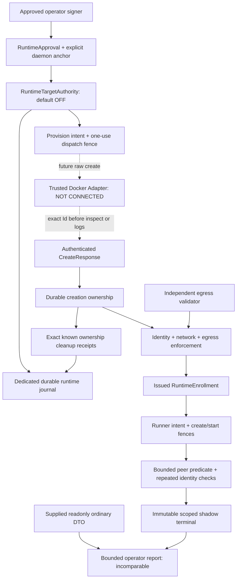

# Trusted Checker Runtime Architecture & Trusted Target Provenance — №20.1b-1

19 октября 2026 · `feature/roadmap-react` · база `4692e09f9cd867a40f3cfeb29355b9d08f2bafde`.

## 1. Executive summary

Добавлен самостоятельный пакет `trusted_checker_runtime`: **offline runtime foundation**, который проверяет chain `operator approval → durable provision intent → authenticated raw-create response → ownership → runtime identity → enrollment → authorized shadow execution`. Все входящие observations/receipts в тестах синтетические. Реальные Adapter, Runner, egress enforcer/validator и Recovery Agent **не реализованы и не подключены**. Статус: offline-validated, runtime pending; не security sign-off.

`RuntimeTargetAuthority` не использует `FakeTrustedAuthority`, `FakeExecutionBackend` или `OfflineCoordinator`. Последние сохранены без изменений. Общими остаются только immutable `trusted_checker_shadow.policy.POLICY`, canonical digest и чистый HTTP predicate. Никакого Django registration, metadata DB reader, Celery hook или записи в academic evidence нет.

Policy по-прежнему `service-bind-localhost-peer-v1`, HTTP IPv4:8080 `/`, status200, body≤1024 с удалением только завершающих LF. Её существующий digest включает **`execution_mode=offline_fake_only`**. Новый authority имеет отдельный marker `offline_runtime_contract_only`; он не переименовывает старую policy в разрешение live execution. Для №20.1b-2 нужно явно утвердить live artifact/mode и соответствующий versioned policy digest. Ни старый synthetic approval, ни approval из этих тестов не разрешают Docker.

Основные исходники повторно исследованы: Sandbox `docker_service.py:create_task_container`, `environments.py:run_environment_start`, `ledger_models.py:TechnicalCheckExecution`; shadow authority/coordinator/store/predicate; PoC `docker_adapter.py:prepare`, `state.py`, `recovery.py`, lifecycle/diagnostics и тесты. Учтены [аудит №20.0](TRUSTED_CHECKER_SANDBOX_INTEGRATION_AUDIT.md), [№20.1a](TRUSTED_CHECKER_SHADOW_FOUNDATION.md), [prepare diagnostics](TRUSTED_CHECKER_PREPARE_DIAGNOSTICS.md), [стабилизация тестов](TRUSTED_CHECKER_TEST_STABILITY_FIX.md). Старые VDS результаты здесь не перепроверялись и не используются как новое evidence.

Добавлены **13 Python-файлов и этот отчёт**; все новые:

| Файл | Назначение |
|---|---|
| `trusted_checker_runtime/__init__.py` | Пакет без bootstrap/runtime discovery. |
| `trusted_checker_runtime/profiles.py` | Immutable task-specific Target/Runner/Limits/Network profiles, egress rules/matrix digests. |
| `trusted_checker_runtime/contracts.py` | Закрытые versioned approval/intent/identity/enrollment/probe/cleanup DTO. |
| `trusted_checker_runtime/attestation.py` | Проверка authenticated receipts с раздельными signer roles/scopes. |
| `trusted_checker_runtime/boundary.py` | Чистый capture exact `Id` из supplied raw-create response, без SDK. |
| `trusted_checker_runtime/journal.py` | Отдельный durable SQLite journal, SQL immutability/replay/ownership constraints. |
| `trusted_checker_runtime/authority.py` | Provisioning/admission, identity phases, create/start fences, terminal/cleanup/revocation/report. |
| `trusted_checker_runtime/interfaces.py` | Только будущие versioned Protocol ports, без реализации I/O. |
| `trusted_checker_runtime/tests/__init__.py` | Тестовый пакет. |
| `trusted_checker_runtime/tests/support.py` | Explicit trusted test setup, управляемые часы, HMAC signers и simulated observations. |
| `trusted_checker_runtime/tests/test_provenance.py` | Approval, raw-create, ownership, duplicates, restart, adoption/revocation. |
| `trusted_checker_runtime/tests/test_execution.py` | Identity/security phases, scoped verdict, kill/deadline, replay/cleanup/correlation. |
| `trusted_checker_runtime/tests/test_isolation.py` | Процессы, kill/create synchronization, SQL guards, imports/redaction/foreign DB. |

Из существующих файлов ничего не изменено. В частности, Sandbox, Django models/migrations, Ledger, completion/achievements/платина, Celery, synthetic PoC guards и offline API остались прежними. Существовавшие untracked `docs/` и предыдущие отчёты сохранены. Docker SDK/API/build/run/cleanup, staging/production, реальные Sandbox targets, VDS evidence и historical orphan не использовались. Commit/push/rebase/deploy не выполнялись.

## 2. Runtime trust boundaries



Пунктирные edges — будущие операции. Сейчас все receipts приходят из локальных fixtures. Нет обратного ребра в CheckRun, TechnicalCheckExecution/Event, TaskAttempt, snapshots, achievements, review/AI, Roadmap или адаптацию.

Trusted inputs: installation-configured operator/adapter/enforcer/validator/recovery principals и ключи, exact daemon/endpoint anchor, immutable approved images/profiles/policy, собственный защищённый journal. Untrusted inputs: candidate IDs, names, labels, inspect content без authenticated origin, HTTP body, trainee input и supplied ordinary generation claims. JSON digest обеспечивает целостность сравнения; он **не авторизует** approval или ownership.

`ReceiptVerifier.verify` (`attestation.py`) требует exact DTO type, правильные role/scope, известный principal и HMAC-SHA256. Domain separation включает version/type/signer. Для operator, adapter, enforcer, validator и recovery используются разные principals и key material. Ключи передаются только trusted installation code, не извлекаются из approval и не сохраняются в SQLite/report. Signer implementation имеется **только в tests/support.py**. Runner не получает ключей и не подписывает собственные control-plane claims.

Это authenticated local boundary, **не криптографическая аттестация Docker/kernel/host**. Verifier знает симметричные ключи и входит в TCB. Злоумышленник с ними, доступом к trusted Python process или journal owner может подделать цепочку. Разные HMAC keys не доказывают независимость процессов или host validator: это отдельный deployment gate.

| Угроза | Проверяемая защита сейчас | Остаточное ограничение |
|---|---|---|
| Existing container выдают за созданный authority | Issued immutable intent + consumed dispatch + authenticated exact response + ownership обязательны до enrollment. Candidate conversion отсутствует. | Честность origin adapter — TCB; живой adapter ещё отсутствует. |
| Labels/name/inspect подменяют ownership | `capture_create_response` принимает только full64 `Id`; authority связывает permit/intent/daemon/image. | ID сам не доказательство creation; подпись от trusted adapter обязательна. |
| Retry после lost create | Dispatch intent committed до внешнего действия; повторный fence отвергается, circuit закрыт. | Физический Docker create не проверен; unknown ID нельзя найти по labels и принять. |
| Target restart/substitution | Полный enrolled snapshot, StartedAt/RestartCount, generation/binding, daemon session, EndpointID/IP сравниваются на пяти фазах. | Между snapshots возможны невидимые краткие изменения. |
| Root target вмешивается в peer traffic | Task-specific target без caps, dedicated topology, host egress/anti-spoofing и отдельный validation receipt обязательны. | Правила и kernel enforcement пока только контракт. |
| Internal bridge принимают за egress isolation | Кроме network receipt нужны enforcer и отдельный validator с полным matrix digest/case set. | Структурно корректные тестовые receipts не доказывают работающий firewall. |
| Kill/timeout потерял поздний create ID | Поздний authenticated ID записывается только как ownership/quarantine; terminal immutable. | Отправленный SDK call нельзя отозвать задним числом. |
| Cleanup удаляет target вместо runner | Раздельные ownership domains и context/daemon/exact ID/receipt checks; authority не имеет delete method. | Реальный remover/verifier ещё предстоит реализовать. |
| Shadow даёт учебный зачёт | Нет legacy writer/DB/API; operator-only bounded report. | Реальные SELECT grants/auth service не реализованы. |
| HTTP forgery даёт лишние гарантии | Passed только external IPv4 observation; authenticity unproven/local unverified/persistence unverified. | Static/dynamic responder способен удовлетворить поведенческий predicate. |

## 3. Operator approval

`contracts.py:RuntimeApproval` — frozen, schema1, mode `offline_runtime_contract_only`; `register_approval` проверяет authenticated operator и exact installation anchor. Новая DB OFF; регистрация approval не включает её.

| Поле | Контракт |
|---|---|
| `approval_uuid`, `operator_principal` | Canonical UUID; установленный `operator:…`, совпадающий с signer и текущим authority principal. |
| `scope` | Только `test-shadow-*` или `staging-shadow-*`; prod/production/live tokens запрещены. Synthetic `poc-*` не принимается. |
| `daemon` | Exact daemon ID, explicit `endpoint:…` reference, digest защищённой endpoint/transport configuration, trusted agent `session_uuid`. Нет URL/socket auto-discovery и `from_env`. |
| `target_image_id`, `runner_image_id` | Разные immutable `sha256:` +64hex. Registry digest/source correspondence должны быть подтверждены отдельно; mutable tags не принимаются. |
| `checker_source_digest` | Full SHA-256 source/artifact binding; будущий adapter проверяет его в probe receipt вместе с image. |
| `network` | Полный dedicated internal bridge profile: exact full64 NetworkID, имя `tc-shadow-pilot-*`, RFC1918 /24–/28, distinct numeric target/runner IP и egress enforcement reference. |
| `task`, `policy_id/version/digest` | Ровно `l1/service-bind-localhost` и текущий immutable peer-v1 contract. Bool вместо integer version отвергается. Нет synthetic/legacy fallback. |
| `target/runner_profile_digest` | Ровно digest immutable профилей этого пакета. |
| `limits` | Fixed CPU/memory/PID, HTTP2s/API3s/run8s, max concurrency1. Изменение требует версии контракта. |
| `created_at`, `expires_at` | Finite positive timestamps, lifetime≤3600s; registration/admission/start/publication проверяют expiry/revocation. |
| `digest` | SHA-256 canonical JSON всех полей; вычисляемое property, не отдельно доверяемая строка. |

Approval не содержит credentials, TLS keys или raw transport paths. Endpoint reference разрешается **будущим** trusted installation provider в заранее approved config. Совпадение названия scope не доказывает, что endpoint действительно non-production/dedicated: это обязанность оператора, а не эвристика по имени. Неподтверждённую среду нельзя разрешать созданием подходящего DTO.

Session UUID — новая control-plane incarnation, а не Docker `info.ID`. Надёжный agent должен изменять/отзывать её при daemon restart, потере событий или непрерывности transport. Случайно сгенерировать новое session поле при каждом inspect нельзя. Получение надёжного session evidence пока prerequisite; текущий код лишь отвергает несовпадение с установленным anchor.

## 4. Target provisioning state machine

`authority.py:provision/begin_create/create_fence/record_create_response/verify_provision/enroll` и `journal.py:RuntimeJournal` реализуют:

```text
approved (зарегистрированный approval document; flag отдельно)
  → intent_recorded
  → create_requested + persisted DispatchPermit
  → persisted create_dispatch BEFORE future RAW create
  → exact_id_recorded + creation ownership receipt
  → persisted one-use initial target_start_dispatch
  → identity_verified
  → enrolled

lost/late/unproven outcome → quarantined; cleanup отдельно
```

Intent хранит provisioning UUID, stable sandbox instance/attempt/owner/task, authority-created runtime binding и generation UUID, approval digest, immutable image/network/policy/profile, fingerprint, created/deadline. Canonical target key — instance+attempt; иной owner/approval payload с тем же key конфликтует. Один request UUID с другим payload также конфликтует. Unique rows и `BEGIN IMMEDIATE` сериализуют процессы. Один target на pilot journal сохраняется до подтверждённого closure; это ограничение staging pilot, не general orchestration.

`create_fence` имеет две короткие фазы: сначала отдельный commit dispatch intent, затем проверка flag/epoch/expiry/deadline под mutation gate и yield **фиксированного** CreateIntent. Уже committed dispatch не исчезает при исключении внутри следующей transaction. Повтор dispatch запрещён даже если вызов фактически не успел отправиться. Это сознательная at-most-once invocation/fail-closed ambiguity; не exactly-once физическое исполнение.

`boundary.py:capture_create_response` не вызывает Docker. Он принимает supplied raw dict только с `Id` и optional `Warnings`, требует full64 `Id`, отбрасывает warnings и не ищет fallback `id`/Name/labels. Будущий adapter обязан вызвать RAW SDK create, немедленно capture/sign/передать ownership, **перед** secondary GET/inspect/log I/O. Текущий PoC использует этот порядок в `trusted_checker_poc/docker_adapter.py:prepare`; новый пакет его не вызывает.

`record_create_response` проверяет issued dispatch, exact context/permit/resource/intent digest/daemon/image, время и signer; ownership — первая durable запись returned ID. Никакой диагностический I/O не предшествует ей. При ошибке persistence исходный intent остаётся blocking; возвращается константный `ownership_persistence_unconfirmed`. Можно повторно зафиксировать **тот же** известный exact signed response, но нельзя повторить create. Изменённый ownership response конфликтует.

Поздний exact ID после deadline/kill/revocation сохраняется как owned/quarantined для cleanup, не допускается к start/enrollment. Если response вообще неизвестен, lookup/list/prune/adopt отсутствуют. Quarantine не снимается таймером. Исторические orphan не импортируются.

Initial target start — отдельный `target_start_fence`: только новый owned target, один persisted dispatch до будущего bounded start, повтор/restart запрещён. Это необходимый новый lifecycle step: безопасный RAW create ещё не означает running app. Нельзя подменять create+start существующим Sandbox `containers.run`, где дополнительные SDK actions могут случиться до capture ownership.

Ownership domains: `authority_created_target` и `shadow_runner` хранят отдельные exact receipts; `sandbox_task_ownership=not_claimed` всегда. Authority не удаляет ни свои targets, ни обычные Sandbox containers. Она лишь принимает authenticated cleanup confirmation от будущего recovery agent для уже известного owned объекта. Активный enrolled target не допускается к cleanup; сначала explicit binding revocation/quarantine.

## 5. Enrollment и generation

`TargetSnapshot` включает attempt/owner/task/instance, full64 container/image IDs, daemon/endpoint/session, authority binding+generation, Docker StartedAt и RestartCount, Running/Paused/Restarting/Dead, exact network/EndpointID/IPv4 и allowlisted RuntimeConfig/policy. В отличие от current Sandbox application `started_at` это именно Docker timestamp; Sandbox `restart_count` не используется как Docker RestartCount.

Enrollment требует creation receipt, initial start intent, running target без paused/restarting/dead, RestartCount0 и StartedAt в окне созданного intent; единственный target endpoint; exact task profile. `RuntimeEnrollment` выдаётся и сохраняется authority, включает creation receipt UUID/digest, policy/approval и полный baseline. Frozen dataclass, labels, DTO constructor или корректный digest сами по себе enrollment не создают: `_verify_enrollment` сверяет выданный immutable document и current authority state.

Пять обязательных identity phases:

| Phase | Обязательная проверка |
|---|---|
| Enrollment | `verify_provision` + current approval/ownership/initial start, полный signed identity/network/enforcer/validator bundle. |
| Перед runner create | `check_target(BEFORE_CREATE)`, затем `begin_create/create_fence` требуют актуальный committed phase и daemon receipt. |
| Перед runner start | `check_target(BEFORE_START)` + created runner profile/ID, `authorize_start/start_fence`, current flag/epoch/binding/deadline. |
| После HTTP probe | `check_target(AFTER_PROBE)` сравнивает target и runner с baseline; live/exited runner допустим только после доказанного live endpoint. |
| Перед публикацией | `check_target(BEFORE_PUBLISH)` и `publish` повторяют gate/freshness/issued enrollment checks. |

Observation age≤3s, absolute run budget≤8s. Любое target tuple mismatch в execution phase фиксирует immutable unknown. Непринятый runner-live/probe receipt также закрывает run в unknown; повтор правильного receipt не повышает его до passed. Новое измерение имеет новый sample slot и допускается только при здоровом scope. Initial enrollment rejection оставляет не-enrolled target; никакого результата стажёру не создаётся.

Docker restart с прежним ID обнаруживается по изменению StartedAt/RestartCount; новый create по тому же имени/IP не переносит binding. EndpointID/IP и лишние attachments проверяются отдельно. Running=false, Paused/Restarting/Dead дают отказ. Даemon session change не превращается автоматически в новую approval.

Snapshots фиксируют ограниченное bracket evidence, **не непрерывную аттестацию**. На live boundary для detection короткого detach/rejoin понадобятся защищённые events/anti-spoofing/enforcement и policy об event gaps. Даже все совпавшие samples не доказывают отсутствие любого временного изменения; terminal явно `continuous_attestation=false`.

## 6. Target/runner security profiles

`profiles.py:TargetProfile/RunnerProfile/Limits`, `contracts.py:RuntimeConfig/expected_config` фиксируют весь allowlisted config, проверяемый будущим adapter на created/live/finished фазах. RuntimeConfig digest fields — нормализованная конфигурация из trusted adapter, не claims target. `host_mounts` должен считать **все non-tmpfs mounts**, включая named volumes, а не только bind mounts.

| Параметр | Новый pilot target | Будущий runner |
|---|---|---|
| Image | Approved target `sha256:…` | Другой approved runner `sha256:…` + checker source digest |
| User/rootfs | `0:0`, writable, app/config editable | `10001:10001`, read-only |
| Privileges | privileged=false, drop ALL, no additions, nnp | То же |
| PID/IPC | Private | Private |
| Mounts/socket | Non-tmpfs0, socket отсутствует | Non-tmpfs0, socket отсутствует |
| tmpfs | `/tmp`128MiB, `/run`64MiB; noexec,nosuid,nodev | `/scratch`1MiB, uid/gid10001, mode0700, noexec,nosuid,nodev |
| Command | Empty entrypoint, fixed `/start.sh` | Fixed Python isolated command `/checker/service_bind_peer.py`; empty command override |
| Environment | Empty explicit environment | Empty explicit environment; никаких proxy/credentials |
| CPU/memory/PID | 1 CPU /768MiB /256 | 0.25 CPU /64MiB /32 |
| Logs/protocol | Fixed bounded config16KiB/1file, 4096-byte control output | 16KiB/1file, protocol4096, HTTP body1024 до normalization |
| Network | Один approved target endpoint | Один approved runner endpoint, egress только target8080 |

Это **новый предлагаемый profile**, не уже проверенная совместимость старого Sandbox. Сейчас `sandbox/services/docker_service.py:80` создаёт target по mutable tag, не задаёт explicit task network, drop только AUDIT_WRITE/MKNOD, tmpfs `/tmp,/run`; задача даёт root-shell и изменяемое приложение (`training_tasks/l1/service-bind-localhost/Dockerfile`). У нового профиля caps строже. Совместимость tools/manual solutions и поведения tmpfs/command требует отдельных runtime tests; synthetic adapter guards не ослаблялись.

Entry command задачи удаляет `/start.sh` после первого запуска (`files/start.sh`). Поэтому Docker restart не эквивалентен Sandbox reset и не считается допустимым reuse generation. `RunnerProfile` фиксирует **проект artifact**, его image/entrypoint ещё не существует в реализации; никаких Dockerfiles/builds этой задачей не добавлялось.

## 7. Network topology и egress

Pilot требует dedicated non-production daemon без чужих недоверенных workloads, отдельную internal bridge `tc-shadow-pilot-*`, один target и максимум один runner. Существующая `training-platform-runtime` недопустима. Profile фиксирует точные NetworkID/subnet/targetIPv4/runnerIPv4; NetworkEvidence должен содержать ровно ожидаемые endpoints. Созданный до start runner не получает выдуманный live EndpointID; live endpoint обязан быть наблюдён после start. Extra networks учитываются как `RuntimeConfig.network_count` и как network membership list.

Internal=true — необходимое, но недостаточное условие. Proposed enforcement `host_nftables_bridge_v1` действует **вне изменяемого target**: default deny для runner, allow только numeric approved targetIP:8080 и established response; deny других портов/IP, host gateway/services, platform DB/Redis/Django, metadata, DNS/IPv6 и L2/IP spoofing. Правила должны учитывать bridge traffic, cross-bridge/host paths и direct same-bridge peers; обычной проверки FORWARD chain недостаточно. Реальная схема nftables/interface matching, namespace/host permissions и fail-closed установка ещё не реализованы.

`_check_bundle` принимает **два** egress authority records:

1. `EgressEvidence`: установленный rules digest, target tuple digest, runner ID (если создан), daemon/profile/reference, default-deny/only8080/deny-host-platform-metadata/anti-spoofing flags.
2. `EgressValidation`: другой signer/key, ссылка именно на этот enforcement receipt, approved validation matrix digest и полный ordered case set: allow_target_8080, deny_other_target_ports, deny_other_ipv4, deny_host, deny_metadata, deny_db_redis_django, deny_dns, deny_ipv6, deny_spoofing.

Matrix method предусматривает independent host-rule readback **и** active peer connectivity checks. Поле enforcer `validation_digest` — только его внутренний evidence reference; оно не заменяет отдельный validator receipt. Пустой/частичный case set, чужой enforcement digest, подменённые endpoints или отсутствие validator отвергаются до admission/start/pass.

В тестах ни одно из этих правил физически не установлено и ни один network packet не отправлен. До live pilot нужно спроектировать, как validator безопасно выполняет negative matrix до runner admission, затем проверяет per-run rules и continuity без расширения egress runner. Закрытый набор signer DTO не является доказательством сетевой изоляции.

## 8. Runtime adapter interfaces

`interfaces.py:INTERFACE_VERSION = trusted-checker-runtime-boundary-v1`; Protocol declarations без SDK, RPC, HTTP clients и implementations:

| Port | Trusted inputs и допустимые операции |
|---|---|
| `RuntimeAuthorityV1` | Authenticated approval, typed provision/run; выдаёт immutable intents/enrollment/permits, revokes binding/kill. |
| `RuntimeDockerAdapterV1` | Только issued fixed CreateIntent/DispatchPermit, approved enrollment и StartPermit; exact daemon observation, raw create capture, observe target, один initial owned-target start и runner start внутри authority fence. |
| `TrustedHTTPRunnerV1` | Policy-bound enrollment; только bounded result protocol, не authenticated receipt; numeric IPv4/8080 `/`, no DNS/proxy/redirect resolution. |
| `RuntimeShadowBackendV1` | По issued run ID наблюдает owned runner и валидирует bounded protocol/identity; подписывает filtered ProbeResponse через trusted adapter boundary. |
| `EgressEnforcerV1` | Только approved topology/binding/phase, attests installed rules. |
| `IndependentEgressValidatorV1` | Читает exact enforcement receipt, независимо проверяет readback/negative matrix. |
| `CleanupRecoveryAgentV1` | Только известный ownership receipt digest; возвращает exact confirmed-removal evidence. Никакого arbitrary ID/remove/list/adopt/start API. |
| `OrdinaryMetadataReaderV1` | Только AttemptReference → bounded readonly OrdinaryMetadata; без DB connection/queryset/writer в authority. |

Concrete authority дополнительно предоставляет `create_fence`, `target_start_fence`, `runner_create_intent`, `check_target`, `start_fence`, `record_runner_live`, `record_probe`, `publish`, `expire_run`, `abandon_run`, `record_cleanup`, `report`. Fence сам не исполняет callbacks/SDK и не ограничивает hostile caller; будущая trusted composition обязана поместить **только** соответствующую fixed bounded mutation внутрь gate. Это не безопасный plugin host. `OfflineCoordinator` не получил runtime injection point.

Ошибки validation/auth/state представлены `profiles.py:Denied` с константными reason codes; arbitrary exceptions/body/inspect не импортируются в report. Runtime transport ещё должен map timeout/decode/API/storage failures в finite classes, закрывать run через unknown/quarantine и не маскировать их под технический failed. Denied/foreign malformed receipts не разрешают fallback к legacy checker.

Fences проверяют flag/epoch/binding/deadline и consume durable dispatch/start **до** side effect. No repeated create/start on crash. Gate сериализуется SQLite; будущие API calls обязаны иметь bounded timeout≤3s и runtime cancellation policy. Это сохраняет intent при crash, но **не доказывает hard wall-clock finish**: scheduling, locks, kernel/client behavior и уже отправленный remote call остаются вне гарантии. Постоянный clock highwater отсекает обнаруженный rollback; он не заменяет production monotonic deadline/clock integrity design.

## 9. Shadow state/correlation

`RuntimeJournal` принимает только отдельный `*.runtime.sqlite3`, новый файл0600, symlink отвергается; existing DB сначала открывается read-only для проверки точного набора tables/marker `trusted_checker_runtime_provenance_offline_v1`/version1. Foreign/Django-looking DB отвергается без изменения bytes. Схема и guards создаются одной transaction; миграций приложения нет.

| Table | Authority |
|---|---|
| `rt_meta`, `rt_control` | Store version; defaultOFF/epoch и clock highwater. |
| `rt_documents` | Append-only approvals/intents references, permits, ownership, baseline/enrollment, per-phase snapshots/receipts refs, sanitized probe/cleanup. |
| `rt_objects` | Immutable target/run intent bindings, mutable lifecycle и separate cleanup; terminal immutable. |
| `rt_requests`, `rt_claims` | Request aliases и canonical target/sample uniqueness. |
| `rt_ownership` | Exact created IDs в раздельных domains, unique daemon/container ownership. |
| `rt_receipts` | Receipt UUID/digest/context/purpose; replay с иной семантикой запрещён. |
| `rt_revocations`, `rt_audit` | Append-only revocations и finite event codes/timestamps. |

SQL triggers запрещают UPDATE/DELETE append-only records, удаление object, изменение binding/fingerprint/epoch/deadline и terminal result/phase. Terminal cleanup может обновляться отдельно. Это защита от ошибок application writers, не от владельца SQLite-файла, способного удалить guards/заменить DB. Нет production reader role, migration/backup/retention/HA/metrics service. Подготовленный journal path должен быть в private operator directory; проверка symlink не обещает защиты от hostile filesystem owner/race.

Связь сохранена до issue/create: `shadow_run_uuid (= runner intent UUID) → saved RuntimeEnrollment → provisioning UUID/binding/generation/attempt → optional ordinary execution UUID/CheckRun ID`. Dedupe run key — enrollment+sample slot+ordinary execution; fingerprint включает owner/request/enrollment, иной payload конфликтует. Explicit resample требует новых request UUID/sample slot, не обходит circuit breaker.

`OrdinaryMetadata` содержит только attempt refs, optional CheckRun/execution IDs, verdict/timestamp, optional **claimed** binding и legacy scope. Поля `same_generation_proven`/correlation_quality на input отсутствуют. Authority не подтверждает такую claim по строке UUID: report максимум `same_attempt_temporal` при наличии anchor+timestamp, иначе unpaired; чужой binding — generation_mismatch. Comparison всегда incomparable, включая coincident timestamps и identical supplied binding. Существующий `TechnicalCheckExecution` (`sandbox/ledger_models.py:89`) не хранит trustworthy Docker generation; добавлять её задним числом нельзя.

`report` — allowlisted JSON≤16384 bytes, policy/approval/target/ownership/correlation refs, lifecycle/deadline и последние16 finite audit events. В journal сохраняются bounded per-phase snapshots и digest authenticated receipt, не raw signatures/ключи/raw HTTP body/SDK response/Config.Env/HostConfig/stdout/errors или ответы стажёра. Probe body существует только в in-memory typed receipt; wrong body не сохраняет response_digest. Совпавший bounded policy body может иметь digest. HMAC receipt digest фиксирует authenticated envelope; это не архив arbitrary body. Исключения не копируются в diagnostics. Report читает только собственный approval operator scope; production authenticated transport/viewer ещё отсутствует.

Passed всегда `external_ipv4_http_only`, local_access=unverified, application_authenticity=unproven, persistence=unverified, mode offline_runtime_contract_only. Это даже не live HTTP observation на этом этапе, а результат fixtures; не полный technical pass и не путь к платине.

## 10. Kill/recovery semantics

Flag OFF хранится в journal. `set_enabled` увеличивает epoch при каждом explicit change; disable→enable не оживляет старые run permits. `kill` закрывает admission/create/start; approval и binding могут быть отозваны независимо. `publish` заново проверяет epoch/deadline/approval/binding/freshness и не принимает late positive после отмены. Terminal CAS/SQL guards сохраняют любой уже terminal outcome, включая unknown.

Persisted create/start intents предшествуют выдаче будущего вызова; mutation gate сериализован с kill. Уже начавшийся gate/call может завершиться до того, как kill получит lock, и ответ может прийти после disable. Поздний exact authenticated ID разрешено учесть только для ownership/cleanup; это не разрешение start или verdict. Протестирована эта linearization двумя threads с explicit Events и watchdog, без sleeps. На production blocking SDK нужен отдельный bounded adapter; замораживание произвольного thread здесь не реализовано. SQLite transaction имеет busy timeout1s: если journal занят дольше, control change может завершиться ошибкой и не считается применённым kill. До подключения SDK с API budget3s нужно отдельно решить надёжный control channel/retry и lock budget, не обещая мгновенного disable по самому факту вызова метода.

Circuit breaker journal-wide закрывает новые shadow launches при unresolved dispatched create/quarantine или terminal pending/quarantined cleanup. Max parallel1 включает active run; дедупликация не создаёт новый run. Нет TTL release, force, list-by-labels, повторного start/create или учебной блокировки Sandbox. Неразрешённое начатое действие требует operator/recovery intervention. `expire_run/abandon_run` фиксируют unknown; фонового watchdog/coordinator scheduler в пакете нет.

`record_cleanup` работает после disable/expiry/revocation и даже при новой installation session для старого approval: он проверяет authenticated recovery principal, exact known receipt domain/context/daemon/containerID/ownership digest и confirmed-removal evidence digest, не текущий launch gate. Неизвестный outcome не снимает lease. Runner должен быть terminal, target quarantined; активный enrolled target не удаляется. Cleanup изменяет только отдельный status/receipt/audit, не terminal.

**Docker orphan recovery не реализована.** Если create response потерян и ID неизвестен, подтверждение cleanup невозможно. Будущий recovery требует независимое daemon create evidence/защищённый raw trace, exact candidate verification и cleanup-only восстановление ownership; labels, name, NotFound после потерянного remove-ответа и истечение срока недостаточны. Existing PoC `recovery.py` не вызывается и не ослабляется. Два historical orphan остаются вне journal/fixtures/actions.

Safe rollback для будущего pilot: disable/revoke launch capability, cancel future gates, учесть late responses и exact owned resources, сохранить recovery credentials/state до closure/quarantine, затем отключить viewer/service. Никаких compensating writes в учебную историю, grants или snapshots.

## 11. Security test results

Выполнены локально из project root:

```sh
.venv/bin/python -W error::ResourceWarning -m unittest discover -s trusted_checker_runtime/tests -t .
.venv/bin/python -W error::ResourceWarning -m unittest discover -s trusted_checker_shadow/tests -t .
.venv/bin/python -m unittest discover -s trusted_checker_poc/tests -t .
```

| Suite | Фактический результат |
|---|---|
| Новый runtime foundation | **66 tests, OK**, без skips/ResourceWarning; final5.963s. |
| Существующий shadow foundation | **56 tests, OK**, без skips;2.894s. |
| Существующий PoC | **166 tests, OK**, без skips;8.655s. |
| Всего | **288 tests, OK**; Docker integration не запускалась. |

Локальные логи: `/tmp/task201b1-runtime-tests.log`, `/tmp/task201b1-shadow-tests.log`, `/tmp/task201b1-poc-tests.log`. Не deployment/evidence package; тестовые SQLite удаляются owned TemporaryDirectory после join processes/threads. Два spawned Python process проверяют общий SQLite mapping; один отдельный локальный Python проверяет imports с запрещёнными socket/subprocess calls **внутри импортируемого пакета**. Эти процессы не запускают Docker/HTTP/Django.

Покрытие содержит subtests, поэтому66 — число unittest methods, не число отдельных negative inputs:

| Группа | Assertions |
|---|---|
| Approval/auth | Forged signature/digest, unknown signer, role/key/scope separation, expiry, daemon/endpoint/config/session mismatch, production/synthetic scope, mutable image/changed policy/profile/version/limits/network. |
| Provision/ownership | DefaultOFF, duplicate/restart/concurrent threads+processes, owner payload conflict, raw-create shape/short ID/alternative fields, forged/wrong permit/image/domain/daemon receipts, missing dispatch, lost response, failed SQLite ownership persistence, late ID/deadline/kill, immutable ownership. |
| Enrollment | Existing ID/labels adoption denied, initial start one-use, missing chain, wrong image/config/network, nonzero restart, pre-create StartedAt, stopped/paused; issued enrollment survives restart, forged enrollment/foreign owner/attempt/scope denied, approval/binding revoke. |
| Identity phases | Every target tuple dimension включая StartedAt/RestartCount/EndpointID/IP/extra attachment/session; checks перед create/start, после probe и перед publication; mismatch никогда не passed. |
| Runner | Root/RO/privileged/caps/nnp/PID/IPC/mount/socket/tmpfs/command/env/resource/network/log/output mutations, paused/restarting/dead/restart/StartedAt/endpoint drift, fast exit без live endpoint не принимается. |
| Network | Internal/driver/profile/endpoints, deny flags/rules binding, wrong runner, missing/partial/replayed validator relation; enforcer не может подменить validator. |
| Lifecycle | Kill before create/start и во время simulated create, changed epoch/re-enable, deadline boundary/stale observation, create/start crash intents survive rollback, immutable unknown/late ownership/replay, pending/foreign cleanup, recovery after disable, new sample circuit. |
| Predicate/correlation | Scoped HTTP pass/wrong status/body/redirect/oversize/incomplete/timeout, wrong probe source cannot retry into pass; ordinary supplied matching binding не даёт generation proof, foreign binding incomparable. |
| Isolation | SQL terminal/append-only guards, foreign Django-looking DB byte-identical, dedicated path0600/symlink denial, bounded redacted report/journal, AST no legacy/SDK/network/process imports, fresh import without runtime calls. |

На подготовке исправлены canonical tuple/list normalization persisted DTO и тестовый import-check: reload DTO modules внутри общего interpreter менял Python type identity; он заменён свежим изолированным Python process. Негативные profile cases выполняются каждый на отдельном полном fixture chain, чтобы первый отказ не маскировал следующие cases уже terminal run. Production guards ради тестов не ослаблялись.

Проверка SHA-25657 baseline files подтвердила неизменность всех исходников `trusted_checker_shadow/`, `trusted_checker_poc/` и четырёх предыдущих отчётов; tracked Git diff пуст. Добавленный AST/import test разрешает из старого пакета только pure policy/predicate. Для отчёта проверены13 разделов, парность fenced blocks, whitespace и базовая структура Mermaid delimiters; полноценный Mermaid renderer/parser не запускался. `.env`, credentials, рабочие БД и Docker sockets не читались. Новых Django regression runs не было: текущая задача не подключает Django, а прежние результаты №20.1a не объявляются новыми проверками этого пакета.

## 12. Residual risks и принципиальные ограничения

1. **Existing Sandbox target без изменения provisioning.** При отсутствии trusted creation chain privileged operator не может получить enrollment **этого** authority одним inspect/label/DB ID. Можно лишь оформить candidate диагностику вне admission. Если существует независимый contemporaneous signed create journal, нужна отдельная reviewed import/recovery схема; в этом API её нет. Одобрить новую архитектуру ручного existing-target trust можно как новое решение, но нельзя выдать его за доказанную creation provenance.
2. **Невосстановимые historical facts.** Текущие `container_id`, names, StartedAt или restart_count не восстанавливают original raw create response/attempt ownership, первый image digest/build correspondence, daemon endpoint/session в тот момент, прошлые network endpoint generations, hidden restarts/detach, bytes исполнившегося mutable checker и точное observation window обычного CheckRun. Совпадение нынешнего состояния не заполняет эти пробелы. Новые binding UUID нельзя задним числом приписывать старым results.
3. **Автоматическая Sandbox integration требует provisioning work.** Сейчас `create_task_container` использует tag+`containers.run`, а `environments.py:316`/`:416` записывают SDK ID после start/terminal provisioning; общей DB/Docker transaction нет. Нужны runtime-agent authority и durable approval/intent до create, raw ID receipt до GET/start, initial start/identity snapshot, explicit daemon/network/image profile, связанный с environment operation/attempt generation journal, cleanup ownership и event-gap policy. Ordinary execution потребует своего trustworthy target identity receipt для stronger correlation. Это отдельное изменение Sandbox provisioning/workflow; оно здесь не выполнено и не разрешено автоматически.
4. **Отдельная test VDS без Django.** После отдельного approval можно создать новые task-specific test targets через authority-owned standalone provisioner, использовать opaque test attempt refs, проверить raw-create/start/runner/network/kill/cleanup и supplied metadata. Нельзя назвать такие refs реальными Sandbox attempts или заявить Django integration/academic regressions. Сейчас ни VDS, ни transfer/build/run не выполнялись; №20.1b-2 требует отдельного задания.
5. **Shared daemon и socket holders.** Existing Celery worker (`docker-compose.yml`) и ttyd (`docker_service.py:create_terminal_container`) имеют Docker socket. Любой такой holder способен менять/создавать containers, networks/privileges и обходить локальные labels/profile checks; authority не создаёт isolation от daemon administrator. Dedicated daemon и исключение чужих socket holders обязательны для выбранного pilot. Для запрета socket у всего legacy worker/ttyd нужен отдельный constrained runtime/exec gateway refactor. Переезд только shadow Broker или удаление одного mount не доказывают этого свойства.
6. **Docker daemon identity.** `info.ID` — операционный identifier из доверенного endpoint, не криптографическая аттестация daemon/host; он может пережить daemon restart и быть подделан скомпрометированным endpoint. TLS peer/config binding, host identity и защищённая agent session/event continuity нужны отдельно. Тест session mismatch проверяет authority contract; надёжное detection настоящего restart пока не реализовано.
7. **Неразрушающие runtime checks.** На будущем boundary возможны info/inspect по exact known ID, Image/State.StartedAt/RestartCount/flags, NetworkSettings NetworkID/EndpointID/IP, normalized HostConfig, external network membership и protected daemon events — без stop/restart/exec и без чтения target filesystem. Такие reads всё равно содержат TOCTOU и могут временно быть недоступны; в report должны попадать только allowlisted fields. Enforcer/validator имеют отдельные полномочия. Никакие live reads в этой задаче не проводились.

Дополнительные пределы: нет живого immutable runner artifact, HTTP client/protocol decoder, resource enforcement, host firewall/validator, transport auth service, deployment role separation, durable raw-response sidecar/recovery неизвестного ID, production watchdog/clock design/metrics, migration/backup/retention/HA. API timeouts и limits пока constraints, не измеренные SLA. HMAC signatures fixtures не доказывают kernel isolation/image correspondence/физическое at-most-once. SQLite tests не подтверждают PostgreSQL semantics. Behavioral HTTP match не доказывает app authenticity, loopback criterion или persistence; платина остаётся выключенной.

## 13. Prerequisites и безопасный план №20.1b-2

Этот раздел — план для review, **не выполняется** частью №20.1b-1.

1. Утвердить architecture/TCB и узкий peer-only predicate. Выбрать dedicated non-production daemon без чужих socket workloads; exact endpoint/daemon/session trust source, images/source correspondence, network/resources и new live-mode policy approval. Старые synthetic/offline approvals не переносить.
2. До runtime подготовить reviewable adapter/runner/provisioner design: explicit endpoint resolution без env discovery, bounded raw SDK create capture, separate initial target start, normalized profile checks во всех фазах, strict bounded runner protocol без credentials/target exec. Уточнить journal atomicity/crash behavior, monotonic/deadline/cancel/transport error mappings и initial target lifecycle budgets.
3. Спроектировать host egress/anti-spoofing с independent readback+active negative validation, защищённый validator lifecycle, no-connect path к DB/Redis/Django/host/metadata, extra attachment/event-gap detection. Не считать internal=true достаточным. Reject admission при любой непроверенной topology.
4. Спроектировать exact known-ID cleanup и unknown-create recovery: protected contemporaneous create evidence, ownership-only reconciliation без повторного start/verdict, quarantine hold, safe report/redaction, backup/retention/metrics и kill/rollback runbook. Никакой discovery/adoption исторических контейнеров.
5. Сначала расширить offline negative/contract tests будущих implementations; сохранить66/56/166 основы и unchanged academic writers. Если нужна автоматическая связь с настоящим Sandbox, отдельно согласовать prerequisite provisioning/ordinary identity instrumentation и readonly metadata reader. Standalone VDS pilot возможен без Django с явными test refs.
6. Подготовить конкретный runtime plan **до исполнения**, с exact approved resources/artifacts, лимитом1, stop conditions, ownership accounting и отдельным разрешением build/run/cleanup. Не запускать текущий synthetic `integration.Runtime` на Sandbox targets.
7. Только после разрешения: read-only preflight approved daemon/transport/session/images/profile; negative admission checks без mutations. Затем approved isolated network+host enforcement/independent validation. Новое target create: persisted intent → raw response → ownership → one-use initial start → inspect/enrollment. Существующие targets не принимать.
8. Выполнить ограниченные cases: loopback broken → scoped fail; corrected wildcard/manual legitimate listener → scoped pass; wrong port/body/stopped; forged responder как documented limit. Проверить реальные runner UID/caps/nnp/RO/mount/socket/resources/live endpoint, fixed HTTP без DNS/proxy/redirect, actual log/body/API/deadline bounds.
9. Затем контролируемые duplicate/reset/restart/endpoint/kill/lost-response/cleanup cases только в approved test scope. Integrity failure, unknown create, unresolved ownership/cleanup или validator gap немедленно закрывают новые admissions. Невозможные daemon faults оставить fake-only/inconclusive; не получать зелёный runtime искусственной задержкой fast runner.
10. Учитывать каждый exact newly owned object, отдельно подтвердить cleanup либо quarantine; rehearse rollback/recovery after disable, сохранить новые filtered receipts и coverage gaps. Historical orphan и прежние VDS evidence не менять. Оценить результаты на review; production, post-check hook/outbox/full-task predicate/платина требуют отдельных решений.

**№20.1b-1 завершена на offline foundation. Остановка для review; №20.1b-2, Docker и подключение к настоящему Sandbox не начаты.**
