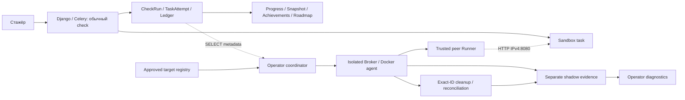

# Trusted Checker → Ticket Sandbox: аудит и проект shadow mode

Задача №20.0 · 19 октября 2026 · ветка `feature/roadmap-react`.

База аудита: `4692e09f9cd867a40f3cfeb29355b9d08f2bafde`.

Статус: **проект для согласования; реализация №20.1 не начата**. Единственный создаваемый артефакт проекта — этот отчёт. Код, модели, migrations, workflow и runtime PoC не менялись. Docker, production, VDS evidence и исторические orphan-контейнеры не использовались. Уже существовавшие untracked-каталоги `docs/` не относятся к аудиту.

Метод: чтение исходников и конфигураций, поиск связей и существующих тестов. Номера строк относятся к указанной базе; запись `путь:строка` обозначает исходную точку реализации. Runtime-свойства установлены только в пределах, явно следующих из кода. `.env`, credentials и содержимое рабочих БД не читались. Существующие тесты изучены, но в рамках read-only аудита не запускались; результаты предыдущей VDS-проверки ниже — входной контекст пользователя, а не повторно полученные доказательства.

## 1. Executive summary

**Первое ограниченное внедрение: отдельный операторский shadow coordinator вне HTTP/Celery workflow Sandbox, только для `l1/service-bind-localhost`, сначала fake-тесты, затем отдельно одобренный staging runtime.** Платформа предоставляет только минимальный снимок метаданных для чтения. Coordinator и Broker записывают результаты в отдельное хранилище; обратного канала записи в учебные результаты нет.

Прямое подключение текущего PoC к `TaskAttempt.container_id` **сейчас недопустимо без изменения доверенной архитектуры интеграции**. ID имеет полезное происхождение — SDK возвращает его платформе после создания контейнера, — но отсутствуют закреплённые daemon identity, image identity, полная runtime generation, trusted enrollment и проверяемая связь creation → attempt → target. Кроме того, PoC предназначен для synthetic target в одобренной internal-сети; Sandbox создаёт другое приложение, с другой сетевой конфигурацией и tmpfs mounts.

Наиболее существенные факты:

1. Пользовательская техническая проверка уже асинхронная: HTTP → `start_attempt_check_in_background` → Celery → `run_attempt_check` → Docker exec. `CheckRun` — только `passed/failed`; отдельный Ledger умеет `unknown`. Эти два представления нельзя смешивать (`sandbox/services/checks.py:161`, `:298`, `sandbox/models.py:815`, `sandbox/ledger_models.py:109`).
2. Единственного shadow `CheckRun(result=passed, exit_code=0)` достаточно, чтобы через legacy fallback засчитать техническую часть, даже без `technical_passed_at`. Поэтому shadow запрещено сохранять в `CheckRun`, а также в `TechnicalCheckExecution/Event` (`sandbox/services/technical_evidence.py:22`, `:39`, `sandbox/services/ledger_evidence.py:180`).
3. Успешная обычная проверка в одной DB-транзакции обновляет попытку, завершает Ledger, фиксирует Completion Snapshot и публикует achievement source. Shadow не должен вызывать ни одну из этих операций (`sandbox/services/checks.py:244`).
4. У задания root-shell, изменяемый `/task/check.sh` и изменяемые `curl/ip/app_server.py`; подмена локальной проверки возможна по конструкции. Отдельный peer способен независимо наблюдать HTTP, но HTTP-ответ не доказывает подлинность приложения, сохранность конфигурации или весь учебный результат.
5. PoC Runner проверяет `/probe` и JSON с echo challenge, реальное задание отвечает текстом на `/` или `/health`. Текущий Registry допускает только synthetic policy. **Нужна новая task-specific policy и отдельная совместимая реализация adapter/runner; маскировать задание под synthetic target нельзя** (`trusted_checker_poc/runner.py:20`, `registry.py:27`, `training_tasks/l1/service-bind-localhost/files/app_server.py:7`).
6. Web в базовом Compose не имеет socket mount, существующий Celery worker и ttyd имеют Docker socket. Вынесение shadow Broker не устраняет эти уже существующие полномочия (`docker-compose.yml:96`, `sandbox/services/docker_service.py:229`).

Fail-open относится **только к workflow стажёра**. Внутри Trusted Checker любое неподтверждённое исполнение/identity/протокол остаётся `unknown` либо отказом в admission; никогда `passed`.

Предыдущая VDS-проверка по контексту задачи: Ubuntu 24.04.5, Docker 29.9.1, Python 3.12; 9 × 166 unit tests OK, 17/17 Docker-сценариев и 10/10 short-runner repetitions passed, 19 наблюдавшихся физических запусков, 27 terminal receipts, последний infrastructure unknown = 0, cleanup complete. Пять fake-only fault injections не проверены на daemon, общий integration status — `test_inconclusive`. Это не security sign-off и не evidence интеграции с реальным заданием. Два исторических orphan-контейнера остаются в quarantine и исключаются из любых будущих автоматических действий.

## 2. Фактический lifecycle Sandbox

### 2.1. Последовательность вызовов

```text
GET /sandbox/ → dashboard → build_trainee_dashboard_context
  → get_current_attempt(user, task) → TaskAttempt №1 при отсутствии

POST /attempts/{id}/start/
  → start_task → try_mark_environment_starting + Ledger request [DB commit]
  → on_commit → start_environment_in_background
  → Celery start_environment_task → _run_environment_start_background
  → @environment("start") → begin_environment [DB claim]
  → run_environment_start → create_task_container → Docker run
  → create_terminal_container → ttyd → docker exec -it <имя> bash
  → wait_for_terminal_ready → TaskAttempt + Ledger finished [DB commit]

POST /attempts/{id}/check/ (ещё нет technical evidence)
  → check_task → start_attempt_check_in_background
  → try_mark_attempt_check_running + request_check [DB commit]
  → on_commit → run_attempt_check_task → _run_attempt_check_background
  → @checked → begin_check [DB claim]
  → run_attempt_check → check_task_container(<имя>)
  → Docker exec: timeout --kill-after=5s <limit>s bash /task/check.sh
  → exit_code + объединённый stdout/stderr
  → CheckRun + TaskAttempt + Ledger finished [DB commit]
     └ при exit 0: Completion Snapshot + achievement source в той же транзакции
        → on_commit: achievement evaluation и notification

POST /attempts/{id}/check/ (technical evidence уже есть, нужен manual review)
  → сохранить draft → проверить непустые тексты
  → submit_answer + optional AIReview + ON_REVIEW [DB commit]
  → optional AI dispatch, best-effort cleanup current environment, notification

POST /attempts/{id}/mentor-feedback/ [staff]
  → review_answer + projection: APPROVED → PASSED / NEEDS_REVISION → FAILED
  → Ledger review + achievement source; technical evidence не отзывается
```

Маршруты: `sandbox/urls.py:19`, `:22`, `:25`, `:28`, `:33`, `:36`, `:41`, `:46`, `:51`; они подключены без дополнительного префикса в `config/urls.py:40`.

### 2.2. Этапы, параметры, side effects и транзакции

| Этап и точка кода | Вход | Реальные side effects и DB-граница | Конкуренция / ограничения |
|---|---|---|---|
| Создание попытки: `sandbox/views.py:138` → `services/trainee_dashboard.py:10` → `services/attempts.py:6` | Авторизованный user, активные tasks доступного уровня | GET dashboard может создать credit `TaskAttempt` или сделать последнюю попытку current. `TaskAttempt.save` в atomic создаёт coverage/manifest при включённом Ledger (`models.py:252`). | Unique current и номер попытки (`models.py:669`); `get_current_attempt` ловит IntegrityError на create. Shadow должен читать таблицы напрямую/read-only DTO, не вызывать dashboard builder. |
| Запрос start: `views.py:280` / `start_task`; `environments.py:167` / `try_mark_environment_starting` | HTTP owner, attempt_id, optional operation_id | Внешняя atomic view; проверяет current/available/technical lock, создаёт environment requested event, conditional update → STARTING; dispatch только on_commit (`views.py:353`). | Conditional update не даёт параллельный start/reset по environment status; duplicate operation сверяется с attempt/kind/actor/origin. Нет общей транзакции с Docker. |
| Worker start: `tasks.py:9`, `environments.py:577`, `ledger_execution.py:70`, `ledger.py:442` | attempt_id, environment operation UUID | Короткая atomic claim-фаза: started один раз, дубликат возвращается до Docker side effects. Затем runtime без общей DB-транзакции. | Процесс может умереть после started, redelivery не означает безопасный повтор create. `environment_live` отвергает поздний DB-результат закрытой операции (`ledger.py:488`). |
| Выбор image/create: `docker_service.py:80` / `create_task_container` | queue_slug, task_slug, attempt_id | Tag `ticket-sandbox-{queue}-{task}`; проверяет directory; images.get, build при ImageNotFound; containers.run с детерминированным именем `ticket-sandbox-{queue}-{task}-{id}`. SDK возвращает `container.id`; 768 MiB, PID 256, tmpfs `/tmp,/run`, nnp, drop только AUDIT_WRITE/MKNOD. Нет DB-транзакции. | Mutable tag, нет digest pin/проверки daemon; create ответа и DB commit неатомарны. Одновременный image build/tag change может дать разные images. Сеть не указана; нельзя приравнивать её к terminal network. |
| Выдача ttyd: `docker_service.py:190`, `environments.py:296` | queue/task/attempt, target **name**, port/base_path | Удаляет старый terminal по имени; создаёт `ticket-sandbox-ttyd` с rw Docker socket и командой `ttyd -W … docker exec -it <name> bash`. Runtime network из settings либо published 127.0.0.1 host port; ready TCP wait ≤10 s (`docker_service.py:44`). | Host port выбирается проверкой connect без reservation, возможен port race (`:13`). Readiness доказывает TCP ttyd, не работоспособность task app. Замена target по имени может перенаправить новое terminal exec. |
| Фиксация контейнера: `environments.py:313` и `:336` | SDK container/terminal handles | `container_id/name`, shell_command, terminal refs, application `started_at=timezone.now()`, READY, `environment_finished_at`; atomic row lock + environment_live + Ledger success. | Docker уже создан до commit. Если terminal/readiness падает раньше, target может существовать без сохранённого ID; error handlers (`:484`, `:520`) меняют status, не journal ownership. `started_at` — время Django, не Docker State.StartedAt. |
| Terminal access: `views.py:950` / `terminal_auth`; `terminal_gateway.py:28` | Cookie user, attempt_id/port или X-Original-URI | Read-only auth; owner либо staff, нужные refs/port, current/READY/can_access_terminal/is_available. Nginx auth_request и websocket proxy (`deploy/nginx/docker/default.conf:28`, `:51`). | Auth не делает Docker inspect/daemon binding; established websocket не проверяется этим view на каждое действие. Settings default host_port (`config/settings.py:138`), Compose включает docker_network. Прямой URL при выключенном gateway строится в `terminal_gateway.py:43`; deployment-dependent защита, не универсальная гарантия. |
| Запрос check: `views.py:533`, `checks.py:355`, `:62` | Owner, attempt_id, optional operation_id | Status/access checks; atomic conditional update непрошедшей/nonrunning попытки, increments attempts_count, RUNNING, request_check; on_commit Celery с Ledger run UUID. | Двойной POST отсекается conditional update; повтор UUID проверяется. View не охватывает одной atomic check и reset; guards view читаются до DB update, остаётся окно между параллельными check/restart. |
| Claim и Docker exec: `ledger_execution.py:11`, `ledger.py:313`, `checks.py:99`, `docker_service.py:132` | attempt/user, Ledger run UUID, **container_name** | Atomic begin_check создаёт started единожды. Refresh и technical evidence guard до exec. Затем `containers.get(name)` и `exec_run`, внешняя операция вне DB atomic. Порт/URL checker задаёт внутри target. | Ledger fences дубликаты delivery и поздние результаты; не закрепляет проверяемый Docker ID/generation. check_live проверяет закрытие execution, не target identity. Watchdog/cleanup может прервать execution, пока Docker ещё работает. |
| stdout/exit и CheckRun: `docker_service.py:156`; `checks.py:127`, `:161`, `:244`, `:298` | Integer/None exit, bytes output | stdout+stderr включены без demux, decode UTF-8 replace; exit124 добавляет timeout note. `0` → passed CheckRun; любой другой integer → failed CheckRun. Exception/None → ERROR, без выдуманного CheckRun. Короткие atomic row lock + check_live + save + Ledger finish. | CheckRun не представляет unknown. Ledger: 1→technical failed; 124/137→unknown timeout; 125/126/127→unknown infrastructure; остальные ненулевые→unknown. Объём обычного output здесь не ограничен. Target может подменить checker/launcher/tools. |
| Успех и завершение технической части: `checks.py:176` | exit0, attempt, requires_manual_review/is_credit | `technical_passed_at`, check_status PASSED. Для credit+manual сохраняет IN_PROGRESS и terminal до отправки текста; для extra/nonmanual удаляет containers **до** DB success transaction, очищает refs, PASSED/finished_at (`:197`). Atomic success также создаёт snapshot/events (`:268`). | Удаление Docker не откатывается с DB rollback; сбой удаления может прервать оформление успеха extra/nonmanual. Для этого task manual=true в definition, но значение БД в audit не проверялось. |
| Отправка наставнику: `views.py:571`, `:587`, `:615`, `:658`; `ledger.py:522` | Owner, raw client_answer/trainee_report, operation UUID | Первый atomic сохраняет draft, второй atomic фиксирует versioned submission, ON_REVIEW, optional AIReview; AI enqueue on_commit. Для current attempt best-effort cleanup после commit; отдельный on_commit notification. | Same UUID/body idempotency, повтор status guarded row lock. После отправки terminal запрещён по статусу независимо от удаления. Shadow не должен задерживать отправку/cleanup ради наблюдения. |
| Решение наставника: `views.py:827`, `ledger.py:564` | Staff, attempt_id, decision/comment, submission_id, operation UUID | Atomic view; запрещает extra; версия/latest submission проверяется; review event → `sandbox_review`; approve PASSED + finished_at, revision FAILED + finished_at=None; optional AIReview annotation. | Исправления review версионируются. FAILED после text revision не отменяет technical_passed. Shadow не является наставником и не публикует review. |
| Reset среды: `views.py:368`, `environments.py:237`, `:372` | Owner, attempt_id, operation UUID | Atomic request + on_commit task; wrapper claim. Удаляет old terminal/task по именам, создаёт новые с прежними именами, **новым Docker ID**, перезаписывает refs, increments restart_count при успешном завершении; final atomic + environment_live. | HTTP блокирует reset при ordinary check RUNNING/technical lock, но не знает shadow. `restart_count` — счётчик успешных Sandbox reset, не Docker RestartCount/generation; intermediate create failures могут оставить resources. |
| Повторное прохождение: `views.py:450` / `rerun_task`, `attempts.py:56` | Current owner attempt, technical lock, PASSED | Atomic: select_for_update последней попытки для next number; previous is_current=False; новая NEW attempt_number>1; контейнер создаётся позднее обычным start. | Старые credit evidence сохраняются. Unique constraints отсекают конфликты; конкурентный rerun не следует считать полностью доказанным exactly-once API. Shadow привязывается к attempt_id, не к «текущей задаче пользователя». |
| Cleanup/зависания: `environments.py:38`; `management/commands/cleanup_task_containers.py:26`; `detect_stuck_attempts.py:160`, `:198` | Attempt refs; cron возраст >72 h; watchdog timeout | Cleanup helper best-effort и очищает refs только после удаления/NotFound. Cron охватывает старые незавершённые и manual credit после technical pass, interrupt Ledger в отдельной atomic перед Docker, затем final atomic. Watchdog завершает неопределённую execution/environment и меняет projection. | Поиск/удаление Sandbox по имени; helper не создаёт shadow ownership receipt. Cron selection и external cleanup отделены от final DB locks. Shadow не вмешивается в эти операции и сам никогда не удаляет target/ttyd. |

Дополнительные точки: ручной image build — `sandbox/management/commands/build_task_images.py:11`; definition sync читает JSON (`sync_training_tasks.py:89`) и применяет метаданные к Task. Это не trusted checker policy. Admin reset status (`sandbox/admin.py:446`, `:459`) может менять projection независимо от Docker и создаёт ограничения для вывода generation из статусов.

### 2.3. Что дают и чего не дают существующие fences

В коде действительно есть Ledger UUID, row locks, conditional updates и запрет поздней фиксации после interrupt. Они не заменяют runtime identity. `TechnicalCheckExecution` хранит attempt/user/task/ordinal/checker digest, но **не container ID, daemon, Docker start time или network snapshot** (`sandbox/ledger_models.py:89`). Environment events также не содержат runtime identity (`:141`). `checker_identity` хеширует файл **на стороне репозитория**, не исполнявшийся изменяемый файл контейнера (`sandbox/services/ledger.py:130`).

PostgreSQL locks и SQLite не эквивалентны; транзакционные тесты/guards предусмотрены (`sandbox/tests/test_ledger_concurrency.py:21`, migrations `sandbox/migrations/0033_ledger_guards.py`). Read-only аудит не подтверждает фактическую СУБД/версию deployed service и не объявляет все races устранёнными.

## 3. Dependency map

### 3.1. Источники технического зачёта

```text
ordinary Docker exit0
  ├─ CheckRun(passed, exit_code=0)
  ├─ TaskAttempt.technical_passed_at
  └─ TechnicalCheckExecutionEvent(finished, passed, CheckRun ID)

technical_passed_at OR earliest CheckRun(passed, 0)
  → get_technical_evidence → TaskAttempt.technical_passed / technical_locked
  ├─ доступ к start/restart/check/text/rerun/terminal
  ├─ next task availability (credit attempt предыдущего order)
  ├─ queue technical progress → diary readiness
  ├─ completion capture (только ordinary successful write)
  └─ first/five successes achievements

Ledger manifest + checks + resets + submissions + reviews + completion
  → ledger_evidence.program_evidence
  → advanced achievements (silver/gold/clean answers; platinum disabled)

SandboxProgramCompletion
  ├─ frozen progress completion
  ├─ Roadmap Sandbox completed → with_review available
  └─ sandbox_completion achievement event
```

**Запрещённая связь:** `shadow evidence → любой узел этой схемы`. Разрешена только направленная наружу read-only корреляция `ordinary metadata → shadow evidence`.

### 3.2. Потребители и запрет для shadow

| Механизм | Реальный код / поведение | Изоляция shadow |
|---|---|---|
| Technical evidence | `sandbox/services/technical_evidence.py:22`, `:39`: timestamp имеет приоритет, legacy passed/0 — самостоятельный fallback. Workflow status не доказательство (`:98`). | Не создавать CheckRun даже «помеченный shadow»; такой фильтр сейчас отсутствует. Не менять timestamp, check_status, related manager/prefetch `check_runs`. |
| TaskAttempt и unlock задач | `sandbox/models.py:490`, `:501`, `:519`, `:556`, `:564`, `:605`: terminal/start/reset/rerun/next. Availability смотрит credit предыдущего order, не mentor approval. | Не менять поля, counters, is_current, cached technical annotations, environment state и locks стажёра. |
| Dashboard/status/admin | `sandbox/services/trainee_dashboard.py:45`, `mentor_dashboard.py:11`, `attempt_display.py:20`; `views.py:718` возвращает ordinary technical flags/output; `admin.py:263`, `:473`. | Отдельный operator report; не добавлять shadow в текущие check-status, history и списки ordinary CheckRun. |
| Progress / TraineeDiary | `sandbox/services/progress.py:70`, `:133`: credit-only technical count и отдельные text counters; `traineediary/services/sandbox_progress.py:2` — re-export. `assessment.py:179`, `:214`: readiness по live is_ready. | Не менять DTO/progress queries; shadow passed/failed/unknown одинаково не влияют на readiness и историю адаптации. |
| Completion Snapshot | `sandbox/services/completions.py:123`, `:198`, `:218`: active composition, credit evidence, validated ordinary trigger, immutable per-user/program snapshot. Restore — только explicit maintenance (`:258`). | Не вызывать capture/restore, не расширять evidence sources, не менять frozen snapshot/fingerprint/дату. Не выполнять backfill. |
| Roadmap | `roadmap/services/projection.py:115`: live count отдельно от saved completion; :130 завершён по completion_id; :144 разблокирует with_review по saved completion; :159 показывает readiness. | Не использовать shadow для completion/unlock/action readiness. Не вводить обновление Journey из shadow. |
| Смена этапа адаптации | `traineediary/views/kanban.py:187`, `:333` — staff POST; `traineediary/models.py:693` — explicit atomic move_to_stage + StageHistory. | Автоматического вызова move_to_stage из successful check/notifications в исследованном коде нет. Readiness — индикатор, не автоматический перевод; shadow не вызывает transitions. |
| Completion/technical achievements | `checks.py:272` → publish sandbox_technical; `completions.py:209` → sandbox_completion; `achievements/services/events.py:18`, `:30`, `:82` → evaluate/grant. Wake может выполняться сразу после commit, без Celery (`:43`). | Не вызывать publish/wake/grant/reconcile/notification; не добавлять shadow provider в существующий registry. Отключённый Celery сам по себе не отключает achievements. |
| Advanced achievements / Evidence Ledger | `sandbox/services/ledger_evidence.py:17`, `:180`, `:241` сверяет CheckRun c Ledger, ordinals, provenance/coverage; `achievements/services/evaluators/sandbox.py:27`, `sandbox_advanced.py:17`. | Не записывать shadow как TechnicalCheckExecution: иначе это изменит first real check, completeness и advanced eligibility. Не считать shadow закрытием Ledger gap. |
| Платина | `sandbox_advanced.py:10`, `:72`: даже идеальные другие условия → unknown/runtime_checker_integrity_unproven. Evaluator выбора tier идёт только gold/silver (`sandbox.py:42`); catalog `catalog.py:26` automatic=false, migration `0006_sandbox_advanced_activation.py:11` не активирует platinum. | Все три барьера остаются. Один task-specific shadow run не даёт program-wide runtime integrity и не меняет этот reason. |
| Наставник / AI review | `views.py:615`, `:827`; `ledger.py:564` публикует sandbox_review; `sandbox/services/ai_reviewer.py:280` включает ordinary technical_check_passed в AI snapshot. | Не подмешивать shadow в AI prompt/context, mentor decision или versioned submissions. Shadow diagnostics доступны отдельной operator role, не основание учебного решения. |
| Уведомления | `sandbox/services/notifications.py:8`, `:34`: review/completed-all по ordinary status/evidence; `achievements/services/notifications.py` и grants обслуживают earned events. | Никаких trainee toasts, писем/Telegram о shadow verdict или автоматического «исправления» credit. Только internal diagnostics. |
| Maintenance | `restore_sandbox_completions.py`, `audit_sandbox_progress.py`, `audit_sandbox_ledger.py`, cleanup/watchdog и achievement reconciliation читают/сверяют существующие источники. | Отдельная БД исключает случайное попадание shadow в restore/reconciliation. Rollback не трогает исторические результаты. |

Поиск выполнен по Python production-коду и тестам Sandbox/achievements/roadmap/traineediary/assessment/config/react_frontend, определениям `training_tasks`, а также frontend/templates и существующим документам. Имена `TraineeDiary`/`Roadmap` относятся к модулям/UX; ключевая фактическая модель адаптации — `TraineeJourney`. Наличие текстовой ссылки в старом отчёте не считается новой исполняемой зависимостью.

## 4. Аудит service-bind-localhost

### 4.1. Полный набор специфичных файлов

| Файл | Функция и важные строки |
|---|---|
| `training_tasks/l1/service-bind-localhost/Dockerfile:1` | Ubuntu 22.04 (mutable base tag), apt curl/iproute2/python и диагностические tools; :19 directories; :21 COPY app/config/launcher/systemctl/start/check; :28 executable bits; :35 CMD /start.sh. Нет USER с понижением прав, rootfs read_only не задаётся платформой. |
| `training_tasks/l1/service-bind-localhost/files/start.sh:4` | Запускает customer-app, удаляет `/start.sh`, держит PID1 через tail. `docker restart` того же контейнера после удаления entry command не равнозначен Sandbox reset и может не поднять среду. |
| `training_tasks/l1/service-bind-localhost/files/app.conf:1` | Исходное `BIND_ADDRESS=127.0.0.1`, `PORT=8080`. |
| `training_tasks/l1/service-bind-localhost/files/customer-app:8` | Source shell config, PID/log files; :39 nohup python с bind/port; :58 stop; :103 restart. Это изменяемый wrapper, не systemd. |
| `training_tasks/l1/service-bind-localhost/files/systemctl:4` | Имитация list-units и forwarding start/stop/status/restart к customer-app (:13); текст «active» сам по себе не сетевое evidence. |
| `training_tasks/l1/service-bind-localhost/files/app_server.py:7` | ThreadingHTTPServer; только `/` и `/health`, status200, body `APP OK: customer service is running\n`; остальные paths 404; bind/port argv (:26). |
| `training_tasks/l1/service-bind-localhost/files/check.sh:10` | Проверяет HTTP body локально и по первому global IPv4 из target `ip`; curl --noproxy '*' --max-time 2; совпадение строки после shell command substitution; итог exit0/1 (:38). |
| `training_tasks/l1/service-bind-localhost/task.json:1` | Definition: order12, manual review=true (:9), active=true (:16), AI context с root cause/resolution; порт указан в описании, отдельного immutable expected-port поля нет. |
| `training_tasks/l1/service-bind-localhost/12_service-bind-localhost_description.txt:1` | Операторская/учебная спецификация; :71 типовое решение 0.0.0.0 и restart, :130 success contract локально + interface. Не источник signed policy. |
| `sandbox/tests/test_task_checkers.py:24` | Запускает настоящий script с PATH doubles curl/ip: local+network, loopback, stopped/wrong port, wrong body, missing IP. Показывает границу OS tools; не runtime attestation. |
| `sandbox/tests/task_scenarios/service-bind-localhost.sh:12` | Docker runtime regression: loopback fail; :17 manual wildcard process без PID file passes; :30 stopped fails; :32 wrong8081 fails. |
| `sandbox/tests/task_scenarios/README.md:1` | Инструкции ручного runtime regression. В этом аудите команды оттуда не исполнялись. |

### 4.2. Учебный контракт и допустимые решения

Исходно приложение работает только на loopback: локальный 8080 отвечает, interface IPv4 не принимает подключения. Ожидаемая работа стажёра — установить адрес listener, изменить binding и применить изменение. Типовое исправление — wildcard IPv4 `0.0.0.0:8080` и restart customer-app.

Текущий checker оценивает **поведение**, а не способ запуска: оба адреса должны вернуть ожидаемый body на 8080. Он не требует конкретного PID, supervisor, argv order, `systemctl`, текста config или неизменности app_server.py. Manual launch прямо разрешён regression-сценарием. Другой supervisor или два корректно работающих listeners на loopback/interface тоже не исключаются текущим predicate; это вывод из checker, а не явное педагогическое одобрение любого способа. Bind **только** к interface обычно провалит local criterion; alternative решения должны сохранить оба ответа. IPv6-only/другой порт не являются достаточным результатом этого IPv4 checker.

Checker не проверяет: запрос с другого сетевого namespace, routing/firewall до клиента, сохранность после рестарта, происхождение отвечающего процесса, отсутствие proxy/static stub и соответствие репозиторного checksum реально исполнившимся bytes. `curl -f` здесь не является строгим требованием HTTP status200; `-L` не включён, но non-error response с нужным body может удовлетворить script. Command substitution удаляет trailing newlines, поэтому byte-exact body с обязательным одним LF — более строгий новый predicate, который надо отдельно версионировать.

### 4.3. Изменяемость и способы ложного успеха

Из Dockerfile и ttyd command следует root-shell в task без read-only rootfs. Стажёр может менять config, launcher, app code, PID/log files, `/task/check.sh`, системные tools и состояние процессов. Task сам **не получает socket mount** (`docker_service.py:102`), но separate ttyd получает socket (`:229`); это не равнозначно доказанной возможности доступа из task к socket. Host control остаётся отдельной границей, которая не проверена этим аудитом на проникновение.

Статически подтверждаемые способы обойти ordinary result:

- Переписать `/task/check.sh` так, чтобы он немедленно возвращал 0: платформа верит exit0 и не проверяет runtime bytes.
- Подменить используемые `curl`/`ip`/другие executable либо сделать `ip` возвращающим loopback как «global IP». Внешний код запускает изменяемые `timeout`, `bash` и script; absolute script path не обеспечивает доверие к нему.
- Запустить на 8080 другой HTTP responder с ожидаемым текстом. Он удовлетворит поведенческой проверке, но не докажет исправление исходного приложения.
- Включить responder только на время проверки. Два HTTP samples не доказывают устойчивость или сохранность конфигурации.

Это анализ доступных путей, **не результат выполненной эксплуатации**. Исправление самого задания за рамками №20.0.

### 4.4. Evidence для будущего checker и предел verdict

Обязательное независимое evidence: pinned checker image/source/policy; target admission и generation; точные daemon/container/network/endpoint identities до/после; отдельный peer HTTP request к numeric IPv4:8080 и `/` с bounded timeout/body, без DNS/proxy/redirect; status/body predicate из immutable policy; typed receipt и cleanup confirmation.

**Рекомендуемый predicate пилота `service-bind-localhost-peer-v1`:** отдельный peer получает HTTP200 и ожидаемый нормализованный текст на `/` по approved target IPv4:8080. Предлагаемая нормализация: при body не более 1024 bytes удалить только завершающие LF и сравнить bytes с `APP OK: customer service is running`, без trim остальных whitespace; status должен быть ровно 200. Это отдельная версия predicate, более строгая по status, чем старый script. Этот passed означает только `external_ipv4_http_observed` в данном интервале. Он **не равен полному успеху задания**, потому что не доказывает loopback-доступность внутри target. В receipt обязательно `criteria_scope=external_ipv4_http_only`, `local_access=unverified`, `application_authenticity=unproven`, `persistence=unverified`; несовпадающий scope выводится в operator comparison.

Не следует незаметно приравнивать два predicate. Для полного local+network контракта нужен отдельно одобренный независимый способ доступа к target loopback: например, trusted helper, присоединённый **только к network namespace** target, без target filesystem, exec и сокета. Это другой execution mode и дополнительная security review, за пределами минимального peer-пилота. Запуск `curl`, `ss`, Python или `/task/check.sh` внутри изменяемого target не даёт независимого доказательства. При требовании полного predicate уже в №20.1 до решения этого вопроса semantic-complete verdict остаётся `unknown`; нельзя маркировать peer pass как complete task pass.

Challenge генерируется Broker CSPRNG на каждый новый run (аналог `trusted_checker_poc/broker.py:87`); связывается с run/generation/policy/target через trusted receipt и digest. Реальное приложение не echo-ит challenge, поэтому header служит correlation и не подтверждает server identity. Не добавлять `/probe`, query nonce (handler отвергает path с query) или echo endpoint в task ради совместимости. Нельзя записывать неподтверждённое `challenge_response_matched=true` для этого приложения. Dynamic fake server может корректно echo-ить nonce и всё равно не быть исходным приложением — это прямо отражено в `trusted_checker_poc/tests/test_foundation.py:72`.

## 5. Trust boundary

### 5.1. Классификация данных

| Данные | Trusted control-plane inputs | Untrusted target observations | Independent evidence / недостающая гарантия |
|---|---|---|---|
| Attempt identity | DB attempt_id/user_id/task_id/attempt_number из ограниченного SELECT, не HTTP body | Переданные стажёром IDs/тексты/имя target | Coordinator проверяет exact task allowlist и owner/context, не доверяет client-supplied Docker attrs. |
| Container ID | SDK-returned `container.id` в `environments.py:316`, `:416`, сохранённый DB-кодом | Имя/ID, заявленные из shell или labels | Full64 ID + approved daemon + trusted enrollment/create provenance + snapshot. DB поле — хороший locator, но одиночного locator недостаточно. |
| Daemon identity | Explicit endpoint + approved daemon ID + protected transport config | DOCKER_HOST/context/user environment | PoC ctor сравнивает info.ID (`docker_adapter.py:63`); Sandbox `get_docker_client` выбирает mac socket/from_env (`docker_service.py:26`). В интеграции нужны проверки до admission, перед mutation и после execution; ID не криптографическая аттестация daemon. |
| Image | Approved immutable image ID `sha256:…`, build/source provenance от оператора | Tag, тексты task/app, claimed digest | Docker attrs.Image из approved daemon, сравнение allowlist. Repo Dockerfile/hash не доказывает реально запущенный image; local image ID и registry digest — разные сущности. Sandbox хранит только tag convention, не image snapshot. |
| Start/generation | Платформенная environment operation UUID и отдельный runtime binding UUID | PID, file timestamps, `systemctl status` | Docker StartedAt + RestartCount + full ID. Django `started_at` и restart_count — другие часы/счётчики. Новое create или Docker restart требует нового binding; старый не переносится. |
| Network | Approved daemon/network ID, source provisioning receipt, approved topology/egress profile | `ip`, hostname -I, routes из shell | Docker NetworkSettings exact NetworkID/EndpointID/IP, one approved target endpoint; независимая peer connection. Sandbox create не задаёт network; TERMINAL_DOCKER_NETWORK относится к ttyd, не target. |
| IP target | Numeric IPv4 из validated Docker endpoint в approved network/subnet | IP/URL из checker output, task answer, DNS, labels | Runner подключается только к этому IP и fixed policy port. Private-range check один не защищает от SSRF/cross-target; нужны network membership и egress restrictions. |
| Policy/port/body | Immutable operator registry: task policy id/version/digest, port8080, path `/`, bounded body/status semantics | app.conf PORT, task stdout, task-provided JSON/URL | PoC Registry сейчас synthetic-only, port hardcoded в Runner (`runner.py:20`). Новая task policy не берётся из редактируемого target или POST. task.json используется для анализа semantics, не runtime authority. |
| Challenge | Broker-generated per-run nonce, trusted binding/digest | Echo/любой HTTP response, headers/body target | Independent request transcript hash и свежий run ID. Echo — correlation, не proof of correct application. Нельзя публиковать nonce/ownership token через diagnostic API. |
| Ownership | Protected enrollment/provisioning receipt, scope/daemon/task/attempt/generation binding, authenticated operator | Docker labels и совпадающее имя | Labels — только consistency checks. Для runner: durable create intent + exact SDK response ID; recovery требует независимого daemon create evidence. Для existing task такой journal сейчас отсутствует. |
| Stop/restart/replacement | Операторская policy, current admission record | Target claims «не менялся» | Inspect Running и также Paused/Restarting/Dead, start/restart/endpoint snapshots; stop/notfound→unknown. Не искать новый контейнер по прежнему имени/IP и не переносить результат. |

Target content всегда остаётся недоверенным даже при доверии к Docker metadata: metadata доказывают endpoint/process boundary, не истинность педагогического результата.

### 5.2. Можно ли использовать текущий Sandbox container ID в PoC без изменения доверенной архитектуры?

**Нет.** В синтаксическом смысле SDK ID может соответствовать full64 формату `Request.parse`, но полноценная admission сейчас требует несуществующих связей и другого runtime:

1. Sandbox не фиксирует daemon ID/endpoint approval. Один и тот же locator нельзя безопасно разрешать через auto-discovery на другом daemon.
2. Нет trusted target enrollment с owner, task, generation, daemon, image, network и creation provenance. `State.enroll` является privileged operator boundary (`state.py:54`), а не функцией «добавить labels из inspect». Автоматическое принятие произвольного existing target по именам/labels недопустимо.
3. PoC ожидает scope `poc-*`, internal network с точным ID, `tc-poc.role=target`, owner/generation/task labels, single network и отсутствие **любых** mounts (`docker_adapter.py:55`, `:73`). Sandbox labels другие; есть `/tmp,/run` tmpfs, network не задаётся. Удалять проверки PoC или выдавать совместимые labels не доказывает ownership.
4. Mutable Sandbox image tag не равен pinned image identity. Нужны allowlisted target image и независимо подтверждённая привязка к исходникам.
5. У Sandbox нет persisted Docker StartedAt/RestartCount/EndpointID; Ledger operation UUID не описывает каждый физический restart. Возможна замена target между чтением DB и запуском runner.
6. HTTP protocol и policy synthetic checker несовместимы с customer-app (§4). Передача ID не исправляет predicate.

Для первого pilot доверенный enrollment должен оформлять оператор/runtime authority на **отдельно одобренной тестовой среде**: точный tuple и protected provenance должны подтверждаться контролируемым созданием target/проверяемым create receipt. Снимок existing DB+inspect без такой цепочки допускается только как candidate диагностики `enrollment_unproven`, запуск запрещён. Историческим attempt нельзя задним числом приписать неизвестную generation. Если автоматическая фиксация create provenance потребует изменения Sandbox provisioning, это отдельный согласуемый prerequisite, не «маленький shadow hook».

### 5.3. TOCTOU и сетевые ограничения

PoC сравнивает Target до/после probe (`broker.py:98`, `:123`), включая ID/generation/owner/task/network/IP/start/restart/image/scope. Это ограниченное bracket evidence, не непрерывная аттестация. В `Target` нет endpoint ID, а target inspect не проверяет явно Paused/Restarting/Dead и не повторяет info.ID на каждом run. Нельзя приписывать эти дополнительные гарантии текущему PoC.

Будущая интеграция должна проверять approved endpoint/daemon и полный tuple при enrollment, перед runner create/start и после probe; проверять current attempt binding отдельно от Docker identity. При drift — `unknown/target_identity_changed`, даже если HTTP успешен. Для защиты от временного detach/reattach с возвратом прежнего IP необходимы сетевые isolation/контроль мутаций или bounded daemon events с EndpointID/поколением; если этого нет, receipt честно указывает ограниченную observation consistency. **Нельзя обещать обнаружение любого кратковременного изменения только по двум inspect.**

Default/shared bridge, root target и сохраняемые capabilities не дают доказательства отсутствия сетевого вмешательства соседей. Для одобренного runtime pilot нужен dedicated test daemon без других недоверенных workloads, разрешённая test topology с единственным выбранным task target, ограничение egress runner только на target8080, запрет доступа к host/platform/metadata/другим tasks. Не присоединять runner к `training-platform-runtime`, где находятся DB/Redis/web, по факту существования этой сети. Topology и enforcement проверяются отдельно до admission. Если совместимость требует нового target network profile или task-specific adapter для штатных tmpfs, профиль должен быть явно согласован и протестирован, без ослабления original synthetic adapter.

Stop/NotFound после admission не становится техническим failed или passed: unknown и cleanup только runner. Sandbox reset создаёт новый full ID при прежнем имени; Docker restart может сохранить ID, изменив StartedAt/RestartCount. Имена и IP могут переиспользоваться; full ID не следует считать глобальной идентичностью между daemon instances. Реальное повторное использование full ID в том же daemon не предполагается как штатное поведение Docker, но mismatch binding всегда отвергается.

## 6. Сравнение точек интеграции

| Критерий | 1. Внутри synchronous HTTP check | 2. Async после ordinary check | 3. Независимый operator mechanism |
|---|---|---|---|
| Соответствие текущему коду | HTTP сейчас лишь ставит ordinary check в Celery; синхронного verdict в view нет. Потребуется ожидание/перестройка или независимый launch до завершения ordinary. | Hook после commit worker result либо durable outbox. Простого вызова сразу после exec недостаточно. | Operator CLI/service читает только selected committed metadata; нет hook в ordinary code. |
| Latency стажёра | Добавляет admission/runner/deadline к HTTP; даже bounded failure увеличивает задержку. | При правильной изоляции ожидания нет; inline on_commit dispatch может задержать worker response/failure path. | Нет сетевого ожидания shadow в запросе; общие ресурсы всё равно требуют лимитов. |
| Blast radius | Ошибка integration может сломать HTTP; Docker/DB pressure попадает в web. | Сбой worker/queue/after-commit callback способен затронуть ordinary worker, если не выделены очередь/dispatcher. | Отдельный процесс, state, ресурсы и операторские права; не изменяет ordinary transaction. Остаточный риск общей машины/daemon устраняется изоляцией deployment. |
| Trust boundary | Особенно опасно принять Docker attrs из request. | Message только opaque run/attempt ID; worker не authority для произвольного target. | Authenticated operator + protected enrollment; IDs разрешаются внутри runtime authority. |
| Docker access | Не давать web socket ради shadow. | Generic Celery не должен получить новые полномочия; лучше broker RPC. Legacy worker уже имеет socket. | SDK только у выделенного Broker/agent с explicit approved endpoint; Runner socket не получает. |
| Django transactions | Не держать atomic во время Docker; результат позднее требует своей state machine. | Commit ordinary сначала. on_commit не durable delivery; для полной доставки нужен outbox, не source event achievements. | Короткий read-only snapshot/export, без блокировки TaskAttempt во время probe; запись только shadow DB. |
| Timeout | Риск HTTP timeout после фактического create; ambiguous retries. | Timeout сообщения/worker не означает runner не создан; нужен durable intent/recovery. | То же требование к Broker, но операторский timeout не затрагивает trainee request. |
| Повторные запросы | Double click multiplication без собственного key, обычный Ledger shadow не защищает. | Повтор delivery/worker crash; transactional dedupe перед issue/create. | Operator request key + unique trigger binding + target lease, один issued run на repeated command. |
| Celery | Можно не использовать для shadow, но ordinary уже зависит от него. | Требуется новая очередь/worker или отделённый runtime consumer; не переиспользовать unrestricted ordinary job. | Shadow не зависит от Celery. Рестарт ordinary worker влияет лишь на доступность correlation metadata. |
| Infrastructure | Защищённый RPC и runtime всё равно нужны; экономии архитектуры нет. | Dispatcher/outbox, отдельный consumer, auth/RPC, monitoring и runtime. | Operator process + read-only metadata adapter, protected target registry, separate durable state/report; runtime только после отдельного approval. |
| Diagnostics / correlation | Близость к click не гарантирует identical target state. | Лучший автоматический CheckRun correlation; target может быть уже удалён success path. | Явная selection/correlation и temporal gap; нет гарантии проверки каждого click. |
| Отключение | Нужно гарантировать, что флаг не оставил блокирующий HTTP path. | Выключить emit/admission, drain consumer, recovery продолжается; очередь требует учёта. | Disable admission/stop scheduler, сохранить exact-ID recovery/cleanup; обычный Sandbox не знает об отключении. |

**Выбор для №20.1 — вариант 3.** Он позволяет доказать независимость storage, identity admission и lifecycle до появления production hook. Недостаток принят явно: sampling/manual launch, разные моменты наблюдения и возможный пропуск target после cleanup. Для обязательного shadow после каждого check позднее рассмотреть вариант 2 отдельной задачей с outbox и provenance snapshot. Перенос runner внутрь task и использование его `/task/check.sh` как authority исключены во всех вариантах.

## 7. Рекомендуемая shadow architecture

### 7.1. Компоненты и последовательность

Ниже — **проектируемые** компоненты и поведение, не существующий API.

1. **Metadata reader** с отдельной DB role/защищённым SELECT-only export читает allowlisted поля выбранной попытки, task slug, обычной execution и optional CheckRun. Не вызывает `get_current_attempt`, dashboards, ledger observe, completion или achievements. Для минимального внешнего хранилища cross-DB foreign keys не нужны.
2. **Target authority / enrollment registry** хранит approved runtime binding с creation provenance (§5), не выданный пользователем ID. Enrollment отделён от launch, подписан/аудирован operator identity и ограничен staging scope. Неподтверждённые candidate IDs не запускаются.
3. **Operator coordinator** по authenticated operator request проверяет feature flag/scope/task, ready/current выбранной attempt, enrollment, generation, deadline, capacity и health unresolved state. Резервирует один shadow UUID по idempotency key в собственной DB **до** выдачи Broker run. Никаких Django writes.
4. **Broker** с immutable task registry валидирует message только как opaque issued identity; самостоятельно разрешает policy, target snapshot и ресурсы. Прямого публичного generic Docker RPC нет. SDK client explicit с bounded API timeouts; daemon approval не берётся из env auto-discovery.
5. **Task-specific adapter/Runner** выполняет независимый bounded HTTP predicate из §4.4. Переиспользуются принципы durable create intent, raw create response ownership, phased runner validation, deadline/cancellation, immutable terminal CAS и cleanup receipts. Existing PoC не monkey-patch-ится и synthetic harness не используется для автоматического provision/cleanup настоящих Sandbox targets.
6. **Shadow store/report** принимает только строгий versioned DTO из authenticated Broker channel, проверяет issued run/binding/enum/schema/digests. Operator-only read доступ отдельно от trainee API. Rejected admissions и ошибки тоже видны. Не использовать `run_attempt_check` для записи shadow.
7. **Recovery agent** читает собственный journal, reconciles только точные owned runner IDs, подтверждает cleanup отдельно. Не удаляет target, ttyd, чужие сети или historical quarantine. Нет list/prune/label discovery как основания удаления.



В диаграмме нет ребра из shadow evidence в Django results или учебные consumers. Approved registry — обязательная новая граница, а не alias текущих labels. Отсутствие reverse edge подкрепляется правами БД и отсутствием legacy writer credentials.

### 7.2. Correlation и время наблюдения

Связь с ordinary run optional: `technical_execution_uuid`, `check_run_id`, `ordinary_finished_at`, `shadow_observation_window`, generation binding и `correlation_quality`. Ошибки Docker/None могут не создавать CheckRun, поэтому correlation по нему одному неполна. Проверять, что referenced CheckRun и execution относятся к той же attempt/user/task, и сверять terminal Ledger, когда он есть.

Нынешний CheckRun не доказывает, какой физический target проверялся. Поэтому при существующей схеме correlation не выше `same_attempt_temporal`; `same_generation_proven` требует нового trusted identity receipt ordinary execution, которого сейчас нет. Близость timestamps не повышает её автоматически. Доступный operator run без надёжного ordinary anchor хранится как unpaired; не выбирать «последний CheckRun» без фиксации ID.

Сравнение хранится только в shadow report: agrees / differs / incomparable + причина. Shadow unknown → incomparable; scope difference (§4.4), слабая correlation и непересекающиеся observation windows отображаются явно. Ordinary failed + shadow peer passed не автоматически «ошибка старого checker»: стажёр мог исправить сервис между проверками или потерять loopback. Нельзя пересчитать исторические результаты по позднему состоянию контейнера.

Контейнер не удерживается ради shadow: manual credit обычно живёт до отправки ответа, но отправка/cron/reset вправе удалить его в любой момент; extra/nonmanual удаляется в ordinary success path до записи CheckRun. Для исчезнувшего target — `unknown/target_unavailable` без восстановления, повторного create или продления trainee workflow.

### 7.3. Границы транзакций и durable delivery

Metadata snapshot — короткая read-only transaction. Admission/idempotency/issue correspondence — короткая собственная write transaction. Docker операции вне Django transaction; Broker state может кратко сериализовать bounded create/start/cleanup gates в собственной DB, как `state.py:168`, `:203`. Не держать lock TaskAttempt или Journey на время probe.

При разных DB coordinator/Broker нужен durable mapping `shadow_run_uuid ↔ issued_broker_run_uuid` и идемпотентный issue protocol. Текущий `Broker.issue` всегда создаёт новый UUID (`state.py:60`), поэтому вызов issue «ещё раз после timeout» небезопасен. Предпочтительно authority выдаёт и сохраняет mapping в одной собственной transaction; transport retry возвращает уже выданный ID. Если commit/ответ неоднозначны, admission остановлен до reconciliation, а не второй create. Это требование будущей реализации, не готовая гарантия PoC API.

## 8. Shadow evidence model

### 8.1. Выбор хранилища и минимальные записи

Для первого pilot — **отдельная durable DB с отдельной runtime role и schema**, без models/migrations Sandbox и без подключения shadow к Django technical providers. Локальный fake pilot может использовать отдельный SQLite-файл с ограниченными правами и append-only receipts; multi-process production требования (backup/locking/availability) решаются отдельно. PoC `State` — полезный reference lifecycle journal, но не готовая модель Sandbox correlation и не public diagnostics API.

Логическая сущность `ShadowRun` (проект; модель не создаётся):

| Группа | Обязательные поля / ограничения |
|---|---|
| Identity | shadow_run_uuid PK, schema_version, mode=`shadow`, environment_scope, source=`operator` (в будущем отдельный `post_check`), operator principal/reference; no credentials. |
| Sandbox relation | sandbox_instance_id + attempt_id, task_id/queue_slug/task_slug, attempt_number; optional pseudonymous user_id для owner binding. IDs фиксируются как immutable refs, без cascade удаления между БД; проверка owner/task при admission. |
| Trigger / dedupe | request_key, immutable trigger_digest; unique(scope, request_key), отдельный canonical key для same attempt+binding+ordinary execution+policy+sample slot. Один key с другим payload → conflict, а не новый run. Explicit resample имеет новый slot и аудит причины. |
| Correlation | optional ordinary_check_run_id, technical_execution_uuid, ordinary_result/exit code enum/int и finished_at; correlation_quality, comparison status/reason, observation windows. Не копировать ordinary output. |
| Checker / policy | checker_id/version, checker_source_digest, runner_image_id, adapter_id/version, policy_id/version/digest, criteria_scope, expected fixed endpoint predicate, approved deployment reference. Менять policy в существующем run нельзя. |
| Target identity snapshot | approved daemon reference + daemon_id, full container_id, runtime binding UUID, creation/enrollment evidence ref+digest, Sandbox environment operation UUID если известен, Docker StartedAt/RestartCount, target image_id, registry digest если подтверждён, network_id/endpoint_id/IPv4, topology profile digest, owner/scope/task binding. До/после snapshots строго allowlisted. |
| Lifecycle | queued/admitted/running/terminal или rejected; created_at, admitted_at, started_at nullable, finished_at nullable, observation_started/finished_at, persisted deadline. До terminal verdict=NULL, не поддельный unknown receipt. Не начавшийся rejected run имеет audit record/finished_at и при необходимости terminal unknown без runner. |
| Verdict | terminal result passed/failed/unknown, typed failure_class, allowlisted reason_code, integrity dimensions и criteria_scope; write-once CAS. HTTP response/protocol/infrastructure маппятся явными правилами, не bool(exception). |
| Cleanup | separate cleanup state not_required/pending/confirmed/quarantined, last_attempt_at, confirmed_at, cleanup receipt ID/digest; runner ownership ref, unresolved_create flag. Lease не освобождается по одному terminal timestamp. |
| Audit | structured append-only events с stage/event_code, occurred_at, bounded retry_count, sanitized error class/reason, evidence digest и actor principal; no arbitrary message/body. Ошибки до создания ShadowRun тоже должны быть наблюдаемы безопасным audit sink. |

Отдельные логические append-only записи: `ShadowTargetEnrollment`, `ShadowRunEvent`, `RunnerCreateIntent`, `RunnerOwnershipReceipt`, `RunnerStartReceipt`, `CleanupReceipt`, `RecoveryDecision`. Не все требуют отдельной ORM-модели: важны persisted uniqueness/immutability и recovery semantics. Runner intent/ownership — **закрытое внутреннее state Broker**, в operator DTO только reference/digest. Verdict и cleanup имеют разный lifecycle: immutable passed с cleanup pending не становится «полностью законченной операцией», но cleanup не переписывает passed в unknown и не повышает unknown до passed.

### 8.2. Admission, result, cleanup — разные состояния

Текущий PoC способен вернуть промежуточный `execution_in_progress`, `target_busy`, `capacity_exhausted` как Result-shaped response, пока `runs.status` ещё не terminal (`broker.py:53`, `:64`, `state.py:78`). Интеграция не должна копировать любой return Broker в terminal evidence. Проверяются authoritative status и persisted terminal receipt, а refusal/pending хранятся как lifecycle audit. Для первого pilot при capacity refusal можно завершить shadow admission как rejected/unknown, не оставляя незаметную очередь повторов.

`Result.cleanup` в PoC обычно `recorded_separately` (`broker.py:27`); источник cleanup truth — отдельный receipt `cleanups`, а не это поле. SDK remove timeout/NotFound после потерянного ответа не доказывает cleanup (`docker_adapter.py:299`, `state.py:203`). При однозначном отказе **до** prepare можно recorded `not_required`; после persisted create intent отсутствие ID — unresolved/quarantine, не not_required.

### 8.3. Что не сохранять

В shadow report, Django, метриках, stdout оператора и transport logs запрещены: credentials, cookies/session/CSRF tokens, Docker/TLS private keys, пользовательские секреты и файлы, значения Config.Env, полный inspect/HostConfig, mounts paths без нужды, произвольный stdout/stderr, raw HTTP request/response bodies, необработанные API responses/exceptions, ownership tokens и полные internal create intents. Не копировать client_answer/trainee_report/mentor comments из Sandbox.

Разрешены typed reason/status, bounded HTTP status, length/response digest, digest policy/checker/enrollment и allowlisted identity metadata. Хеширование произвольного секрета не делает его безопасным для хранения: target bodies не архивируются «на всякий случай»; body digest только для ограниченного проверяемого ответа policy. Challenge можно хранить digest/reference, без raw header/body. Внутренний Broker ownership token необходим текущему lifecycle (`state.py:108`) и остаётся **исключительно** в закрытом state с минимальными filesystem/DB правами; он никогда не экспортируется как evidence. Требование «не хранить ownership tokens» здесь означает отсутствие в shadow evidence/public audit, не удаление необходимой trusted ownership записи из Broker.

В первый pilot предлагается retention sanitized shadow records 30 дней; финальный срок, backup и доступ утверждаются до runtime. Нельзя purge unresolved ownership/cleanup records по истечении срока: они удерживаются до разрешения/формального quarantine decision. Labels с token не являются permission boundary; пользователи с daemon access входят в TCB. Отдельный operator reader видит только отфильтрованный DTO, без чтения Broker sqlite напрямую.

## 9. Failure/race matrix

Все строки сохраняют ordinary Sandbox поведение; ни одна shadow ошибка не повышает/понижает учебный результат и не продлевает жизнь task. Ниже задаётся **будущая** обработка, а не утверждение о готовой интеграции.

| Сценарий | Shadow verdict / состояние | Защита, cleanup и retry | Влияние на trainee workflow |
|---|---|---|---|
| Двойной click «Проверить» | Ordinary conditional gate пропускает один ordinary execution; operator pilot сам по click не запускается. При duplicate shadow trigger вернуть тот же UUID/state. | Unique trigger key и transaction before issue; payload conflict reject; не надеяться только на Broker target lock. | Обычные messages/status/counters как сейчас. |
| Reset контейнера во время shadow | Если drift до terminal: unknown/target_identity_changed либо target_unavailable. Если terminal уже зафиксирован: хранится прошлое наблюдение и его окно, к новой generation не применяется. | Полный tuple до/после, current binding check; cancel future start, очистить только owned runner. Новый target требует fresh enrollment/run. | Не блокировать restart и не удерживать старый target; ordinary technical lock остаётся штатным. |
| Ordinary passed, shadow unknown | Ordinary passed сохраняется; shadow incomparable с reason. | Не повторять автоматически обычный check, не перезаписывать terminal. Разрешён новый явно оформленный shadow sample после health checks. | Progress/answers/mentor/completion/achievements следуют ordinary данным. |
| Ordinary failed, shadow passed | Только external-peer passed с scope; comparison differs/incomparable по binding/time/scope. | Никакой синхронизации verdict в CheckRun/TaskAttempt. Диагностика возможных временных изменений/loopback различия/подмены checker. | Задание не засчитывается из shadow. |
| Docker API недоступен | До admission reject/unknown infrastructure; после create ambiguity unknown с unresolved ownership. | Bounded API timeout, не выполнять SDK discovery/fallback на другой daemon. Сохранять intent/lease, остановить новые runtime admissions, recovery отдельно. | Sandbox не ожидает shadow API и продолжает свой workflow. Его собственный Docker outage имеет прежнюю обработку. |
| Истёк Trusted Runner deadline | Unknown/runner_deadline_exceeded, неизменяемый terminal. | Cooperative cancellation + persisted deadline + start fence; late ID разрешён лишь для ownership/cleanup, поздний pass запрещён. SDK call уже отправленный до cancellation нельзя «отменить фактически» по одному таймеру. | Нет дополнительного HTTP ожидания/ошибки стажёру. |
| Стажёр отправил ответ/завершил Sandbox до конца probe | До terminal target gone/binding invalid → unknown. Уже завершённое observation сохраняется исторически. | Revalidate eligibility и target; cleanup только runner; не восстанавливать task и не отменять submission/completion. | Завершение и штатный cleanup выполняются без ожидания shadow. |
| Celery worker перезапущен | Shadow coordinator независим; committed ordinary anchor используется, незавершённый ordinary anchor помечается pending/unpaired. | Shadow не инициирует ordinary redelivery. При рестарте самого coordinator/Broker восстанавливать persisted run/deadline/ownership, без повторного create/start после ambiguity. | Никакой новой зависимости от Celery; обычный сбой ordinary worker имеет существующую семантику. |
| Terminal receipt есть, cleanup не подтверждён | Verdict прежний, lifecycle cleanup_pending/quarantined; run не объявляется operationally complete. | Target lease/ограничение admission сохраняются; в пилоте circuit breaker всего shadow scope до разбирательства. Не освобождать из-за истечения TTL. | Текст/прогресс/новые обычные attempts не блокируются shadow lease. |
| Target заменён, имя/IP переиспользованы, другой daemon | Unknown/identity_mismatch, до запуска admission denied. | Full ID + daemon + generation/start/image/network/endpoint; никакого resolving по name/IP, latest attempt или labels fallback. | Ничего не менять в текущем Sandbox target/refs. |
| У нового run остался unresolved create intent либо предыдущий run удерживает его target/scope | Unknown execution/ownership unproven; новые creates запрещены в затронутом pilot scope. | Persist intent до create, raw exact ID receipt до diagnostic I/O; global pilot health gate дополнительно к per-target lock. Intent без ID не означает «контейнер не создан». | Обычные checks доступны; лишь shadow pause admission. |
| Reconciliation недоступен/не хватает create evidence | Unknown/quarantine сохраняется, не становится passed и не освобождает lease. | Retry только recovery/read/cleanup с ограничениями; alert; нет force adopt/list-prune. Новые admissions приостановлены. | Sandbox продолжает работу. |
| Broker issue timeout / coordinator crash между issue и mapping | Pending/unknown issuance, без второго run. | Durable idempotent issue mapping (§7.3), replay возвращает тот же ID; иначе manual recovery и запрет нового issue. | Не отражается на ordinary request. |
| Daemon доступен, но runner protocol/output malformed/oversize | Unknown/runner_protocol_invalid либо runner_output_limit. | Strict schema/enums, immutable approved runner; bounded reads/logs; cleanup; не интерпретировать exit0 runner как passed. | Учебный result неизменен. |
| Target network кратковременно изменена и восстановлена | При обнаружении unknown; без непрерывного evidence гарантии нет. | Endpoint/generation/events и isolation; если continuity обязательна, а evidence отсутствует, unknown; не выдавать attestation по двум samples. | Нет блокировки работы стажёра ради shadow integrity. |
| Shadow DB/diagnostic sink недоступен | Не начинать новый runtime; уже начатое исполнение не получает выдуманный terminal. | Durable Broker state/recovery остаётся authority; alarm, восстановить импорт receipt один раз, без rerun. История gaps явно видна. | Ordinary DB/write transaction не зависит от shadow storage. |

В PoC per-target locks не обеспечивают глобальную остановку нового другого target при неизвестном create. Остановка по health реализована в integration harness (`integration/runtime.py:117`, `integration/health.py:28`), а не универсально в `Broker.execute`. Будущий coordinator обязан иметь собственный admission circuit breaker. Не запускать synthetic `Runtime.provision/target/cleanup` на Sandbox resources как готовый orchestrator.

Recovery текущего PoC (`recovery.py:81`, `:156`) разрешает только terminal unknown, exact candidate ID, соответствующий intent/journal + независимый daemon create event, full **pre_start** runner validation. Apply восстанавливает **только ownership**, не execute/delete и не verdict. Эти ограничения сохраняются; если новый task policy требует другого recovery verifier, его проектируют/тестируют отдельно, а не подставляют значения в synthetic `Policy`.

## 10. Security invariants

### 10.1. Непересекающиеся authority

1. Shadow не вызывает legacy checks/ledger writers/completion/achievement functions и не имеет write grants к их таблицам. Наставническое решение/AI/technical progress не читают shadow.
2. Политика immutable и allowlisted для одного task; никакие command, image, URL, network, mounts, resource limits или Docker API body из пользовательского запроса не проходят в Broker.
3. Runner вне target, pinned immutable image, непривилегированный UID/GID, read-only rootfs, cap_drop ALL, nnp, private PID/IPC, только минимальный scratch tmpfs, bounded logs/body и отсутствие Docker socket/credentials/host mounts. Эти гарантии относятся к Runner, не к root target.
4. Target ownership — trusted provenance + exact binding; labels лишь consistency. Подтверждение network identity — реальный exact approved network/endpoint, не совпадение имени.
5. Неизвестность инфраструктуры/identity/exec не технический failed и тем более не passed; fail-closed admission/вердикт совместимы с fail-open trainee workflow.
6. Terminal immutable; повторный request/late callback/recovery никогда не меняет unknown на passed. Новая проверка имеет новый UUID и provenance, старый unknown сохраняется.
7. Cleanup удаляет только exact durably owned runner и отдельно owned временные ресурсы, если они вообще нужны. Не target, ttyd, shared network, labels-selected containers или historical orphans.
8. Ownership/cleanup ambiguity удерживает lease и закрывает новые shadow admissions; отключение запуска не отключает recovery.
9. Peer passed ограничен stated predicate/моментом, не доказывает application authenticity, конфигурацию/постоянство или полное задание. Shadow никогда не является основанием активации платины.

### 10.2. Минимальные operational gates

| Условие | Проект первого внедрения |
|---|---|
| Feature flag | `TRUSTED_CHECKER_SHADOW_ENABLED=false` по умолчанию (предлагаемое имя, сейчас отсутствует). Второй allowlist ровно `l1/service-bind-localhost`, scope только approved non-production. Флаг проверяется до Docker client construction/launch и непосредственно перед create/start. |
| Доступ к результатам | Operator role; при Django viewer минимум authenticated staff **и** explicit shadow permission, object/scope checks. Owner attempt не получает shadow DTO. Pilot может ограничиться local operator report с filesystem ACL, без нового web endpoint. |
| Daemon permission | Explicit approval для exact endpoint/daemon/network/images/topology и данного пилота; подпись/учёт operator approval, no from_env/context. Ранее одобренный synthetic VDS run не даёт разрешения на Sandbox/production runtime. |
| Раздельные права | Metadata reader только SELECT allowlisted projection; Broker отдельный OS principal/state/секреты; report reader без daemon credential и internal token state. Runner без секретов и SDK. Если один daemon обслуживает legacy worker, все socket holders входят в один TCB — per-container privilege separation из этого не следует. |
| Resource/concurrency | Начальный лимит 1 active shadow run на весь pilot scope, 1 на target binding; включает unresolved create/cleanup. В качестве исходного профиля runner: 0.25 CPU, 64 MiB, 32 PID, 4096-byte protocol, 1024-byte body (§PoC `registry.py:19`). Coordinator/queue admission тоже bounded, без unlimited retries. |
| Timeout | Исходный бюджет Broker 8 s (как integration runtime), HTTP≤2 s внутри него, SDK≤3 s; один persisted absolute deadline и локальный monotonic fence. Ожидание state locks/cleanup отдельно bounded и не является гарантией exact wall-clock finish. Конкретные значения подтвердить fake/runtime тестами, не удлинять budget скрыто при retry. |
| Cleanup | Durable intent/ownership/start/terminal/cleanup receipts, retries только exact ID. Cleanup grace: alert после 30 s, не auto-release. Неподтверждённый cleanup немедленно закрывает новый admission в pilot scope. |
| Kill switch | Немедленно запрещает новые admissions/create/start и повторные launches; cancel активных cooperation gates, завершает transport waits по deadlines. Нужен runtime flag/token, а не только env, прочитанный при старте. Уже отправленную SDK mutation нельзя считать отменённой; recovery остаётся активным. |
| Метрики | issued/admitted/rejected/deduped; probe pass/fail/unknown по reason; target mismatch; start requested/invoked/physically observed раздельно; unresolved intents/ownership, cleanup backlog/age, deadlines, queue age, diagnostics failures, comparison by correlation quality/scope. Метрики без секретов и per-user high-cardinality labels. |
| Observability | correlation UUIDs в structured safe logs, timestamps/latency и immutable audit, alerts unknown burst/integrity failure/cleanup pending. Не log full requests/inspect/credentials. Если health/diagnostics недоступны — закрыть новые shadow admissions. |
| Production gate | Runtime только отдельным согласованием non-production окружения. Production rollout/deploy/build/run не входит в №20.0 и не разрешается утверждением этого документа. |

### 10.3. Docker socket: фактическое состояние и требуемая изоляция

Сейчас worker имеет rw socket mount + DOCKER_GID (`docker-compose.yml:96`), ttyd также rw socket (`docker_service.py:229`), web в базовом Compose — без него. Это configuration evidence, не inspection реально deployed Compose. Основные Docker операции уже выполняет worker, но после отправки ответа `views.check_task` вызывает cleanup из web (`views.py:658`): в deployment без web socket этот путь может закончиться best-effort exception и ожидать maintenance cleanup. Давать web socket ради shadow нельзя; текущая cleanup особенность не исправляется в аудите.

**Минимальный pilot не добавляет socket/daemon credentials ни web, ни новым generic Celery tasks.** Shadow Docker выполняет отдельный agent/Broker на approved runtime host. Между coordinator и runtime — authenticated узкий command API: issued run ID, cancel и sanitized status. Он не принимает raw Docker parameters, mount paths, exec/shell или arbitrary endpoints и не является универсальным socket proxy.

Если требование deployment — «web и весь Celery вообще без Docker socket», текущий baseline ему **не соответствует**. Одним удалением mount нельзя сохранить start/check/reset workflow. Нужен предварительный отдельный инфраструктурный этап: выделенный Sandbox runtime agent берёт существующие create/check/reset/cleanup/terminal operations; web/Celery получают только constrained authenticated API/queue; убрать socket mounts, Docker group membership, host socket paths и Docker TLS credentials, закрыть TCP socket/host маршруты, изолировать runtime network. Ttyd с socket также требует отдельного constrained exec gateway, иначе полномочия остаются у терминального сервиса. Проверять effective permissions, mounts и reachability, а не только отсутствие `/var/run/docker.sock` в одной YAML.

Такой перенос — отдельное согласуемое изменение existing architecture; его нельзя скрыто включить в minimal shadow hook или заявить уже выполненным. До решения production запрещён. Dedicated staging pilot может явно считать существующий worker/ttyd частью trusted runtime, но это должно быть принято как ограничение, а не как выполненный запрет socket.

### 10.4. Rollback

1. Выключить feature flag и revoke admission/issue capability; остановить scheduler/coordinator emit. Проверить, что queued transport retries не проходят flag/issued-state gate.
2. Отменить новые create/start и ограниченно дождаться active deadline; **сохранить** runtime recovery credentials/state для exact-ID cleanup.
3. Подтвердить cleanup по каждому собственному runner; unresolved — quarantine/alert, без удаления target/orphans и без снятия lease «ради rollback».
4. Отключить operator report/reader access по необходимости, сохранить sanitized history и закрытое recovery state согласно retention. Удаление integration сервиса допустимо после учёта всех owned resources.
5. Не менять/откатывать исторические CheckRun, TechnicalCheckExecution, timestamps, snapshots, grants, Journey/StageHistory. Для выбранного варианта ни одной компенсирующей учебной DB-операции не требуется.

## 11. Open questions

До реализации согласовать архитектурные решения; до runtime дополнительно environment approval.

| Вопрос | Предложение / необходимое решение |
|---|---|
| Какой именно predicate пилота? | Принять узкий `external_ipv4_http_only` и explicit local_access unverified. Если нужен full task verdict, сначала спроектировать независимую loopback probe и новый execution mode; не выдавать peer pass за полный success. |
| Как доказать target enrollment/create provenance без изменения task workflow? | Определить trusted runtime authority и durable creation binding для новых pilot environments. Текущего DB ID+labels мало; при отсутствии receipt admission запрещён. Возможный provisioning instrumentation требует отдельного согласования scope №20.1. |
| Где проходит TCB и разрешён ли legacy worker/ttyd socket на staging? | Утвердить dedicated non-production daemon и кто имеет socket. Для полного запрета socket web/Celery — prerequisite runtime-agent refactor. |
| Какая network topology совместима с реальным target? | Согласовать isolated pilot topology и task-specific tmpfs allowlist. Default bridge/общая platform network не считается уже одобренной; explicit egress enforcement и coverage TOCTOU. Изменения provisioning/network profile должны быть reviewable заранее. |
| Кто подтверждает pinned target/runner image correspondence исходникам? | Версионированная сборка/артефакт и operator approval. Mutable tags, repo checksum и поля task JSON недостаточны. Сборка и Docker runtime будут отдельными одобренными действиями. |
| Нужна ли точная ordinary generation correlation? | Для первого pilot допустить same_attempt_temporal + scope warning. Для stronger claim нужен новый control-plane ordinary identity receipt; старые CheckRun не обогащать выдуманной историей. |
| Что значит повторный sample оператора? | Unique request key и canonical sample slot; intentional resample — новый UUID/slot с reason. Утвердить TTL запроса/deadline и запрет автоматического rerun после unknown. |
| Где живёт state и кто видит diagnostics? | Отдельная DB и restricted operator DTO; выбрать SQLite только для single-host pilot либо отдельную service DB, утвердить backup, availability, retention 30 d и hold unresolved receipts. |
| Какие rollout gates после fake tests? | Отдельное согласование daemon endpoint/ID/images/network/ресурсного бюджета и runtime cases. Не использовать прежнее synthetic approval или общий test_passed как разрешение production. |

Неустановленные факты: live Task rows могут отличаться от task.json, фактические image IDs/daemon/network/runtime permissions не inspected, timestamps VDS evidence не перепроверялись, эксплуатация ttyd/host boundary не тестировалась. Это пределы данного audit, не доказательство наличия либо отсутствия дополнительных vulnerabilities.

## 12. План №20.1 с этапами реализации

Все шаги ниже — будущие; выполнение начинается **после согласования архитектуры**, не в №20.0.

1. **Зафиксировать контракт и границы пилота.** Утвердить operator-only вариант, external-peer predicate/scope, источники enrollment/provenance, TCB/socket решение и non-production topology. Новые ADR/policy schema должны явно отделять synthetic PoC от task-specific implementation. Если prerequisite provisioning/socket work не согласован, ограничиться fake implementation и не допускать real targets.
2. **Добавить независимый metadata reader и shadow store.** Allowlisted SELECT-only adapter, immutable refs/correlation, strict schema/retention/roles, atomic dedupe, lifecycle/audit/cleanup records. Не добавлять shadow relation к CheckRun как technical evidence; не менять legacy models/migrations ради флага результата.
3. **Создать target authority и admission protocol.** Protected registry, exact daemon/full ID/generation/image/network binding и creation provenance; explicit rejection insufficient identity; idempotent issue mapping, per-binding lease и scope health breaker. Auth transport не выводит owner из JSON. Approval выключен по умолчанию.
4. **Разработать task-specific policy/adapter/runner.** Fixed numeric endpoint 8080 `/`, согласованный status/body predicate, no task exec/volumes/socket. Сохранить original synthetic PoC guards и тесты; новый schema/version/verifier для Sandbox profile, без spoofing synthetic fields. Runtime hardening/TOCTOU evidence/cleanup lifecycle покрыть fake boundary tests.
5. **Добавить operator coordinator/report и выключатель.** Bounded run budget, selected attempt scope, filtered receipts, comparisons с correlation quality, no trainee UI/publish, separate recovery. Полноценный kill switch до create/start и наблюдаемость unresolved intent/cleanup.
6. **Пройти локальные fake/regression gates из §13.1.** Временные test DB/state, fake Docker boundary, отсутствие подключения к daemon; сравнить ordinary records/projections/side effects и читателей до/после всех shadow outcomes. Отдельно проверить issue crash window и unknown recovery.
7. **Подготовить reviewable runtime plan без запуска.** Список exact non-production ресурсов/identity/артефактов, сценариев, ограничений и cleanup ownership; fake-only faults оставить честно обозначенными. Получить отдельное runtime approval.
8. **Только после approval — limited runtime (§13.2).** One task, one scope, max_parallel1; первыми negative admission/isolation checks, затем broken/fixed/forgery/races/cleanup; остановка при integrity/unknown create/cleanup backlog. Зафиксировать operational receipt отдельно от security sign-off.
9. **Оценить sampling результат.** Расхождения исследовать без изменений исторических зачётов. Автоматический post-check hook/outbox, full predicate, production и платина — отдельные будущие решения, не расширение №20.1 по умолчанию.

Вероятные будущие изменения: новый изолированный integration package/service, immutable task policy и runner artifact, metadata projection/read role, protected enrollment/creation journal, separate shadow persistence, operator interface/metrics/kill switch, deployment permissions/network profile, fake tests и отдельно одобренный runtime harness. Точные filenames/API согласовать при проектировании реализации; они не выдаются здесь за существующие точки кода.

## 13. Acceptance criteria

### 13.1. Обязательные локальные fake-тесты и проверки

Каждый критерий требует проверяемого assert/state observation; один happy-path демонстрационный запуск недостаточен. В этих тестах Docker client заменён boundary fake; реальные daemon/build/run/cleanup не выполняются.

| ID | Проверяемое условие |
|---|---|
| F01 | По умолчанию feature flag off; для неразрешённого task/scope/staff permission — отказ **до** Docker client construction/issue/create. Запрещены prod endpoints и auto-discovery. |
| F02 | При flag off/on и shadow passed/failed/unknown/exception обычные HTTP responses, status transitions, check timeout/output semantics, draft/submission/mentor/reset/rerun/cleanup ведут себя как baseline. Не ждать shadow в обычных requests и не добавлять вызовы Docker в web. |
| F03 | Shadow execution не создаёт/меняет `CheckRun`, `TechnicalCheckExecution/Event`, `technical_passed_at`, attempts_count/restart_count, statuses, is_current и environment refs. Существующие historical записи byte/value-identical относительно baseline без shadow. |
| F04 | До/после любого shadow outcome одинаковы technical evidence/count/unlock следующего задания, TraineeDiary readiness/Journey/StageHistory и Roadmap states/actions. Legacy CheckRun fallback остаётся прежним; shadow «passed» не виден related `check_runs`/prefetch. |
| F05 | Shadow не вызывает completion capture/restore и не создаёт/меняет `SandboxProgramCompletion.snapshot`, fingerprint/completed_at/source; existing completion сохраняется. Прогон с последним ordinary task доказывает, что snapshot создаётся только ordinary success transaction. |
| F06 | Нет shadow source events/grants/upgrades/achievement notifications/Telegram/AI modifications; DB grants на legacy writes отсутствуют. Сравнить ordinary achievement effects baseline и baseline+shadow, а не запрещать штатные достижения ordinary success. |
| F07 | Платина Sandbox остаётся automatic=false, evaluator не выбирает platinum и trust reason не снимается shadow receipt; silver/gold/first/five/clean-answer eligibility совпадает с baseline. |
| F08 | Каждый terminal result сохраняется отдельно с UUID, attempt refs, source, versions/digests, target snapshots, timestamps/deadline, scope, reason, correlation quality и cleanup state. Отсутствующий CheckRun correlation допускается и не фабрикуется. |
| F09 | Unknown от infrastructure/timeout/missing identity/protocol никогда не превращается в passed; malformed runner exit0 не passed. CAS защищает от позднего positive callback, повторного request и recovery. Новое измерение не переписывает старый run. |
| F10 | Concurrent duplicate requests/deliveries/restart coordinator создают один canonical shadow run, один issue mapping, не более одного create/start на него. Payload conflict rejected; crash между Broker issue и mapping не разрешает второй issue. Explicit resample имеет новый slot и аудит. |
| F11 | Проверяются daemon identity/approved endpoint, full ID, owner/task/attempt, runtime binding, Docker StartedAt/RestartCount/image/network/endpoint/IP. Name-only, short ID, reused IP/name, other daemon, foreign owner, unenrolled target, substituted labels, missing provenance и mutable image отказаны до create. |
| F12 | При target stop/reset/replacement/network drift до/во время probe positive не фиксируется; unknown сохраняет scope. Temporary drift coverage ограничено честно: fake tests bracket/events, а гарантия сетевой изоляции отдельно проверяется runtime. |
| F13 | Отрицательные request tests: extra schema fields, arbitrary URL/port/image/command/mount/network/resource/owner, invalid nonce, unknown policy/version и политики с заменённым digest не проходят. Не использовать fallback на ordinary checker. |
| F14 | Новый Runner не читает target filesystem/tools/check.sh, target stdout или shell как trusted input. Подмена target check.sh/curl/ip не влияет на external-peer predicate. Dynamic fake responder может дать scoped behavioral pass; receipt не заявляет application authenticity/full task correctness. |
| F15 | HTTP fixed numeric endpoint: нет DNS/proxy/redirect; wrong port/body/status и oversized/malformed response обрабатываются согласно policy; refuse → failed только при подтверждённой identity/network, transport uncertainty → unknown. При network-only pass и local-fail fake scenario scope остаётся incomplete, ordinary failed не засчитывается. |
| F16 | В Runner launch/config validation проверяются image pin, uid/gid, read_only, caps/nnp, private namespaces, только approved network/scratch, CPU/memory/PID/output limits; spoofed/extra network, host mount/socket, altered entrypoint/env/config отвергаются во всех фазах, включая finished. |
| F17 | Deadline и kill switch проверяются до create/start, включая точную границу времени/state lock delay. Timeout после ambiguous create оставляет intent/lease; late exact ID только ownership/cleanup, не start/verdict. Возврат execution_in_progress/capacity не импортируется как terminal receipt. |
| F18 | Cleanup подтверждается отдельным durable receipt только для own exact ID; lost response/NotFound, API failure, conflicting image/labels/intent/daemon не освобождают lease. Terminal verdict с pending cleanup не operational complete. No-create доказанный prelaunch rejection имеет not_required. |
| F19 | Unresolved create intent, reconciliation unavailable, unknown ownership/cleanup блокируют новые shadow admissions в pilot scope, включая другой target; обычный Sandbox продолжает работать. Recovery не меняет verdict и не запускает runner. Исторические quarantine resources никогда не принимаются/удаляются. |
| F20 | Staff/operator authorization и scope checks защищают read/launch/cancel; trainee/anonymous/foreign-scope access rejected. DTO/logs/metrics не содержат credentials, raw API bodies, inspect/env, arbitrary stdout/stderr, ответов стажёра, challenges/ownership tokens. Storage failure не влияет на ordinary DB transaction. |
| F21 | Безопасное отключение: off прекращает admission/queued retries/create/start; recovery/cleanup остаётся доступным до closure; сохранённая история не меняется, никаких compensating writes CheckRun/snapshot/grants. |
| F22 | Регрессии существующего Sandbox/PoC проходят в изолированных test DB/fakes. Значимые существующие основы: `sandbox/tests/test_check_runs.py:39`, `test_progress.py:339`, `test_completions.py:446`, `test_ledger_concurrency.py:69`, `:166`, `test_rerun_attempt.py:48`; PoC `test_foundation.py:61`, `:72`, `:88`, `test_runtime_hardening.py:92`, `:124`, `test_timeout_semantics.py:152`, `test_docker_contract.py:218`. Тестировать новые границы и invariants, не просто повторять структуру реализации. |

### 13.2. Только отдельно одобренный runtime integration

Fake tests не доказывают реальные Docker inspect semantics, kernel isolation, topology/egress или отсутствие orphan после lost response. До этих проверок статус реализации — fake-validated, runtime pending.

| ID | Условие и наблюдаемое evidence |
|---|---|
| R01 | Оператор отдельно одобрил exact dedicated non-production endpoint/daemon/network/images/topology/resources, не synthetic fixtures прошлого этапа. Preflight подтверждает approved daemon ID/transport и image platform/ID, unknown endpoint отклонён без mutation. Production исключён. |
| R02 | Реальный `service-bind-localhost` имеет trusted creation/enrollment binding с attempt, полным ID/start/restart/image/network/endpoint, а не только labels. Совместимость штатных tmpfs подтверждена новым task profile; synthetic adapter guards сохраняются. |
| R03 | Реальная peer-сеть изолирована от platform DB/Redis/web, host APIs/socket/metadata и соседних tasks; egress ограничен policy target8080. Проверены effective mounts/permissions/connectivity согласно выбранному socket/TCB варианту. Если нужен полный запрет web/Celery socket — prerequisite agent refactor завершён и проверен, а не лишь удалён mount из одного сервиса. |
| R04 | Исходный loopback target даёт peer failed; исправленный wildcard/alternate legitimate manual process даёт scoped passed; stopped/wrong8081/wrong responder body не дают passed. Local-only/peer-only semantic difference явно отражается; no fixture `/probe` или изменение задания ради challenge. |
| R05 | Target checker/tool tampering не влияет на trusted Runner; намеренный поддельный HTTP responder тестируется как ограничение behavioral predicate, не выдаётся за application integrity. Отсутствуют DNS/proxy/redirect и непредусмотренные сетевые пути. |
| R06 | Runner physically observed с pinned image/uid/caps/nnp/read-only/socket absence/resource limits и реальным endpoint после start. Быстро завершившийся runner без доказанного live endpoint не принимается искусственной задержкой как verified runtime. Counts start_requested/physically_started/terminal_receipts не смешиваются. |
| R07 | Контролируемые duplicate/operator retry, target reset/stop/network change, Broker restart/timeout и cleanup failure cases дают ожидаемые receipts и не меняют ordinary workflow. Fault injection выполняется только в approved test scope; невозможные real-daemon faults остаются fake-only/inconclusive, без заявления полного runtime покрытия. |
| R08 | Каждый созданный runner учтён точным ID, имеет ownership/start/terminal и confirmed cleanup либо явный quarantine. Lost create/remove response не превращается в successful cleanup; reconciliation требует независимое create evidence, ничего не запускает и не трогает два исторических orphan. |
| R09 | Actual maximum concurrency/CPU/memory/PIDs/deadline/лог limits измерены; kill switch во время active run запрещает новые starts и позволяет учесть уже отправленные mutation. Отсутствуют trainee latency dependencies на shadow; ресурсные effects подтверждены в approved test environment. |
| R10 | Снимки baseline и baseline+shadow подтверждают отсутствие shadow влияния на historical CheckRun, technical progress, Completion Snapshot, achievements/платину, mentor flow, Roadmap и адаптацию. Shadow output доступен только operator, secret-redaction проверена на реальные filtered receipts. |
| R11 | Rollback репетирован: admission выключен, активные owned resources accounted/cleaned либо quarantine, ordinary Sandbox работает, historical academic evidence неизменно. Отчёт runtime сохраняет coverage gaps и не объявляет test_inconclusive полноценным security sign-off. |

### 13.3. Проверка артефакта №20.0

Проверены наличие всех 13 разделов, 22 fake-критериев и 11 runtime-критериев, парность fenced blocks, существование файлов и допустимость номеров строк для полных source references. Mermaid flowchart прошёл локальную проверку структуры nodes/edges/quotes. Полный Mermaid parser/CLI в проекте не найден; render/parser validation не выполнялась, зависимости не устанавливались. Приложение и Docker не запускались; unit/runtime results в этом документе не выдаются за новые прогоны.

**Следующий шаг — согласование architecture/predicate/enrollment/TCB и prerequisite scope. До него остановиться; не начинать №20.1, Docker runtime, commit/push/deploy или изменение VDS evidence.**
