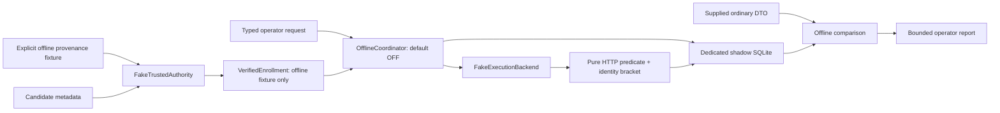

# Trusted Checker Shadow Foundation — №20.1a

19 октября 2026 · `feature/roadmap-react` · база `4692e09f9cd867a40f3cfeb29355b9d08f2bafde`.

Реализован независимый пакет `trusted_checker_shadow` для **offline/fake mode** задания `l1/service-bind-localhost`. Основа — полный аудит [№20.0](TRUSTED_CHECKER_SANDBOX_INTEGRATION_AUDIT.md), прежде всего разделы 4–13. Runtime integration и №20.1b не начаты.

В production-коде нового пакета нет импортов Django, Sandbox, achievements, Roadmap, TraineeDiary, Docker SDK, HTTP/network clients или subprocess. Нет изменения моделей, migrations, Celery, `/task/check.sh`, synthetic policy/runner и учебных источников evidence. Runtime backend намеренно не подключается: coordinator принимает только точный тип `FakeExecutionBackend`, authority — только `FakeTrustedAuthority`. Это ограничение этапа, а не готовый runtime plugin API.

## 1. Добавленные файлы

Все перечисленные файлы новые; существующие tracked-файлы приложения и PoC не изменялись.

| Путь | Назначение |
|---|---|
| `trusted_checker_shadow/__init__.py` | Отдельный пакет без runtime bootstrap и Django registration. |
| `trusted_checker_shadow/policy.py` | `PeerPolicy`, единственная immutable policy, canonical SHA-256 digest. |
| `trusted_checker_shadow/contracts.py` | Закрытые typed DTO, validation, verdict/reason enums. |
| `trusted_checker_shadow/enrollment.py` | `ProvenanceFixture`, `FakeTrustedAuthority`: явный offline enrollment. |
| `trusted_checker_shadow/predicate.py` | Чистые `evaluate_response` и `probe`, fake transport, отсутствие live HTTP. |
| `trusted_checker_shadow/backend.py` | Типизированная симуляция issue/start/observations/cleanup, fault fixtures. |
| `trusted_checker_shadow/state.py` | Отдельная SQLite schema, durable mapping/intents, CAS terminal, audit и control gates. |
| `trusted_checker_shadow/evidence.py` | Единственный operator-visible `OperatorReport`. |
| `trusted_checker_shadow/comparison.py` | Offline agrees/differs/incomparable, без записи ordinary evidence. |
| `trusted_checker_shadow/coordinator.py` | Offline operator API, admission, kill switch, report, restricted recovery. |
| `trusted_checker_shadow/tests/__init__.py` | Test package. |
| `trusted_checker_shadow/tests/support.py` | Явные fake provenance fixtures, управляемые часы, temporary state. |
| `trusted_checker_shadow/tests/test_contracts.py` | Policy/enrollment/input/authorization/security contracts. |
| `trusted_checker_shadow/tests/test_predicate.py` | Статус/body/normalization/timeout/protocol/identity predicate. |
| `trusted_checker_shadow/tests/test_coordinator.py` | Повторы, crash windows, replay, deadlines, kill switch, circuit breaker. |
| `trusted_checker_shadow/tests/test_multiprocess.py` | Два отдельных процесса coordinator с общим SQLite state. |
| `trusted_checker_shadow/tests/test_state_and_comparison.py` | SQL immutability, отдельная БД, отсутствие legacy writers, comparison и redaction. |
| `trusted_checker_shadow/tests/django_regression.py` | Явно запускаемый тест изоляции в Django TEST DB. |
| `trusted_checker_shadow/tests/run_django_regressions.py` | Воспроизводимый локальный test runner: in-memory DB, dotenv off, Docker client запрещён. |
| `TRUSTED_CHECKER_SHADOW_FOUNDATION.md` | Этот отчёт и инструкции для следующего этапа. |

Существовавший до задачи untracked `TRUSTED_CHECKER_SANDBOX_INTEGRATION_AUDIT.md` и untracked-каталоги `docs/` не изменялись в №20.1a. Скомпилированные Python caches игнорируются Git; базы тестов и вспомогательные frontend assets находятся во временных каталогах.

## 2. Схема компонентов



Ни один компонент не получает connection/model/writer обычного Sandbox. Diagram edges — локальные вызовы и DTO; HTTP-запросы, Docker containers и RPC в этом этапе отсутствуют.

## 3. Policy contract и verdict semantics

`PeerPolicy` — frozen dataclass; `__post_init__` отвергает изменение любых значений и типов, включая bool вместо integer version. Единственная разрешённая policy:

| Поле | Значение |
|---|---|
| policy_id / version / schema_version | `service-bind-localhost-peer-v1` / `1` / `1` |
| task | `l1/service-bind-localhost` |
| protocol / port / path | HTTP IPv4 / `8080` / `/` |
| status | Ровно `200` |
| body | ASCII bytes `APP OK: customer service is running` |
| max_body_bytes | `1024` до нормализации |
| normalization | Удалить только завершающие LF (`rstrip(b"\n")`); никакого общего whitespace trim. |
| HTTP / run timeout | `2.0` / `8.0` секунд |
| execution_mode | `offline_fake_only` |

Digest — SHA-256 canonical JSON всех полей policy. Полный snapshot policy сохраняется immutable в SQLite вместе с enrollment/request version/digest; report проверяет соответствие digest. Неизвестная/изменённая policy не получает fallback в synthetic или обычный checker. Чтение неподдерживаемого snapshot также должно завершиться отказом, а не переименованием исторического результата в текущую версию.

Pure predicate принимает строго `HTTPResponse(status, body, complete)` и `FakeTransport(response, fault, elapsed_seconds)`. Это данные симуляции, не интерфейс произвольного запроса. В нём нет URL/DNS/proxy/redirect resolver, вызовов curl/ip/shell/Python внутри target или Docker exec. В настоящее приложение не добавлены nonce/header echo/endpoint.

- `passed`: после совпадения fake identity observations подтверждён status200 и допустимый body. Reason — `external_ipv4_http_observed`.
- `failed`: идентифицированный target в симуляции вернул неправильный status/body, redirect или oversized response. Redirect не прослеживается; oversized diagnostics ограничены sentinel length1025, body не сохраняется.
- `unknown`: transport timeout/error, protocol/infrastructure/identity uncertainty, deadline, issue ambiguity, replay либо kill switch. Неполный response/невалидный status/type — protocol unknown.

`ProbeResult` проверяет согласованность enum result/reason: нельзя создать passed с timeout/identity/issue reason. Unknown terminal не изменяется поздним HTTP200, повтором запроса или cleanup.

В каждом operator report присутствуют:

```text
criteria_scope = external_ipv4_http_only
local_access = unverified
application_authenticity = unproven
persistence = unverified
execution_mode = offline_fake_only
enrollment_verification = offline_fixture_only
```

Даже behavioral pass не является полным technical success задания. Поддельный responder с подходящим текстом способен удовлетворить этот predicate; это не доказательство подлинности приложения, loopback-доступности или устойчивости исправления. В №20.1a даже внешнее HTTP-поведение наблюдается **только через fake fixture**, а не на настоящем endpoint.

## 4. Enrollment и trust boundary

### Разделение контрактов

1. `CandidateMetadata(target, source)` — недоверенное предложение (`sandbox_metadata`, `labels`, `inspect`, `offline_fixture`). Candidate не имеет собственного признака trusted.
2. `VerifiedEnrollment` — отдельный тип. Coordinator принимает его лишь после повторной проверки `FakeTrustedAuthority.verify` по установленному authority fixture и operator identity.
3. `RuntimeObservation` — отдельное наблюдение snapshot + Running/Paused/Restarting/Dead flags. Наблюдение не создаёт enrollment и не меняет ownership.

`TargetIdentity` включает sandbox instance, attempt/owner/task, daemon ID, full64 container ID, immutable image ID `sha256:…`, runtime binding UUID, generation UUID, Docker-format StartedAt, RestartCount, full64 network/endpoint IDs, canonical private IPv4 и scope. `CreationProvenance` содержит только reference/digest. Enrollment дополнительно фиксирует authority ID, fixture/enrollment UUID, policy ID/version/digest, trusted operator ID и schema/mode.

### Что именно доверено offline

`FakeTrustedAuthority` конструируется только с явными `ProvenanceFixture` из доверенного test setup. Candidate должен точно совпасть с fixture. Receipt identity детерминирована по authority+fixture+policy; authority с теми же fixtures узнаёт enrollment после рестарта. Frozen dataclass, UUID или labels сами по себе authority не создают. Подмена любого owner/attempt/daemon/image/start/generation/network/IP/provenance/policy/operator поля отвергается.

Дополнительное ограничение против случайного runtime adoption: daemon/instance IDs имеют префикс `fake-`, scopes — `offline-`, provenance reference — только `fixture:…`. Enrollment всегда помечен `offline_fixture_only`. Использование реальных Docker-looking full IDs в контракте проверяет формат; оно не является provenance реального контейнера. Нет импорта/регистрации исторических контейнеров или генерации для них trusted creation receipts.

TCB этого этапа: локальный Python process, установленная policy, explicit fake authority fixtures, OS/SQLite file owner и доверенный вызывающий код. Это не sandbox для hostile Python plugins. Operator constructor проверяет, что principal разрешён authority; report фильтруется по principal. Нет HTTP authentication, multi-tenant service authorization, подписанных runtime receipts или независимой криптографической аттестации. Их нельзя считать реализованными через Python type checks.

Runtime observations сравниваются с полным enrolled tuple до/после fake probe. Drift или неработающий/paused/restarting/dead target дают unknown. Allowlisted before/after snapshots сохраняются отдельно от expected target. Два snapshots не доказывают непрерывность сети/identity между ними.

## 5. Operator API и lifecycle

Основные методы `OfflineCoordinator`:

```text
set_enabled(bool)                  # только explicit trusted operator
submit(OperatorRequest, enrollment) -> OperatorReport
report(shadow_run_uuid)             -> OperatorReport
expire(shadow_run_uuid)             -> OperatorReport
kill()                             # persisted disable + new control epoch
reconcile_cleanup(shadow_run_uuid)  -> bool, exact known FAKE execution only
```

Новая SQLite DB начинается с flag OFF. Flag хранится в state и сохраняется между рестартами; создание нового coordinator не включает его. Для запуска требуются explicit enable, allowlisted task, совпадающие owner/attempt/scope/enrollment и immutable policy. Deadline должен находиться в `(now, now+8s]`. Profile допускает только `max_parallel=1` для всего store.

```text
reserved → issuing → issued → running → terminal
            │                    │
            └ issue unknown       └ deadline / kill / runtime uncertainty
               → terminal unknown, unresolved
```

Незавершённый run имеет verdict=NULL. Промежуточный report не выдаётся за terminal unknown. Unknown — только зафиксированное terminal состояние. Cleanup имеет независимые состояния `not_required / pending / confirmed / quarantined`.

Неизвестный create/issue/start и pending cleanup удерживают глобальный circuit breaker. Даже другая attempt/scope в той же offline DB не запускается до подтверждённого разрешения. Нет автоматического TTL release, повторного issue/start или force-adopt. Обычный Sandbox при этом ничего не ожидает: coordinator в него не подключён.

### Kill switch

`kill()` атомарно сохраняет disabled flag и увеличивает control epoch. Любое изменение флага увеличивает epoch; disable→enable не оживляет уже выданный run. Admission, dispatch и start проверяют control state; terminal commit повторяет проверку и делает late pass unknown при смене epoch или deadline.

Start намерение фиксируется **до** fake side effect. Финальный flag check и строго bounded fake `start` сериализуются с kill в короткой отдельной transaction. Даже если процесс умер внутри fake start, ранее committed pending intent сохраняется. Подобным образом отдельный committed `issue_dispatched` intent запрещает повтор dispatch после потери процесса.

Нельзя утверждать, что kill отменяет уже отправленное действие или прерывает произвольный backend thread. Реальных threads/runner lifecycle здесь нет: только test synchronization gates. Фиксация unknown выполняется через завершение/`expire`; cleanup-only recovery остаётся доступным после disable. Нет production cancellation API.

## 6. Idempotency и crash windows

Две независимые уникальности:

- `(operator_id, request_uuid)` — повтор той же команды. Payload fingerprint обязан совпасть, иначе `request_payload_conflict`.
- Canonical key — hash enrollment snapshot, policy digest, sample slot и ordinary correlation IDs. Новый request UUID на тот же sample возвращает прежний run; изменённый payload при том же canonical key — `canonical_payload_conflict`.

Payload fingerprint включает все immutable request поля кроме request UUID, полный enrollment и operator. Deadline не сдвигается при повторе. Deliberate resample требует **новых request UUID и sample_slot UUID**; старый run остаётся неизменным.

`reserve` сохраняет `shadow_run_uuid`, `execution_uuid`, canonical key, fingerprint и request mapping в **одной BEGIN IMMEDIATE transaction до issue**. Поэтому окно «backend уже выдал ID, а coordinator ещё не сохранил mapping» устранено: ID назначается и сохраняется заранее. Backend не вправе выдать другой execution ID. Separate `issue_dispatched` intent сохраняется до вызова backend; потеря ответа или процесса не разрешает второй issue.

Проверены:

| Ситуация | Поведение |
|---|---|
| Duplicate / concurrent duplicate | Один run, mapping, issue и simulated start; промежуточный duplicate может получить running/NULL verdict. |
| Два независимых coordinator processes | SQLite unique constraints и transactions дают один canonical mapping и один simulated start. |
| Ответ submit потерян / coordinator restarted | Повтор читает тот же persisted run, backend не вызывается. |
| Issue response потерян / чужой issue receipt | Terminal unknown, quarantine, breaker; create/start не выполняются. |
| Процесс умер после issue до ack | Сохраняется issuing + прежний execution ID; retry ничего не отправляет, expiry → unknown/unresolved. |
| Процесс умер внутри dispatch/start | Ранее persisted dispatch/start intent сохраняется; автоматический повтор запрещён. |
| Поздний passed после timeout | Terminal CAS и SQL trigger сохраняют unknown. Cleanup может подтвердиться отдельно. |
| Новый sample slot | Новый run только после health/admission checks; не способ обойти unresolved breaker. |

Это модель at-most-once invocation с fail-closed ambiguity; она не обещает exactly-once физическое исполнение на Docker. Counters `simulated_creates/simulated_starts` в fake backend — симуляция, не runtime evidence.

## 7. SQLite schema и operator evidence

State принимает только отдельный путь `*.shadow.sqlite3`. Новый файл создаётся mode0600; symlink отклоняется. Существующая DB перед инициализацией проверяется read-only: разрешены только ожидаемые shadow tables и marker `trusted_checker_shadow_offline_v1`/version1. Чужая, в том числе Django-looking DB, отвергается без изменения её bytes. Schema, marker и SQL guards новой DB инициализируются атомарно.

| Таблица | Содержание и ограничения |
|---|---|
| `shadow_meta` | Store kind/version; immutable marker. |
| `shadow_control` | Единственная enabled/epoch строка. |
| `shadow_runs` | UUID, canonical unique key, payload fingerprint, operator, immutable enrollment/request/full-policy snapshots, execution UUID unique, epoch, lifecycle/timestamps/deadline, before/after observations, result, cleanup, unresolved. |
| `shadow_requests` | Append-only request UUID → run mapping, unique per operator. |
| `shadow_audit` | Append-only transition events, unique run+code, timestamp/sequence. Повторы запросов не создают неограниченные duplicate events. |
| `shadow_control_audit` | Append-only explicit flag changes и operator identity. |

SQL triggers запрещают изменение bindings/policy/request/mapping, удаление run и переписывание terminal verdict/timestamps/observations. После terminal разрешается только отдельное изменение cleanup/unresolved через trusted internal state API. Append-only таблицы не допускают UPDATE/DELETE. Транзакции SQLite сериализуют competing writers; это не защита от владельца файла, который способен удалить/подменить DB или triggers. Не реализованы migration/upgrade, backup, retention purge или HA service.

`OperatorReport` — единственный экспортируемый DTO. Он содержит scoped verdict, target/allowlisted observations, provenance ref/digest, policy snapshot/version/digest, correlation DTO, lifecycle/timestamps/deadline, sample slot, cleanup и bounded diagnostics. JSON ограничен 16384 bytes, diagnostics — последними 16 enum-coded audit events с total count. История переходов остаётся в отдельном audit; никаких arbitrary message fields.

Не сохраняются:

- Credentials, cookies/tokens/TLS keys, customer answers, trainee reports и mentor comments.
- Docker inspect/Config.Env/HostConfig, arbitrary stdout/stderr, API request/response bodies и exception messages.
- Raw HTTP body, challenge/nonce или ownership tokens. Реальный ownership journal в этом этапе отсутствует.

Для неподходящего body сохраняются только bounded length/status и reason, **не digest произвольного секретного содержимого**. Digest ответа сохраняется лишь для policy-matching bounded body. Backend errors превращаются в константный reason без исходного текста. Denied admission возвращает константный `Rejected` code без создания учебного результата; production error/authorization transport и внешнее observability ещё не реализованы.

## 8. Recovery restrictions

`reconcile_cleanup` читает typed receipt только известного exact simulated execution из того же fake backend. Run должен быть terminal и иметь committed start intent; ticket обязан совпасть с persisted run/execution/enrollment/policy/target binding. Изменяются только cleanup state и audit, не verdict. Повторное подтверждение идемпотентно.

У unknown issue без известного start cleanup не подтверждается. При отсутствии fake backend receipts после рестарта state остаётся unresolved; нельзя объявить отсутствие ресурсов или снять lease по времени. Нет API force, arbitrary container ID, ownership-token input, list/prune, повторного create/start или удаления target.

Эта ограниченная fake recovery **не является** реализацией Docker orphan recovery. Existing `trusted_checker_poc/recovery.py` не вызывается и не изменён. Для реального backend нужен отдельно спроектированный durable create/ownership/start/cleanup journal, exact-ID reconciliation и независимое daemon create evidence. Два исторических orphan остаются вне всех новых fixtures/actions.

## 9. Offline comparison

`OrdinaryEvidence` — supplied bounded DTO, а не чтение Django: attempt/owner/task, optional CheckRun/execution refs, ordinary verdict, criteria scope, quality, binding/generation и observation window. Coordinator проверяет owner/attempt/task consistency; comparison не изменяет DTO или старые записи.

`agrees/differs` возможны только при наличии CheckRun, известных verdict, одинаковом `external_ipv4_http_only` scope, `same_generation_proven`, одинаковом binding/generation и пересекающихся observation windows. Иначе `incomparable` с конкретной причиной: missing ordinary, unknown, scope mismatch, weak correlation, generation mismatch или temporal gap.

Обычная legacy проверка local+network имеет другой scope. Поэтому ordinary failed + external passed — `incomparable/criteria_scope_differs`, а не вывод «legacy checker неверен». Даже `differs` означает лишь различие scoped observations и не является основанием зачёта/исправления истории.

Fake caller может поставить correlation_quality как часть доверенной test fixture; эта строка сама по себе **не доказывает** runtime correlation. Текущие Sandbox CheckRun не содержат trustworthy generation snapshot. Read-only metadata reader, источник ordinary provenance и истинное `same_generation_proven` остаются prerequisite следующего этапа.

## 10. Проверки и воспроизведение

### Offline/fake

```sh
.venv/bin/python -W error::ResourceWarning -m unittest discover -s trusted_checker_shadow/tests -t .
```

Результат: **56 tests, OK**. Покрыты policy/enrollment forgery, foreign attempt/owner/operator, daemon/image/start/generation/network/IP changes, missing provenance, digest/schema/URL/port rejection, redirect/oversized/status/body/protocol/transport, simultaneous threads/processes, duplicate/lost issue, dispatch/start crashes, replay, late pass, global breaker, kill epochs, cleanup-only recovery, sanitized report и SQLite/legacy isolation.

Python3.13 resource warnings об открытых SQLite connections, выявленные первым прогоном, устранены явным closing; финальный offline прогон выполнен с ResourceWarning как error.

### Existing PoC

```sh
.venv/bin/python -m unittest discover -s trusted_checker_poc/tests -t .
```

Результат: **166 tests, OK**. Только существующие unit/SDK-fake tests; Docker integration harness не запускался. Synthetic policy/Runner/lifecycle/security guards сохранены без правок.

### Sandbox / achievements regressions и проверка нулевых writes

Используются отдельная in-memory Django TEST DB, dotenv loading disabled и настройки, соответствующие CI (`DEBUG=True` при загрузке settings). Реальный Docker client constructor заменён запретом: непредусмотренный вызов немедленно проваливает тест **до** Docker API. Применение существующих migrations и создание ordinary records происходит только как setup изолированной test DB; рабочие модели/миграции/БД не изменялись.

Локальный frontend manifest оказался устаревшим — без notifications entry. Fresh assets собраны установленным Vite в `/tmp`, без изменения frontend source и без установки dependencies:

```sh
# Из frontend/:
./node_modules/.bin/vite build --outDir /tmp/trusted-checker-shadow-assets/frontend

# Из корня проекта:
.venv/bin/python -m trusted_checker_shadow.tests.run_django_regressions \
  --static-root /tmp/trusted-checker-shadow-assets
```

Runner использует test-only `StaticFilesStorage` для этих assets. Это не изменение production settings/redirect/security logic и не deployment. В начале подготовки runner неправильный DEBUG профиль дал HTTPS-redirect failures; runner приведён к существующему CI профилю. В новом isolation fixture также явно установлен manual-review режим настоящего задания; Docker guard поймал неполный fixture до какого-либо daemon обращения.

Итоговый результат выбранных regression labels: **150 tests, OK (skipped=6)**. Шесть пропусков — PostgreSQL-specific Ledger concurrency/guard tests, не выполняемые на SQLite. Полный список labels находится в `tests/run_django_regressions.py:LABELS`. Для точечного повтора нового теста изоляции предусмотрен `--isolation-only`; финальный такой прогон после последних изменений snapshot/DTO: **1 test, OK**. Финальный offline прогон: **56 tests, OK**, без ResourceWarning.

Новый `LegacyIsolationTests` сначала создаёт обычное успешное evidence **только в тестовой БД**, затем выполняет shadow passed/failed/unknown. Для каждого исхода проверяются:

- Ноль Django DB queries во время выполнения shadow coordinator.
- Полное равенство строк всех `sandbox_*`, `achievements_*`, `roadmap_*`, `traineediary_*` tables до/после.
- Неизменные technical progress и Ledger program DTO. Следовательно, existing CheckRun, completion, achievement/platinum state и прочие academic rows не меняются из shadow.

Отдельные standalone тесты отвергают foreign SQLite/Django-looking DB без изменения bytes, проверяют отсутствие legacy/network imports и отсутствие legacy connection injection point. Python compiled/import tests и Git diff checks дополняют проверки, но сами по себе не заменяют runtime security tests.

## 11. Чего offline-тесты не доказывают

1. Принадлежность какого-либо реального Sandbox container/daemon/network и достоверность historical generation или creation provenance.
2. Соответствие реально собранного target/runner image исходникам, Docker inspect semantics и изменения endpoint при stop/restart/detach.
3. Реальные права UID/caps/nnp/read-only filesystem, namespace isolation, CPU/memory/PID/log limits, отсутствие host/Docker socket access.
4. Egress enforcement, отсутствие DNS/proxy/redirect/SSRF и доступа к platform/host/metadata endpoints у будущего live transport. Сейчас такого transport вообще нет.
5. Hard real-time deadline/cancellation, bounds Docker SDK calls и физическое at-most-once create/start при сетевых сбоях. Fake counters не физические наблюдения.
6. Реальное отсутствие orphan после lost create/remove response, корректность Docker reconciliation и доказанный cleanup. Fake confirmed не Docker cleanup receipt.
7. Полный успех задания: loopback доступность, application authenticity, неизменность task checker или сохранность исправления после restart.
8. Production authentication/authorization/secret separation, аудит pre-admission transport ошибок, HA/backup/retention/SQLite migration или host compromise resistance.
9. Независимость реальной trainee latency и shared-host blast radius: нет runtime integration, поэтому таких измерений не проводилось.
10. PostgreSQL concurrency semantics по SQLite-тестам и отсутствие всех возможных races/уязвимостей. Ранее VDS PoC results не являются security sign-off новой интеграции.

## 12. Нерешённые вопросы и инструкции для №20.1b

Никакой пункт этого раздела не исполняется автоматически после завершения №20.1a.

1. **Утвердить runtime scope и TCB.** Отдельное разрешение exact non-production daemon/endpoint/network/images/resources. Решить, остаются ли legacy worker/ttyd с Docker socket частью TCB; web/Celery не должны получать новый socket ради shadow.
2. **Определить реальную authority.** Trusted creation receipts для новых pilot targets, policy-bound enrollment, authenticated operator principal и read-only metadata reader. Не заменять fake prefixes реальными IDs без доверенной chain. Не создавать retroactive receipts исторических контейнеров.
3. **Утвердить topology и target profile.** Реальный task отличается от synthetic target по labels, network и tmpfs. Новая совместимость не должна ослаблять existing PoC guards. Требуются per-target egress restrictions и проверка daemon/network/endpoint/start identity.
4. **Спроектировать bounded live transport и runner artifact.** Никакого Docker exec, target filesystem/tools или изменения app ради challenge. Preserve exact policy predicate/scope; если нужен local+network verdict, это отдельный execution mode/security review.
5. **Не подключать live backend прямой подстановкой в этот API.** Текущие exact-type checks намеренно запрещают это. Runtime boundary, transport authorization, immutable runner image/provenance и journal нужно review отдельно; затем versioned interface и новые negative tests.
6. **Сохранить durable mapping/dispatch/start fences.** Потеря любого create/issue/start ответа не вызывает новый UUID/повтор create. Добавить реальный ownership journal, terminal CAS, cleanup receipts и exact-ID reconciliation; не переносить fake confirmed в runtime evidence.
7. **Решить ordinary correlation.** Сейчас comparison работает с supplied DTO. Для genuine same_generation_proven нужен новый trusted evidence source; temporal proximity и последний CheckRun не являются доказательством.
8. **Выбрать storage/операционные границы.** Только отдельная shadow DB/role, protected internal state, sanitized operator read DTO, backup/retention, admission metrics/alerts и explicit kill/recovery operational runbook. Не расширять CheckRun/Ledger providers.
9. **Подготовить runtime test plan до исполнения.** Approved negative identity/permission/topology cases, broken/fixed task, forged responder, reset/network races, lost responses/deadlines/cleanup и kill/rollback. Fake-only faults помечать отдельно, не объявлять полный runtime/security sign-off.
10. **Сохранить учебную изоляцию.** Не подключать shadow outcomes к progress/snapshots/achievements/платине/наставнику/адаптации; automatic post-check hook/outbox не входит в текущую работу. Рабочие CheckRun/history не менять.

После №20.1a — остановка. Docker build/run/cleanup, staging/production deploy, удаление orphan, commit/push/rebase и №20.1b не выполнялись и требуют соответствующего отдельного задания/согласования.
