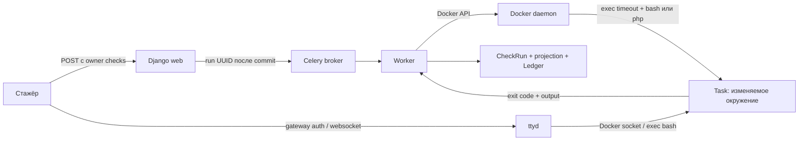
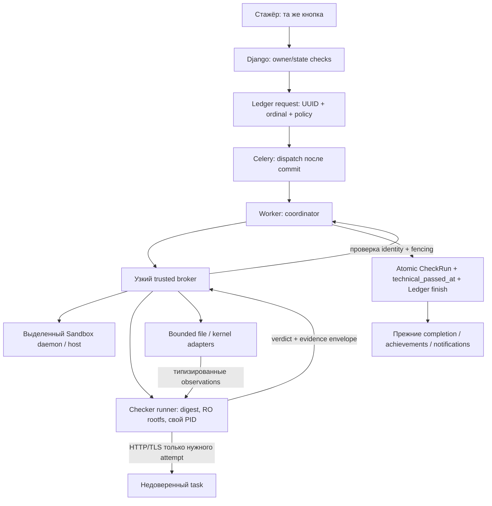

# Trusted Sandbox Checker Audit — задача №17

15 октября 2026. Статический аудит репозитория `/Users/artemkurkin/Dev/training-platform`, ветка `feature/roadmap-react`, HEAD `26cdce0bd3edfbd7d977f855f01d8389d03c06f6`.

**Рекомендация: D, гибрид — отдельный доверенный runner с сетевыми probes и узким broker для файловых/процессных наблюдений.** Исполнение `check.sh` или PHP через изменяемые binaries task-контейнера не должно быть источником trusted verdict. Один read-only скрипт и обычный sidecar не решают задачу доверия. Для WordPress, cron, удалённых дескрипторов и проверки прав нужны отдельные adapters и согласованные критерии; возможность trusted проверки всех 15 заданий ещё предстоит доказать.

Платину оставить выключенной. Изменений кода, Docker images, миграций, evaluators и действующих наград в этом аудите нет. Создан только этот отчёт. Реальные Sandbox containers не запускались, Docker daemon и рабочие БД не опрашивались. Benchmark и эксплуатационный penetration test не проводились.

## 1. Область и достоверность выводов

Прочитаны [Evidence Ledger](SANDBOX_EVIDENCE_LEDGER.md), [Advanced Achievements](SANDBOX_ADVANCED_ACHIEVEMENTS.md), все 15 `task.json`, Dockerfile и `files/check.sh` в `training_tasks/l1/`, связанные start scripts, приложения и конфигурации, WordPress checker, Django/Celery/Docker/terminal services и Compose/gateway configuration. В исходном Git status были только пять каталогов с прежними 83 PNG; задача №16 уже закоммичена пользователем в HEAD.

Здесь «подтверждено» означает установленный **по исходникам путь**, а не выполненный exploit. «Предложение» — будущая архитектура. «Неизвестно» — свойство, для которого нужны runtime inspect, host configuration или согласованный эксперимент. Фактический набор обязательных Task в production не читался: ниже **15 активных L1-заданий репозитория**, все `requires_manual_review=true`, order 1–15. Frozen manifest конкретного пользователя может отличаться; его нельзя заменить этой таблицей.

Для семантики Docker сверены первичные документы: [exec и окружение](https://docs.docker.com/reference/cli/docker/container/exec/), [run, namespace options](https://docs.docker.com/reference/cli/docker/container/run/), [capabilities и пользователь](https://docs.docker.com/engine/containers/run/), [bind mounts](https://docs.docker.com/engine/storage/bind-mounts/), [Docker daemon security](https://docs.docker.com/engine/security/), [Python SDK](https://docker-py.readthedocs.io/en/stable/containers.html), [seccomp](https://docs.docker.com/engine/security/seccomp/). Это документация возможностей, не доказательство версии/настроек фактического хоста.

## 2. Текущая архитектура

1. Owner нажимает POST-кнопку `sandbox.views.check_task`; ownership, состояние и технический lock проверяются сервером. `try_mark_attempt_check_running` создаёт request с UUID/ordinal и RUNNING; dispatch Celery выполняется после commit. [views.py](sandbox/views.py), [checks.py](sandbox/services/checks.py).
2. `run_attempt_check_task` получает attempt/user/run IDs; `ledger_execution.checked` проверяет владельца, допускает единственное исполнение и отсекает duplicate/late writes. [tasks.py](sandbox/tasks.py), [ledger_execution.py](sandbox/services/ledger_execution.py), `ledger.begin_check/check_live/finish_check` в [ledger.py](sandbox/services/ledger.py).
3. `check_task_container` получает **контейнер по имени** и выполняет внутри него `timeout --kill-after=5s <seconds>s bash /task/check.sh`; для WordPress — `timeout ... php -r <platform-source>`. Явные user/environment/workdir и независимый worker-side execution deadline здесь не заданы. Настройка timeout по умолчанию 60 с. [docker_service.py](sandbox/services/docker_service.py), [settings.py](config/settings.py).
4. Exit 0 создаёт successful CheckRun, `technical_passed_at`, finished Ledger event и при необходимости `SandboxProgramCompletion`; exit 1 классифицируется как technical failure. Другие коды и исключения разделяются на timeout/infrastructure/unknown, но классификация зависит от результата внутри task. `checker_started=True` для обычного 0/1 — вывод backend из exit code, не runtime integrity measurement. [checks.py](sandbox/services/checks.py), [completions.py](sandbox/services/completions.py).
5. Read-only providers сверяют историю, counters, identity, frozen requirements и CheckRun. Они подтверждают согласованность зарегистрированных фактов, а не подлинность исполняемого checker. `checker_identity` хеширует **эталон на файловой системе платформы**, не live task image/binary. [ledger.py:checker_identity](sandbox/services/ledger.py), [ledger_evidence.py](sandbox/services/ledger_evidence.py).
6. Платина остановлена причиной `runtime_checker_integrity_unproven`; `automatic=False`. Silver/gold используют прежнюю модель технического зачёта с дополнительными требованиями Ledger. Этот аудит их политику не меняет. [sandbox_advanced.py](achievements/services/evaluators/sandbox_advanced.py), [catalog.py](achievements/services/catalog.py).

### Контейнеры, SDK и сети

`create_task_container` использует локальный image `ticket-sandbox-{queue_slug}-{task_slug}`; существующий image переиспользуется, build из каталога выполняется лишь при ImageNotFound. Digest не закреплён и не сопоставляется с digest checker перед exec. Все 15 Dockerfile имеют `FROM ubuntu:22.04`, не задают USER, не закрепляют base digest/package versions. Task launch не задаёт user/read_only/volumes/network/pid_mode; есть memory=768m, pids=256, no-new-privileges, drop AUDIT_WRITE/MKNOD, tmpfs /tmp и /run. В стандартном Ubuntu образе предполагается root; окончательный UID/HostConfig действующего контейнера без inspect неизвестен. Конфигурация явно не устанавливает непривилегированного пользователя. [docker_service.py:create_task_container](sandbox/services/docker_service.py), Dockerfile ниже. Значение image tag и фактическая rootfs после запуска — разные идентичности; digest образа не измеряет writable layer. [Docker run](https://docs.docker.com/engine/containers/run/).

`get_docker_client` предпочитает `~/.docker/run/docker.sock`, иначе `docker.from_env()`. SDK может получить иной daemon через окружение; выбранный production endpoint, TLS, rootless/userns, kernel, storage driver и LSM не установлены. `get_docker_socket_path` при отсутствии macOS socket возвращает `/var/run/docker.sock`; это не универсальное соответствие удалённому DOCKER_HOST. [docker_service.py](sandbox/services/docker_service.py).

Task не получает socket mount. **ttyd получает rw Docker socket**, запускается из [terminal/Dockerfile](terminal/Dockerfile) с USER root и Docker CLI; команда — `ttyd -W ... sh -c 'docker exec -it <task-name> bash'`. Browser shell находится в **task**, а не автоматически в ttyd. Worker тоже имеет socket, Compose web — нет; приложение в [Dockerfile](Dockerfile) запускается как `app`, worker получает DOCKER_GID. Drop ALL у ttyd не ограничивает права уже доступного Docker API. [docker_service.py:create_terminal_container](sandbox/services/docker_service.py), [Compose](docker-compose.yml).

Gateway проверяет session/owner-or-staff/attempt state через `terminal_auth`; в docker_network mode ttyd подключён к `training-platform-runtime`, где Compose также размещает gateway/web/worker/db/redis. Task network не задан — нельзя объявлять task участником этой сети: его обычный default bridge и реальная межсетевая достижимость требуют проверки хоста. Сам ttyd не получает `--credential` в формируемой команде; защита ingress опирается на gateway/сеть. Доступ к ttyd в обход gateway возможен **только если доказана такая сетевая достижимость**; здесь это неизвестно. [terminal_gateway.py](sandbox/services/terminal_gateway.py), [views.py:terminal_auth](sandbox/views.py), [gateway config](deploy/nginx/docker/default.conf), [Compose prod](docker-compose.prod.yml).

## 3. Инвентаризация всех заданий

В таблице: фактический **запрашиваемый local image**; отсутствие tag трактуется Docker как latest, но его фактическое содержимое неизвестно. В колонке источников доступны и индивидуальный Dockerfile, и checker. Для строк K применяется запуск `timeout ... bash /task/check.sh`, где checker скопирован из `files/check.sh`; для W — платформа передаёт PHP source в task `php -r`. K не означает доверенный код. [Общий dispatcher](sandbox/services/docker_service.py).

| № | Название / slug | Запрашиваемый image | Режим и индивидуальные исходники |
|---|---|---|---|
| 1 | Сайт не открывается после правки конфигурации nginx — `nginx_not_starting` | `ticket-sandbox-l1-nginx_not_starting` | K; [Dockerfile](training_tasks/l1/nginx_not_starting/Dockerfile), [check.sh](training_tasks/l1/nginx_not_starting/files/check.sh), [описание](training_tasks/l1/nginx_not_starting/task.json) |
| 2 | После переноса сайта открывается чужая страница — `sajt-ne-rabotaet-posle-perenosa` | `ticket-sandbox-l1-sajt-ne-rabotaet-posle-perenosa` | K; [Dockerfile](training_tasks/l1/sajt-ne-rabotaet-posle-perenosa/Dockerfile), [check.sh](training_tasks/l1/sajt-ne-rabotaet-posle-perenosa/files/check.sh), [описание](training_tasks/l1/sajt-ne-rabotaet-posle-perenosa/task.json) |
| 3 | Логи приложения разрослись и занимают много места — `disk-full` | `ticket-sandbox-l1-disk-full` | K; [Dockerfile](training_tasks/l1/disk-full/Dockerfile), [check.sh](training_tasks/l1/disk-full/files/check.sh), [описание](training_tasks/l1/disk-full/task.json) |
| 4 | Не выполняется задача по расписанию (cron) — `cron-not-working` | `ticket-sandbox-l1-cron-not-working` | K; [Dockerfile](training_tasks/l1/cron-not-working/Dockerfile), [check.sh](training_tasks/l1/cron-not-working/files/check.sh), [описание](training_tasks/l1/cron-not-working/task.json) |
| 5 | Сайт отдаёт ошибку 502 Bad Gateway — `php-fpm-down` | `ticket-sandbox-l1-php-fpm-down` | K; [Dockerfile](training_tasks/l1/php-fpm-down/Dockerfile), [check.sh](training_tasks/l1/php-fpm-down/files/check.sh), [описание](training_tasks/l1/php-fpm-down/task.json) |
| 6 | Не загружаются файлы больше 2 МБ — `nginx-413-upload` | `ticket-sandbox-l1-nginx-413-upload` | K; [Dockerfile](training_tasks/l1/nginx-413-upload/Dockerfile), [check.sh](training_tasks/l1/nginx-413-upload/files/check.sh), [описание](training_tasks/l1/nginx-413-upload/task.json) |
| 7 | После переноса сайт отдаёт ошибку 500 — `wordpress-500-after-move` | `ticket-sandbox-l1-wordpress-500-after-move` | W; [Dockerfile](training_tasks/l1/wordpress-500-after-move/Dockerfile), [platform PHP](sandbox/task_checks/wordpress_runtime.php), [описание](training_tasks/l1/wordpress-500-after-move/task.json) |
| 8 | После распаковки бэкапа приложение не видит свои файлы — `restored-backup-permissions` | `ticket-sandbox-l1-restored-backup-permissions` | K; [Dockerfile](training_tasks/l1/restored-backup-permissions/Dockerfile), [check.sh](training_tasks/l1/restored-backup-permissions/files/check.sh), [описание](training_tasks/l1/restored-backup-permissions/task.json) |
| 9 | Приложение не запускается: порт уже занят — `port-already-in-use` | `ticket-sandbox-l1-port-already-in-use` | K; [Dockerfile](training_tasks/l1/port-already-in-use/Dockerfile), [check.sh](training_tasks/l1/port-already-in-use/files/check.sh), [описание](training_tasks/l1/port-already-in-use/task.json) |
| 10 | Удалили лог, но место не освободилось — `deleted-file-descriptor` | `ticket-sandbox-l1-deleted-file-descriptor` | K; [Dockerfile](training_tasks/l1/deleted-file-descriptor/Dockerfile), [check.sh](training_tasks/l1/deleted-file-descriptor/files/check.sh), [описание](training_tasks/l1/deleted-file-descriptor/task.json) |
| 11 | Сайт возвращает 502 Bad Gateway, хотя приложение запущено — `nginx-upstream-wrong-port` | `ticket-sandbox-l1-nginx-upstream-wrong-port` | K; [Dockerfile](training_tasks/l1/nginx-upstream-wrong-port/Dockerfile), [check.sh](training_tasks/l1/nginx-upstream-wrong-port/files/check.sh), [описание](training_tasks/l1/nginx-upstream-wrong-port/task.json) |
| 12 | Сервис работает на сервере, но недоступен по сети — `service-bind-localhost` | `ticket-sandbox-l1-service-bind-localhost` | K; [Dockerfile](training_tasks/l1/service-bind-localhost/Dockerfile), [check.sh](training_tasks/l1/service-bind-localhost/files/check.sh), [описание](training_tasks/l1/service-bind-localhost/task.json) |
| 13 | По HTTPS открывается не тот сайт — `https-sni-wrong-vhost` | `ticket-sandbox-l1-https-sni-wrong-vhost` | K; [Dockerfile](training_tasks/l1/https-sni-wrong-vhost/Dockerfile), [check.sh](training_tasks/l1/https-sni-wrong-vhost/files/check.sh), [описание](training_tasks/l1/https-sni-wrong-vhost/task.json) |
| 14 | API отвечает 504 Gateway Timeout — `nginx-upstream-timeout` | `ticket-sandbox-l1-nginx-upstream-timeout` | K; [Dockerfile](training_tasks/l1/nginx-upstream-timeout/Dockerfile), [check.sh](training_tasks/l1/nginx-upstream-timeout/files/check.sh), [описание](training_tasks/l1/nginx-upstream-timeout/task.json) |
| 15 | HTTPS работает по IPv6, но недоступен по IPv4 — `https-ipv4-listener` | `ticket-sandbox-l1-https-ipv4-listener` | K; [Dockerfile](training_tasks/l1/https-ipv4-listener/Dockerfile), [check.sh](training_tasks/l1/https-ipv4-listener/files/check.sh), [описание](training_tasks/l1/https-ipv4-listener/task.json) |

### Что фактически проверяется и какие нужны adapters

Общие возможности Docker API **для каждого** задания: inspect ID/image/config/networks/mounts/state, top/stats, bounded archive чтение файлов с метаданными, exec; это не равнозначно независимой проверке всей семантики. Archive не включает живой `/proc` как полноценную аттестацию kernel state; ни stdout exec, ни container logs нельзя считать истинными по происхождению. [SDK Containers](https://docker-py.readthedocs.io/en/stable/containers.html). Ниже «внешне» означает будущее независимое наблюдение: текущие проверки, кроме места хранения PHP source, все работают внутри task.

| № / slug | Фактические объекты и зависимости текущего checker | Доступ/привилегии; возможность проверки извне | Специфический риск / предлагаемый adapter |
|---|---|---|---|
| 1 `nginx_not_starting` | `nginx -t`, `pgrep -x nginx`, HTTP 127.0.0.1:80; config `/etc/nginx`, webroot `/var/www/html`. Docker CMD — sleep infinity, nginx не стартует. | Читать config, видеть PID, TCP; текущий nginx -t требует доступа к config/log paths. HTTP можно извне; синтаксис и процесс требуют другого наблюдения. | Любой 2xx проходит HTTP-часть; имя процесса и nginx binary изменяемы. Внешний HTTP + сохранённый config snapshot, проверяемый фиксированным nginx в изолированном validator; отдельно kernel/process evidence при сохранении требования nginx. |
| 2 `sajt-ne-rabotaet-posle-perenosa` | nginx -t, nginx PID, HTTP localhost содержит `Client CRM работает`; start создаёт сайт в `/var/www/client-crm`, nginx default обслуживает другой root. | Config/FS/PID/net; внешний HTTP доступен через будущую изолированную сеть. | Текст не доказывает выдачу из нужного каталога; можно изменить заглушку. HTTP challenge + сверка разрешённого config/webroot и fixture identity. Источники: `files/start.sh`, `files/check.sh`. |
| 3 `disk-full` | `du -m /var/log/app/debug.log` ≤50, либо отсутствие файла; существование `/etc/app/app.conf`. Start создаёт 700 МБ log + вспомогательные logs. | Читать размер/allocated blocks/config; можно через broker FS metadata, без запуска task binaries. | Symlink/перенос/новый пустой config; `du` не доказывает отсутствие другого удерживающего FD и освобождение всего FS. Storage/metadata adapter: lstat, blocks, ожидаемый config digest, привязка к исходному inode/target policy. |
| 4 `cron-not-working` | `/var/www/html/status.txt` существует, `date-stat(mtime)` ≤90; `pgrep cron`. `/etc/cron.d/app-update` ссылается на ошибочный script path; правильный `/opt/app/update_data.sh`. | FS + clock + PID + наблюдение во времени; корректирующие действия требуют root в упражнении, observer — узкий read доступ. | Ручная запись/touch проходит; future mtime даёт отрицательный age и тоже не отвергается текущим сравнением. Нужен temporal/scheduler adapter с trusted clock и наблюдением нескольких срабатываний; mtime/process name сами по себе не доказывают cron. |
| 5 `php-fpm-down` | nginx PID, `pgrep -f php-fpm`, HTTP `/index.php` 200 и `PHP сайт работает`; nginx→FPM socket `/run/php/php<version>-fpm.sock`. | PID/net + socket/config observation. HTTP извне возможен; loopback/FastCGI требуют scoped net/Unix socket adapter. | Статический HTML и имитация имени процесса не доказывают PHP runtime. Trusted PHP/FPM workload identity и динамический challenge, если требование именно запустить FPM. Источники: `files/start.sh`, `files/index.php`. |
| 6 `nginx-413-upload` | mktemp, dd 10 МБ, multipart `doc` в localhost `/index.php`, HTTP200, точная строка с 10485760; nginx client_max_body_size и PHP upload/post limits. | Net, генерация payload вне task; текущий checker пишет /tmp. Root для probe не нужен. | Изменяемый PHP handler может просто вернуть строку и не принять файл. Trusted client должен сверять факт обработки непредсказуемого payload независимым защищённым handler; config/runtime adapter для требования PHP, а не одной HTTP-строки. `files/index.php` root:root 0644 защищает от www-data, не от root. |
| 7 `wordpress-500-after-move` | Platform PHP: nginx -T→FastCGI upstream, FPM mbstring и mb_strlen, require wp-config, mysqli/site_pages/server_uuid; HTTP localhost; local MySQL root; случайное изменение home content и CAS restore. | Сейчас task php/nginx/curl/libc, Unix/TCP FPM/MySQL, FS, право UPDATE fixture DB; не read-only probe. | PHP/interpreter и FPM контролируемы; nonce усиливает проверку свежести DB→HTTP, но не аттестует весь runtime. Специальный WordPress/FPM/DB adapter с защищённой fixture и гарантированным cleanup; наибольший блокер. Полный код — `sandbox/task_checks/wordpress_runtime.php`. |
| 8 `restored-backup-permissions` | `su appuser -c /opt/myapp/run.sh`, exit0 + `OK:`; отсутствует world-write у пяти `/opt/myapp*` paths. Script читает config/data и пишет output/result.txt. | UID/GID/groups, DAC traversal/read/write и FS; текущий su требует root. Внешний broker может проверять metadata/access без запуска пользовательского script. | Изменяемые su/run.sh/identity database; простая строка OK не доказывает доступ appuser. Специальный DAC adapter с числовой identity, ACL/parent traversal, bounded read/write probe в изолированной среде; никаких host `su` по имени из task. |
| 9 `port-already-in-use` | `ss -tlnp` + grep :8080 — ровно одна строка; HTTP localhost:8080 содержит APP OK. Start поднимает stale instance с другим APP_MESSAGE. | Network namespace и kernel listener/process metadata; HTTP снаружи возможен. | Число строк не равно числу всех workers, substring может совпасть с другим портом; строка APP OK редактируема. Точный socket endpoint/inode + внешний HTTP + fixture identity; не проверять количество процессов по тексту ss. |
| 10 `deleted-file-descriptor` | `lsof | grep '/var/log/app/huge.log.*(deleted)' | wc -l`; start создаёт 300 МБ файл, logger держит FD3, затем имя удаляется. | Kernel PID/FD/mount/filesystem; нужен доступ к чужим FD. Обычный archive/HTTP недостаточен. | Ошибка lsof в pipeline без pipefail может выглядеть как 0 совпадений и дать pass; путь не стабильная identity inode. Специальный host-scoped FD observer по generation/PID starttime/inode, read errors → unknown. |
| 11 `nginx-upstream-wrong-port` | nginx -t/PID, direct localhost:9000 `CUSTOMER API OK`, proxy localhost:80 HTTP200+тот же marker; `/opt/customer-api/backend.py` слушает loopback9000, config указывает9001. | Нужен доступ к target loopback и внешней стороне proxy; отдельная network namespace у observer без host network. | Два независимых сервера могут вернуть одинаковый marker без проксирования. Trusted backend challenge + proxy causality и immutable fixture; текущий `/tmp/task-site-body` дополнительно подвержен гонке. |
| 12 `service-bind-localhost` | Два точных body `APP OK: customer service is running`: 127.0.0.1:8080 и IPv4 из `ip ... scope global`; конфиг `/opt/customer-app/app.conf`. | Только HTTP/net для поведенческого контракта; root не нужен checker. | Локальный запрос на собственный interface IP не равен соединению от соседа. Пилот: отдельный сетевой peer→scoped target IP:8080 + loopback probe при необходимости; не вызывать task ip/curl. |
| 13 `https-sni-wrong-vhost` | nginx -t/PID; TLS/SNI portal и legacy через --resolve127.0.0.1; portal marker, certificate subject CN, legacy marker. | HTTP/TLS снаружи, trusted CA/expected cert fixture; config/process только если сохраняются как отдельные условия. | Task openssl/curl изменяемы; grep CN и -k не доказывают корректную цепочку/ключ. Внешний TLS adapter сравнивает policy-sanctioned cert/SAN/fingerprint и оба vhosts; изменение семантики критериев требует версии. |
| 14 `nginx-upstream-timeout` | nginx -t/PID, `/usr/local/bin/report-api status`, direct9000 health/report; direct и proxy report должны длиться ≥2с и содержать REPORT READY, proxyHTTP200. Backend штатно sleep3. | Loopback+proxy, trusted monotonic timing; optional process/fixture observation. | Подмена backend/launcher, искусственная задержка/маркер удовлетворяют строковым условиям; `/tmp/task-report-body` общий изменяемый файл. Специальный delayed challenge backend и proxy causality; timing сам по себе недостаточен. |
| 15 `https-ipv4-listener` | nginx -t/PID; curl -6 https://[::1] и -4 https://127.0.0.1 с CUSTOMER HTTPS OK; исходный config только [::]:443 ipv6only=on. | IPv4/IPv6 network probes, root не нужен; локальный и внешний адреса различаются. | Loopback не доказывает внешнюю dual-stack доступность; отсутствие IPv6 у checker infra — unknown, не task fail. Отдельный IPv4/IPv6 peer и проверка возможностей тестовой сети. |

У всех K исполняемые checker, интерпретатор и утилиты лежат в writable task filesystem, доступны предполагаемому root. Внешний перенос HTTP может подтвердить наблюдаемую работоспособность, но **не доказывает исходный способ исправления**. Если критерий требует конкретно nginx/FPM/cron или неизменённый учебный backend, нужен защищённый fixture/runtime и дополнительное наблюдение. Это решение по требованиям, а не повод незаметно заменить нынешние условия одним HTTP200.

## 4. Модель угроз и проверка десяти рисков

Trusted computing base проекта сейчас: код Django/worker и deployment, broker/credentials, Docker daemon/host kernel, Postgres и его оператор. Стажёр со своей авторизованной shell-сессией — недоверенная сторона; его task rootfs, процессы, файлы, ответы HTTP, конфиги, stdout и выходные коды не приобретают доверие лишь из-за использования Docker API. Staff/host administrator compromise вне цели защиты от стажёра; полная компрометация daemon/worker ломает эту модель. Доступ к daemon должен оставаться у trusted операторов. [Docker security](https://docs.docker.com/engine/security/).

| Граница | Подтверждённое состояние и следствие |
|---|---|
| Django → Celery | POST checks и owner IDs есть; durable request precedes dispatch. Broker защищается инфраструктурой, его фактическая сетевая доступность неизвестна. Источники: `views.check_task`, `checks.start_attempt_check_in_background`, `tasks.run_attempt_check_task`, `config/celery.py`. |
| Worker → daemon | Worker может управлять Docker; UNIX group membership не ограничивает API отдельным attempt. Нужны отдельный узкий broker и sandbox daemon/host, а не socket proxy с любым разрешённым POST. Источники: Compose worker, `get_docker_client`. |
| daemon → task | Docker задаёт isolation/resources, но task writable и user не ограничен; no-new-privileges не лишает уже имеющийся root возможности менять файлы. Источник: `create_task_container`, 15 Dockerfile. |
| Browser → ttyd → task | Gateway auth есть; ttyd имеет socket, а пользовательская shell запускается в target. Готовый путь browser→ttyd local shell/socket по коду не установлен. Источники: `terminal_auth`, gateway config, `create_terminal_container`. |
| Checker → target | Checker находится в той же FS/PID/network среде, что пользователь; WordPress source внешний, runtime внутренний. Ответ exec подтверждает exit **запущенного процесса**, не правильность логики. Источник: `check_task_container`. |
| Worker → Ledger | Atomic CheckRun/projection/events и append-only guards защищают историю от обычного переписывания; они не проверяют семантику входного результата. Источники: `checks.run_attempt_check`, `ledger_models.py`, `sandbox/migrations/0033_ledger_guards.py`. |

| № | Риск | Вывод по источникам; что не доказано |
|---|---|---|
| 1 | Изменение check.sh | **Да, статически:** 14 K копируют его в writable /task; root shell не ограничена read-only mount. Можно изменить логику/exit без исправления сервиса. WordPress локальный check.sh — заглушка, изменение именно его не меняет authoritative PHP source. Фактические права live image не проверялись. |
| 2 | Symlink вместо checker | **Путь не защищён:** `bash /task/check.sh` следует task pathname, lstat/NOFOLLOW/digest live file отсутствуют. Writable /task позволяет замену при обычном root runtime. Не проводился live PoC. Это не symlink escape на host: host mount в task не показан. |
| 3 | Подмена состояния перед check и возврат после | **Да:** нет snapshot/freeze/session quiescence; requests читают разные файлы/сервисы последовательно. Для /tmp task-site-body/task-report-body есть общие имена; для cron достаточно свежего файла. Нельзя вывести непрерывно корректное состояние из нескольких моментальных probes. Источники: соответствующие check.sh, `checked`, `run_attempt_check`. |
| 4 | Переменные окружения | **Не любое export:** новый Docker exec наследует environment создания контейнера, а не текущей интерактивной bash. `export PATH/BASH_ENV` в одной ttyd shell не доказан как перенос в будущий exec. Явной sanitization нет; startup image/env и конфиги PHP/shell влияют на выполнение. Код не устанавливает BASH_ENV. [Docker exec](https://docs.docker.com/reference/cli/docker/container/exec/), `create_task_container/check_task_container`. |
| 5 | Бинарные зависимости | **Да, путь подтверждён:** `timeout`, `bash`, `php`, curl/nginx/pgrep/lsof/su/stat/du и загрузчики/библиотеки не закреплены read-only доверенным runtime. При root task binary можно заменить; внешняя доставка PHP этого не предотвращает. Не выполнялись ptrace/library injection PoC. |
| 6 | PATH / startup | `cmd` использует не абсолютные timeout/bash/php, scripts ищут команды через PATH. Writable executable в каталоге, который уже входит в exec PATH, создаёт путь подмены; конкретный live PATH неизвестен. Обычная правка `.bashrc` **не доказана** как запуск при noninteractive `bash /task/check.sh`; startup/env надо проверять отдельно. Файлы `systemctl` — учебные helpers, не внешний trust anchor. |
| 7 | Вмешательство в checker process | Совместная task PID namespace и предполагаемый UID0 позволяют наблюдение/сигналы при стандартных правах; чтение WordPress PHP argv раскрывает переданный source, если /proc permissions позволяют. Конкретные ptrace/process_vm доступы зависят от capabilities, seccomp, Yama/userns — **не установлены**. SIGTERM/KILL способен вызвать timeout/unknown, это не самостоятельное доказательство forged pass. Источники: `exec_run`, ttyd exec, task launch; [seccomp](https://docs.docker.com/engine/security/seccomp/). |
| 8 | Docker socket у стажёра | **Прямой mount в task отсутствует.** У ttyd и worker socket есть. Не доказаны escape из task в ttyd, обход gateway или доступ к удалённому Docker TCP endpoint. Утверждать «стажёр уже управляет host Docker» нельзя. Но компрометация ttyd переносит угрозу на daemon; cap_drop ALL этого не исправляет. Источники: Compose, terminal Dockerfile, `create_terminal_container`. |
| 9 | Изменение после pass | **Да и частично штатно:** у credit/manual-review после pass сохраняются container и terminal для подготовки ответа; terminal auth проверяется на входе, код не доказывает принудительное закрытие всех существующих WS. Технический completion — snapshot в момент зачёта, не гарантия неизменности сервиса навсегда. Источники: `checks.run_attempt_check` success branch, `views.terminal_auth`, submit/cleanup flow. |
| 10 | Pass без решения исходной задачи | **Да по логике:** модификация K/его зависимостей; дополнительно cron ручной status.txt, FD pipeline при сбое lsof, permissions изменяемый run.sh с OK, статический ответ вместо PHP, маркеры вместо реального proxy. Для WordPress простой статический HTML хуже проходит dynamic DB challenge, но подмена task php/timeout всё ещё обходит доверие. Это статические контрпримеры критерия, не записанные успешные попытки. |

Дополнительные ограничения: контейнер выбирается по имени, хотя TaskAttempt сохраняет и ID; label routing WordPress берётся из фактического container.labels. Без сопоставления generation/ID/image/policy имя после reset может ссылаться на другой runtime. Стажёр без daemon-доступа не показан как способный менять Docker labels, но stale job/операционная гонка — отдельный риск, который будущая identity binding должна закрыть. `checked` fencing защищает запись, а не тождественность live target. [environments.py](sandbox/services/environments.py), [docker_service.py](sandbox/services/docker_service.py).

## 5. Сравнение архитектур A–D

| Вариант | Безопасность | Совместимость 15 задач / трудоёмкость | Производительность / эксплуатация | Поэтапность |
|---|---|---|---|---|
| A. Read-only checker в task | Защищает содержимое mount, но task interpreter/libs/PATH/PID остаются недоверенными. Не достаточен для платины. | Почти прежние scripts; низкая стоимость только для защиты исходника. Полноценное исправление runtime/process boundaries существенно сложнее. | Нет нового runner startup; нужно управлять mount, защищёнными зависимостями и путём разрешения. | Можно как промежуточное hardening без trust=true. |
| B. Отдельный checker-container | Собственная immutable rootfs/runtime, собственный PID, нет пользовательского shell/socket. Хороший trust anchor при ограниченных вводах. Простое shared-PID/root sidecar эту гарантию ослабляет. | Большинство HTTP/TLS переносимы; локальные FD/DAC/cron/FPM требуют специальных adapters. Средняя/высокая работа. | Create/start/cleanup и дополнительная память/CPU; холодный pull нельзя включать в обычную SLA. | Пилот одного сетевого задания, затем adapters. |
| C. Worker + Docker API | Trusted decision logic вне task, но широкий daemon доступ и обработка hostile archives в Django/worker повышают последствия ошибки. Exec task utilities не делает результат trusted. | Inspect/archive полезны, полная FD/DAC/cron/FPM семантика одним API не покрывается. | Нет обязательного checker-container startup; лимиты/parsers/очередь ложатся на worker. | Подходит control plane/broker, не универсальный executor. |
| D. Гибрид B + узкий broker C + специальные probes | Разделяет trusted decision и недоверенные наблюдения; минимизирует необходимые privileges по типу задания. Условный trust только для сертифицированного adapter. | Лучший охват разнородных 15 задач без замены пользовательской кнопки. Не обещает «все 15 trusted» до proof-of-concept сложных cases. | Несколько режимов, registry/policy и cleanup сложнее; можно переиспользовать runner images/cache, ограничивать parallelism. | Предпочтителен: сеть → файлы → процессы/время → WordPress; platinum gate последним. |

### A: что даёт read-only mount

Root внутри обычного контейнера не следует объявлять способным просто записать в корректно смонтированный ro filesystem. Mount flags реально ограничивают запись; возможность remount/unmount зависит от SYS_ADMIN, mount namespace/LSM/daemon policy и не подтверждена для текущих task. Проверять надо mount целиком и разрешение пути, а не один chmod; ro nested mounts имеют kernel-dependent ограничения. [Bind mounts](https://docs.docker.com/engine/storage/bind-mounts/).

Тем не менее task может менять `/bin/bash`, `/usr/bin/timeout`, PHP и используемые утилиты/библиотеки либо состояние/процессы во время проверки. Даже статический helper в ro mount не решает hostile peer того же UID/PID и атомарность observation. Из этого следует недостаточность A; для этого вывода не требуется доказывать bypass read-only mount.

### B: доступ к target

Network-only runner может подключаться к выделенной сети данного attempt; `network_mode=container:<id>` полезен для localhost/IPv6, но предоставляет всю network namespace target и требует отдельной оценки. Shared network **не требует shared PID**. PID observer не должен автоматически давать target видимость checker PID/rootfs; присоединение checker к target PID namespace увеличивает взаимную видимость, и `/proc/.../root`/signals требуют проверки изоляции. Это не безопасный default. Docker документирует namespace joins, но их безопасность для этого проекта ещё не проверена. [Docker run namespace options](https://docs.docker.com/reference/cli/docker/container/run/).

Файлы нельзя получить через `volumes_from` как полную rootfs: task не объявляет отдельный volume для каждого проверяемого пути. Не монтировать daemon storage/overlay internals прямо в runner. Broker делает bounded snapshot/stat, либо отдельный host agent читает строго разрешённые объекты. Symlink/special files, traversal, tar bombs, sparse allocation, xattrs/ACL и races — часть контракта extractor. Недоверенный архив нельзя распаковывать поверх worker checkout/host filesystem.

### C: допустимые операции

Control plane может inspect target identity, получать bounded archive, управлять жизненным циклом и получать daemon-side status. Docker exec всё равно запускает процесс в task; перенос вызова на worker не переносит executable в trusted runtime. Docker API не является общим безопасным `/proc`/ACL observer. Чтение файлов не доказывает, что именно их ранее использовал процесс. Доверять нельзя пользовательскому healthcheck/log/exit как окончательному verdict. Ограниченный API broker принимает run ID, а сам разрешает target/пути/режим, не произвольные container names, shell commands или mount specs от клиента.

## 6. Рекомендуемый D: контракт исполнения

**Предложение, не существующий компонент:** broker — отдельный сервис/host agent с минимальным интерфейсом на выделенном Sandbox daemon/host. Сам runner не получает socket, host network/PID, DB/broker credentials или произвольные host mounts. Docker socket остаётся сильной привилегией broker; фильтр labels сам по себе не превращает весь Docker API в безопасный. Deploy/host isolation и allowlist операций обязательны.

1. Registry на стороне платформы связывает task slug + requirements version с checker ID/version, immutable image/artifact digest, adapter schema и trust policy. Только release owner меняет registry. Неподдерживаемый manifest → unknown; никакого скрытого выбора по task-controlled файлу.
2. Перед admission broker связывает run UUID с attempt owner/task/number, **полным target container ID, generation, image identity и instance starttime**. Повторная доставка того же run получает receipt, а не вторую физическую проверку. На reset generation меняется. Перед записью сверяются identity и прежний `check_live` fence.
3. Runner запускается из digest-pinned image, с доверенными interpreter/dependencies, readonly rootfs и отдельным scratch tmpfs, без shell пользователя, cap_drop ALL по умолчанию, no-new-privileges, явным UID/environment/working directory, CPU/memory/pids/IO/output limits. Дополнительные права только конкретному adapter после тестирования; не общий privileged=true/SYS_ADMIN. Обновления поставляются через новую policy, не apt внутри runner.
4. Task inputs рассматриваются как hostile data. Бounded HTTP/TLS без произвольных redirects/URL/proxy из task; targets разрешает broker по ID/endpoint allowlist. Конфиги парсятся как данные, неизвестные includes/dynamic PHP/несанкционированные endpoints → unknown или отдельная manual policy. Ни `source` shell, ни `require` PHP из task на worker/host.
5. Для файлов требуется coherent snapshot: short quiescence/host-managed snapshot там, где это не ломает критерий. `pause` нельзя держать при HTTP/cron проверках: сервис/планировщик перестанет отвечать. Live probes фиксируют интервал и защищённые fixtures; повторное хеширование только до/после не исключает TOCTOU. Если согласованной атомарности нет — integrity unknown.
6. Для процесса/FD broker использует kernel-scoped observation с numeric UID/GID, host PID/starttime/pidfd и inode/device/mount identity; не task `lsof/ss/pgrep`. Это privileged, небольшой, отдельно проверяемый adapter. Разворачивать весь checker с host PID/root ради одного задания не следует.
7. Для scripted/app semantics исполнять непроверенный run.sh/PHP допустимо лишь как **недоверенную нагрузку** в отдельной disposable среде без привилегий. Её exit никогда не становится authority. Decision остаётся у независимого validator по утверждённым наблюдаемым условиям.
8. Broker принимает результат только от зарегистрированного runner identity по закрытому authenticated channel; task не имеет ключа/endpoint записи. Подпись не обязательна, если channel и durable receipts аутентифицированы, но текст `runtime_integrity=true` от runner stdout не является доказательством.
9. Host-side monotonic deadline/watchdog не зависит от task timeout binary; завершает/удаляет runner и ставит unknown при потере результата. Cleanup/reset остаётся отдельным Ledger событием, а не trainee reset из-за служебного checker cleanup.

### Специальные задания и предел обещаний

- **Пилот №12:** независимый peer HTTP к 8080 хорошо отделяет checker runtime. Согласовать, требуется ли одновременно loopback и неизменённая реализация приложения; один правильный ответ не доказывает код процесса. Затем №13 и №15: внешние TLS/SNI/dual-stack, с подтверждением IPv6 infra и expected certificate policy.
- **№3 и №8:** FS metadata/DAC adapters. Для №8 проверять numeric appuser identity, предков пути, ACL и защищённый read/write workload, не доверять переписанному run.sh. Проверка в копии должна сохранять UID/GID/mode/ACL semantics; host root-read не доказывает appuser-read.
- **№10:** kernel FD observer обязателен. Привязывать исходный открытый удалённый inode при старте, сканировать полный scoped набор процессов; неполный scan → unknown. Не допускать повторного использования PID, подмены pathname и превращения ошибки observer в «FD отсутствует».
- **№4:** наблюдение нескольких изменений файла не доказывает именно cron, если root может имитировать расписание. Нужен защищённый scheduler execution audit вне target control либо согласованный более узкий контракт «файл обновляется по расписанию». Последний — изменение версии критериев, не автоматическая trusted сертификация старого check.sh.
- **№6, №11, №14:** защищённые fixture endpoints/backends и непредсказуемые challenge. Для upload независимый приёмник проверяет content/size, для proxy — causal traversal, для timeout — trusted delayed backend. Простое ожидание ≥2с и одинаковые строки недостаточны. Сохранить исходную учебную поломку и запретить подменять fixture произвольным stub.
- **№5 и особенно №7 WordPress:** требуется отдельно доказать идентичность PHP/FPM/application/DB fixture, а не только HTTP content. Возможен validator по строго разобранному config/package snapshot в изолированной эталонной среде с approved PHP extensions и test DB, плюс независимый live probe. Такой replay доказывает работоспособность воспроизведённого состояния, **не автоматически тождество live runtime**. Для утверждения о live mbstring/MySQL нужен защищённый service/runtime boundary или другой доказанный adapter. Выбор модели и ограничения package installation в учебном shell требуют отдельного прототипа/согласования. Пока этого нет, №7 не trusted для платины.

Сохранить root-доступ к ремонтируемым файлам и одновременно доверять любой имитируемой им внутренней службе невозможно лишь за счёт внешнего переноса checker. Требуется определить, какие свойства объективно наблюдаемы, какие fixtures защищены и какое исполнение действительно входит в trust boundary. Если хотя бы один adapter не доказан, D можно внедрять для остальных задач, но платину за всю программу включать нельзя.

## 7. Совместимость Django и будущие изменения

Пользовательский сценарий остаётся прежним: одна кнопка, RUNNING, затем результат; отдельного выбора «trusted» стажёром нет. Прежние owner checks, TaskAttempt/CheckRun, technical_passed_at, completion snapshots, practice, редактирование текста без rerun, mentor review, Roadmap и notifications сохраняются. Новым становится backend execution adapter, а не альтернативная система попыток/наград. Текущий технический lock не должен молча повторно проверять зачтённую старую попытку ради trust. [checks.py](sandbox/services/checks.py), [views.py](sandbox/views.py), [completions.py](sandbox/services/completions.py).

Будущие изменения, **сейчас не реализованы**:

| Область | Необходимая работа |
|---|---|
| Docker/release | Digest-pinned runner registry, защищённые fixtures, per-attempt network isolation, broker/host observer, проверенные capabilities/LSM; исключить возможность runner попасть в platform DB/Redis/ttyd сети. Контролировать trusted artifact promotion и task image drift. |
| Django dispatch | Versioned checker policy на request, target generation/ID binding, typed execution envelope вместо `(exit_code, output)` как единственного интерфейса; та же atomic finalization. |
| Celery | Сохранить durable request/on_commit dispatch и run UUID; broker admission/receipt; retries обрабатывают состояние исполнения и не перезапускают неизвестную физическую проверку без новой аудируемой политики. |
| Lifecycle | Scope locks между reset/cleanup/check; отдельный runner cleanup, durable outcome при worker crash, target disappearance → unknown. Не удерживать DB transaction на время сети/ожидания cron. |
| UI | Прежние страницы и кнопки; безопасные reason codes/сводка, без кода скрытого checker, приватных challenge, DB credentials и служебных endpoint URL. Точные критерии в task script сегодня доступны из shell; перестать их поставлять в будущую task image. |
| Tests | Adversarial matrix на всех 15 заданиях, parser/namespace/identity tests, реальные PostgreSQL concurrency, совместимость completion/review/notifications; независимый аудит сложных adapters до activation. |

## 8. Будущий Evidence Ledger и доказательство платины

**Поля/миграции здесь не добавляются.** Предпочтителен append-only execution attestation, связанный с существующим `TechnicalCheckExecution.run_id`, а не редактирование прежних rows. Request фиксирует требуемую policy; admission и finish — отдельно фактически выполненную. `checker_kind/criteria_digest` v1 сохранить с прежним смыслом repository reference. [Модели](sandbox/ledger_models.py), [request_check/finish_check](sandbox/services/ledger.py).

| Предлагаемый факт | Источник / смысл |
|---|---|
| checker_id, checker_version, artifact_digest, dependency/runtime bundle digest | Release registry и фактически запущенный approved artifact; отличать запрошенный digest от observed image ID/digest. |
| execution_mode, adapter_id/version, observation_schema | network_peer / bounded_fs / kernel_fd / protected_runtime; типы результатов нельзя смешивать. |
| execution_identity | run UUID, ordinal, runner full ID, broker identity, target full ID/generation/image/starttime, owner/task/credit identity. Не только имя контейнера. |
| runtime_integrity_status + scope + reason | verified/unknown/failed для **checker runtime**; отдельно target fixture integrity и consistency окна. Не аттестация всего host и не самодекларация task. |
| trust_policy_version и frozen requirements/checker binding | Какое доверие требовалось этой программе; версия критериев и выпуск trusted assets. Изменение rules не переоценивает старый digest автоматически. |
| admission/start/finish, deadline, checker_started, failure_class | Broker receipt/runner lifecycle; разграничить prelaunch infra, реальные technical fail, timeout и потерю результата. Исключение infra из first-real-check требует положительного доказательства, что task evaluation не начиналась. |
| verdict/evidence digest + protected observation refs | Ограниченные сведения, временное окно, challenge receipt без секрета, snapshot/kernel observations provenance; confirmed result, protocol schema, validated identity и completeness. Raw FS/ответы/секреты не складывать в AchievementEvent. |

DB guards сохраняют append-only; attestation пишет только backend broker adapter с авторизацией и уникальной связью execution/phase. Digest защищает от незамеченной замены bytes при доверенном хранении; сам по себе не доказывает семантику или происхождение. Угрозы privileged DB/host operator остаются за границей модели и фиксируются отдельно.

### Обязательный gate для будущей платины

Для каждого frozen required L1 credit task должны быть полные trusted execution/manifest/source coverage, зарегистрированный technical completion, первая реальная проверка passed, первые required submissions approved и zero successful trainee resets. **Дополнительно для всех первых проверок** — supported trust policy, verified checker artifact/runtime, certified adapter, verified target fixture/consistency в нужном scope и совпадающая execution identity. Legacy, mixed old/new modes, отсутствие attestation, unknown result/start/integrity, неподдерживаемая policy, criteria/generation mismatch — блокируют платину. Одно последующее trusted успешное выполнение не превращает прежнюю недостоверную первую попытку в идеальную.

Новая версия policy/catalog activation допустима лишь после отдельного согласования и тестов. Старые события/CheckRun/completion snapshots не переписываются, `server_php` не переименовывается задним числом в trusted. Старые source events не получают новую trust ретроспективно. Для новых программ нужен новый frozen policy; enrollment старых аккаунтов — отдельная задача. Действующее `automatic=False` оставить. [Текущая блокировка](achievements/services/evaluators/sandbox_advanced.py), [catalog](achievements/services/catalog.py).

## 9. План перехода и безопасный параллельный режим

1. **Согласовать threat model и критерии:** особенно cron causality, сохранность приложений, реальные PHP/FPM/DB dependencies, моментальное/временное состояние. Утвердить, что считается технической ошибкой, infra и unknown. Отдельно установить supported Docker/kernel/LSM/storage matrix.
2. **Синтетический стенд:** отдельный daemon/host, без production данных; malicious task меняет checker/interpreters/libs, подсовывает symlinks, huge archives и fake responses, убивает/задерживает процессы, reset одновременно с check. Ни одного host command, полученного из task. Проект broker/runner должен выдержать эти тесты до переноса реальной задачи.
3. **Пилот №12:** external network peer и generation binding; проверить localhost-only failure, исправленный success, wrong body/port, target restart/disappearance, network infra failure, foreign attempt и duplicate delivery. Сначала отдельный эксперимент, не наградное доказательство.
4. **Параллельный shadow:** старый checker остаётся единственным источником нынешнего зачёта; новый собирает отдельные non-awarding diagnostics с явным shadow ID, **не создаёт второй scored ordinal/CheckRun/technical_passed_at**. Нельзя merge legacy pass и trusted fragment в один perfect-run. Только безопасные read-only probes параллельно; WordPress DB mutation, permissions output и другие side effects — сериализованно в disposable copy/отдельном эксперименте, иначе checker влияют друг на друга.
5. **Сетевые и файловые adapters:** №13/15, простые HTTP с protected fixtures, №3/8, затем №9/10 и causal/time-sensitive №4/6/11/14. №5/7 — отдельный milestone runtime trust, не формальное переиспользование PHP source. Перенос всех 15 завершается только после индивидуального acceptance.
6. **Ledger protocol:** спроектировать/проверить schema на стенде до awarding trusted execution; будущие additive migrations, provider versioning, tests совместимости. Shadow результаты до появления approved protocol не backfill-ятся как trusted. Обновить worker/web/broker согласованно.
7. **Новые программы:** pin trust/requirements policy и версии adapters на старте. На выбранных новых synthetic/staging enrollment весь scored program выполняется trusted mode, legacy fallback обозначается unknown для платины; для текущих bronze/silver/gold fallback политика остаётся отдельной, явной.
8. **Acceptance всех 15:** wrong/right solutions, обходы, resets/practice/text revisions, timeout/prelaunch/unknown, late success/watchdog, Celery duplicate/crash/out-of-order, concurrency/reconciliation, one grant/upgrade/notification, staff dispute/revoke. Доказать performance/resource/cleanup bounds.
9. **Activation отдельной задачей:** dry-run выбранных новых complete programs, независимый review результатов, versioned platinum evaluator и явное разрешение. Никакой массовой выдачи, смешанной истории или «пересдать первую проверку задним числом».

Fallback при недоступности trusted runner не должен молча становиться trusted old exec. Результат — infra/unknown и существующий retry/manual flow по утверждённой политике; попытка не обнуляется. Rollback сохраняет историю и выключает новую activation, а не переделывает attestation в legacy или наоборот.

## 10. Производительность, отказоустойчивость и наблюдаемость

Измерений Trusted Checker нет: **точное дополнительное время/ёмкость неизвестны**. Предполагаемые затраты: runner create/start/cleanup, файловые snapshot/parse, network probes, FD scan. №6 отправляет минимум 10 МБ; №14 уже содержит два запроса с backend delay около3с каждый; №4 temporal proof может ждать несколько cron интервалов и потребует особого budget. Это свойства scripts, а не benchmark нового решения. Image cold pull и build исключить из обычной проверки, pre-pull/cache проверять по digest. [Соответствующие scripts в разделе 3](#3-инвентаризация-всех-заданий).

Текущий Compose worker concurrency=2, task 768m/pids256 и ttyd 256m/pids128 не являются sizing для новых runners. Проекту нужны global/per-user limits, отдельная очередь и limit дорогих adapters, bounds tar/HTTP/output и filesystem snapshot IO. Умножать concurrency Celery на число learners без capacity test нельзя. [Compose](docker-compose.yml), [create_task_container/create_terminal_container](sandbox/services/docker_service.py).

Рекомендуемые операционные факты: admission/queue/start/finish/cleanup durations, run/target/runner identity, artifact/policy version, adapter type, bounded evidence sizes, technical/infra/timeout/unknown counts, stale receipts/late results, cleanup backlog. Логи без credentials/raw PHP, скрытых challenge и клиентских текстов. Секреты checker нельзя помещать в argv/task logs; root в task может читать доступные ему argv, поэтому источник там не скрыт.

Runner cleanup должен быть идемпотентен по run ID и explicit labels с TTL janitor, иметь durable finish/cleanup receipt, работать после worker crash/daemon reconnect. Удалять только принадлежащий broker runner/его network/scratch, не task и не посторонние Docker resources. При исчезновении target — unknown, не successful cleanup task result. При ошибке cleanup после уже committed technical result не переписывать pass в fail; фиксировать infra condition отдельно. Неизвестное исполнение не запускать повторно под тем же ID.

Текущий timeout исполняется в task и может быть изменён вместе с binary; Docker API timeout и срок жизни Celery job — отдельные вещи. Текущий watchdog default10мин закрывает Ledger/состояние, но не доказывает физическое прекращение всех checker side effects. Новый broker должен независимо отменять runner, учитывать lost response и fencing. [docker_service.py:check_task_container](sandbox/services/docker_service.py), [detect_stuck_attempts.py](sandbox/management/commands/detect_stuck_attempts.py), [cleanup_task_containers.py](sandbox/management/commands/cleanup_task_containers.py).

Для WordPress существующий CAS restore/shutdown/SIGTERM handler — полезная защита, но SIGKILL/host crash не гарантирует restore. Новый mutating probe требует durable undo intent/receipt, условного recovery и запрета новых проверок до разрешения ambiguous state. Результат при незавершённом восстановлении не должен считаться perfect. Источник: [wordpress_runtime.php](sandbox/task_checks/wordpress_runtime.php).

## 11. Неизвестное и условия согласования

По исходникам не установлены live image IDs/changes, UID/capabilities/mount flags, доступность Docker daemon/TLS, host userns/rootless/LSM/Yama/seccomp overrides, IPv6, сетевые ACL/достижимость ttyd/platform, scheduler/watchdog deployment, максимальная нагрузка и версия Docker API/kernel. Их нельзя заменять предположением «защищено Docker» или «root уже взломал host». Проверяются только на согласованном отдельном стенде/разрешённым read-only inspect.

Даже trusted observer не доказывает, что стажёр выполнил педагогический способ решения, если тот же внешний результат допускает другую реализацию. До activation нужно либо защитить важные fixtures/runtime, либо явно версионировать наблюдаемый контракт. Особенно трудны cron provenance и WordPress runtime; это release blockers всей-program платины, а не просто TODO после её включения.

Предлагаемый порядок следующих задач:

1. ADR по D, threat model, критерии каждого task и список trust anchors.
2. Изолированный broker/runner протокол, identity/fencing и adversarial synthetic harness.
3. Пилот №12 без наград; shadow/read-only policy и первые эксплуатационные замеры.
4. FS/DAC/FD/temporal adapters, защищённые HTTP/proxy fixtures, отдельный WordPress feasibility milestone.
5. Additive Ledger attestation/protocol, provider compatibility и frozen enrollment policy.
6. Acceptance всех15, security/performance review, затем отдельное согласование platinum activation.

## 12. Состояние после аудита

Создан только `TRUSTED_SANDBOX_CHECKER_AUDIT.md`. Существующие исходники, миграции, evaluators, отчёты №15/16 и PNG сохраняются. Git HEAD не менялся; staging/commit/push/merge/deploy и production операции не выполнялись. Тесты исполняемого приложения и реальные контейнеры не запускались: задача ограничена статическим аудитом. Перед завершением проверены существование локальных ссылок и сохранность файлов по SHA256 относительно исходного дерева.

Архитектура D представлена для согласования. Реализация и активация платины не начаты.
