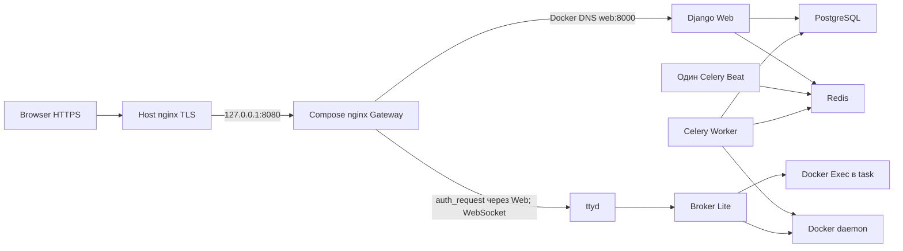

# Ручные релизы Training Platform

Это подготовленная основа для будущего внедрения. Утилита и overlays не применялись
к серверу. Существующие серверные overrides сначала нужно сравнить с этой моделью;
новый набор не считается автоматически эквивалентным действующему.

## Известное состояние и источник истины

Снимок **по данным оператора на 05.11.2026**, не результат подключения к production:

| Роль | Сообщённое состояние | Что проверить перед каждым релизом |
|---|---|---|
| Web | `4ab6530` | Container/image ID, OCI revision/artifact manifest, env и health |
| Worker | `d4aa79c` | Image/revision, socket GID, Celery node/queue/tasks и health |
| Terminal Scheduler | `d4aa79c`, один Beat | Image/revision, ровно один running scheduler, heartbeat/logs |
| Gateway | nginx 1.28.3, динамический DNS Web | Реальный image ID, `nginx -v`, config hash и bind source/inode |
| PostgreSQL / Redis | Существующий Compose project `training-platform` | IDs, версии, volume names, networks, health; в app rollout не пересоздаются |
| Terminal Broker Lite | Включён | Общий SECRET_KEY, flag, Broker/ttyd images и private callback у всех трёх app roles |
| CI/CD | Automatic deploy отключён | `ci.yml` только тесты; `manual-deploy.yml` hard-blocked |



Gateway разрешает `web` через `127.0.0.11`, кеш `valid=10s`; внутри terminal
auth сохраняются cookie, X-Original-URI, Host и X-Forwarded-Proto.
Broker и Worker сохраняют прежний доступ к Docker; эта работа не меняет trust boundary.

## Существующие Compose-файлы и precedence

| Файл / источник | Назначение и эффект |
|---|---|
| `docker-compose.yml` | 6 services, builds app roles, project/network/volumes, healthchecks; Scheduler за profile `terminal-broker` |
| `docker-compose.prod.yml` | `.env.prod` для app roles; DEBUG=False у Web/Worker; только Gateway `127.0.0.1:8080:80` |
| `docker-compose.override.yml` | Dev auto-override: `.env`, Gateway :8081. Не включать в production |
| `docker-compose.local.yml` | Host dev ports, DEBUG=True, legacy external PostgreSQL volume; не production |
| `.env.prod` / private runtime env | DB credentials, SECRET_KEY, allowed hosts, integrations, GID и runtime settings; не Git |
| `.env.prod.example` | Пример, Broker=false; не копировать поверх действующего runtime env |
| Серверные `docker-compose.release.yml`, `docker-compose.lite-pilot.yml` | Не в Git, содержимое здесь неизвестно; не удалять и не заменять вслепую |

`environment` перекрывает `env_file`; CLI `--env-file` используется для Compose
interpolation, но сам по себе не передаёт все переменные контейнеру. Shell может
перекрыть interpolation из env files. Порядок `-f` существенен; mounts/ports и
списки могут объединяться, поэтому поздний файл не всегда просто заменяет ранний.
[Compose precedence](https://docs.docker.com/compose/how-tos/environment-variables/variable-interpolation/),
[merge и !reset/!override](https://docs.docker.com/reference/compose-file/merge/).

## Единый opt-in механизм image pins

Для новой принятой модели фиксируется один набор, в этом порядке:

1. `docker-compose.yml`;
2. `docker-compose.prod.yml`;
3. `deploy/compose/release.yml`;
4. `deploy/compose/lite.yml`;
5. project `training-platform`, profile `terminal-broker`, root через `--project-directory`.

Нужен Compose **>= 2.24.4** (`!override`). Новые overlays сами не подключаются.
`release.yml` удаляет source builds (`!reset`) и заменяет env_file на явный private
runtime path. `lite.yml` согласует включённый Lite, Broker/ttyd pins и callback
у Web/Worker/Scheduler. Он не предназначен для первого включения Lite в legacy.

Скопировать `deploy/releases/images.env.example` **вне Git** в каталог конкретного
релиза с mode 600. Заполнить все строки: отдельные WEB_IMAGE, WORKER_IMAGE,
SCHEDULER_IMAGE, GATEWAY_IMAGE, POSTGRES_IMAGE, REDIS_IMAGE, BROKER_IMAGE, TTYD_IMAGE.
Использовать `registry/name@sha256:<64 hex>` либо локальный `sha256:<64 hex>` ID.
Локальный ID непереносим между daemon; наличие нужных образов проверяется отдельно.
В файле pins нет паролей и токенов. Пример намеренно не содержит готового релиза.
Не использовать один APP_IMAGE для трёх ролей и не считать старые SHA постоянными.

Read-only утилита фиксирует список файлов, project/profile, исключает shell override
image/DB interpolation и не выводит сырой Compose config с секретами:

```sh
python3 deploy/release_config.py \
  --runtime-env /ABS/PRIVATE/runtime.env \
  --release-env /ABS/PRIVATE/releases/RELEASE/images.env validate
python3 deploy/release_config.py \
  --runtime-env /ABS/PRIVATE/runtime.env \
  --release-env /ABS/PRIVATE/releases/RELEASE/images.env plan web
```

Она исполняет только `docker compose ... config --format json`. `plan` печатает
shell-quoted команды для одной роли, **не исполняет** их. Нет режима apply,
аргументов для дополнительных Compose-файлов или обновления DB/Redis.
Ошибочный/пустой/mutable pin останавливает проверку; bootstrap defaults отсутствуют.
Утилита не проверяет состояние daemon, готовность БД, image availability,
совместимость миграций или равенство серверной конфигурации: это ручной preflight.

## Обязательная сверка перед принятием новой модели

1. Под отдельным разрешением получить текущие project/files/profile из container
   labels, exact commands, service IDs/images/StartedAt/RestartCount, networks,
   volume names, image provenance и текущие Broker flags. Не выводить весь env.
2. Приватно сохранить серверные overrides, runtime env, image pins, конфиг nginx
   и контрольные суммы. Render старого/нового Compose сравнивать в приватном
   каталоге: он содержит credentials. Сверить каждый env key, command, user,
   group_add, mount, port, network, volume и healthcheck, а не только image.
3. Если текущие overrides добавляют настройки, отсутствующие в Git, остановиться:
   подготовить reviewed изменение модели. Не добавлять произвольный пятый `-f`
   на лету и не использовать шаблон для «починки» неизвестного runtime.
4. Проверить текущую БД read-only: целевой код совместим с существующей схемой.
   Миграции, data changes, task image/catalog sync и смена Broker/ttyd поколений
   требуют своих планов/репетиций и не входят в обычное обновление роли.
5. Проверить локальное наличие всех выбранных image IDs/digests и их платформу;
   build/pull выполняются заранее отдельно и не меняют теги действующих образов.
   Docker context должен быть явно проверен. Создавать новый project/network или
   новый пустой volume взамен существующего запрещено.
6. Убедиться, что есть rollback pins **всех** ролей и резервные copies конфигураций,
   код/очереди совместимы при смешанных версиях, один Scheduler уже работает,
   `.env.prod` не перезаписан примером. `DOCKER_GID` проверить существующим
   `deploy/check_docker_socket_gid.sh` на соответствующем private env.

## Обновление ролей по отдельности — после отдельного разрешения

Менять только pin выбранной роли. Остальные pins, runtime env и файлы должны быть
прежними. Выполнить validate/plan и review напечатанной команды; она использует
`up -d --no-deps --no-build --pull never <одна роль>`. Общий `up`, `down`,
`--remove-orphans`, массовый `build` и force-recreate Gateway не нужны.
Сохранить snapshot IDs/images/timestamps до операции и сравнить после неё.

| Роль | Порядок и acceptance | Откат |
|---|---|---|
| Web | Проверить совместимость API/tasks/schema с действующим Worker/Scheduler. Переключить только Web; дождаться его healthy, Gateway HTTP 200 и новых terminal auth/WS. После смены IP nginx обновляет DNS без reload; возможен короткий 502 до готовности Web/истечения кеша. | Вернуть WEB_IMAGE и прежний runtime/config, повторить план Web; подтвердить health и auth. |
| Worker | Проверить queues/task signatures и совместимость Web/Scheduler. Дождаться завершения активных операций, согласовать паузу новых задач; warm shutdown, лог завершения. План даёт 600 с, но timeout не доказывает drain: при незавершённых задачах не продолжать вслепую. После смены — healthy, inspect ping/registered, ожидаемый node/queue, Broker flags и отсутствие worker ошибок. | Вернуть WORKER_IMAGE и прежние настройки; обработать in-flight/повторно доставленные задачи по существующему контракту Lite, без ручных изменений БД. |
| Scheduler | Проверить расписание и task signatures. Остановить старый Beat, подтвердить остановку, затем запустить замену из того же полного набора. План печатает stop и up отдельно: между ними обязательна проверка. Никогда два active Beat. У Scheduler сейчас **нет healthcheck**; Running — недостаточно: проверить logs, единственный процесс и отправку ожидаемых периодических задач. | Остановить новый Beat, подтвердить отсутствие второго, вернуть SCHEDULER_IMAGE/config и запустить один старый. |
| Gateway image | До замены проверить `nginx -t` на точном candidate image/config отдельно. Обновление image пересоздаёт Gateway и прерывает текущие WS; отдельное maintenance window. Web/Worker/Scheduler/DB/Redis не затрагивать. После — healthy, HTTP 200, auth и WS. | Вернуть GATEWAY_IMAGE и сохранённый config, обновить только Gateway; проверить маршруты. |

При нескольких ролях нет универсального безопасного порядка: сначала проверить
backward compatibility кода, задач и схемы. Для несовместимого изменения — отдельное
maintenance window, остановка единственного Scheduler, drain Worker и reviewed
порядок обновления. Эта документация не разрешает его автоматически.

PostgreSQL/Redis pins присутствуют для воспроизводимости конфигурации, **не для
их обновления** этим инструментом. Task/Broker/ttyd images и существующие окружения
также не пересоздаются при таком app rollout.

## Bind-mounted nginx config без замены inode

Для изменения только nginx-конфига контейнер и image не пересоздаются. Полный
сценарий с backup, candidate test и автоматическим восстановлением файла до
reload: [Gateway DNS rollout](nginx/web_dns_rollout.md). Обязательная суть:

```bash
# Переменные задаются из фактических Mounts; before/candidate получены и проверены.
# Эти команды — будущая операция только после отдельного разрешения.
if ! cat "$candidate" > "$gateway_config"; then
  cat "$before" > "$gateway_config"
  exit 1
fi
if ! docker exec "$gateway" cat /etc/nginx/conf.d/default.conf | cmp - "$candidate" ||
   ! docker exec "$gateway" nginx -t; then
  cat "$before" > "$gateway_config"
  exit 1
fi
docker exec "$gateway" nginx -s reload
```

`mv`, `sed -i`, git checkout и редактор с atomic save могут заменить inode.
Сначала сохранить конфиг **из контейнера**, сравнить с source на host и проверить
candidate на том же immutable image. При несовпадении или ошибке до reload вернуть
backup in-place и остановиться; не оставить невалидный файл для будущего старта.
Откат: `cat "$before" > "$gateway_config"`, cmp видимого контейнеру файла,
`nginx -t`, graceful reload. Это возвращает старый config, не старую БД.

## Postflight и критерии остановки

```sh
# Выполняются вручную после разрешённого изменения, с реальным allowed Host.
curl --fail --silent --show-error \
  -H 'Host: YOUR_PRODUCTION_HOST' -H 'X-Forwarded-Proto: https' \
  http://127.0.0.1:8080/healthz/
docker inspect --format '{{.State.Health.Status}}' training-platform-gateway
docker inspect --format '{{.State.Health.Status}}' training-platform-web
docker inspect --format '{{.State.Health.Status}}' training-platform-worker
```

Проверить healthy DB/Redis отдельно: `/healthz/` не выполняет SQL и не доказывает
их готовность. Проверить Host/proto, auth endpoints закрыты извне, HTTP routes,
новое terminal WS=101 и разрешённую контрольную сессию. Не создавать учебные
production данные лишь ради технического smoke-test. Наблюдать logs без секретов.
Все нецелевые service IDs/images/StartedAt/RestartCount должны совпасть; DB/Redis
volumes — те же. После Web recreation подтвердить **действительную смену IP**
и восстановление без reload; если IP прежний, это не доказательство DNS recovery.
При неожиданных config/identity differences, unhealthy, auth/WS failure — остановить
релиз и выполнить соответствующий rollback; не добавлять миграции как обход.

## CI/CD дальше

Сохранить hosted checks и manual-only контроль. Здесь workflow не меняются;
manual-deploy остаётся заблокированным. Будущие небольшие шаги: подключить read-only
release tests/линтер документации к CI отдельным review, собирать образы с OCI
revision и registry digest, хранить подписанный release manifest/артефакты и
проверять drift серверных overrides. Staging должен быть доказанно отдельным от
production. Автоматическое выполнение планов, SSH secrets в CI, миграции и
включение CD требуют самостоятельного согласованного проекта.
